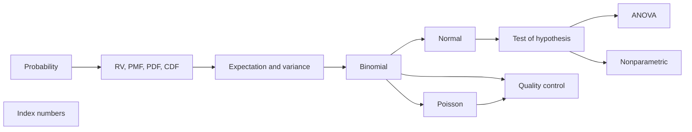

---
{"dg-publish":true,"permalink":"/study/3rd-semester/applied-business-statistics/applied-business-statistics/","title":"Applied Business Statistics (index)","tags":["study","applied-business-statistics","index"],"dg-note-properties":{"title":"Applied Business Statistics (index)","course":"Applied Business Statistics","semester":3,"tags":["study","applied-business-statistics","index"]}}
---

> [!summary] About this index
> Map of all converted notes for Applied Business Statistics. The notes are in this folder and the source PDFs are in `24-25 Session sheets/`. Notes are reworded for studying; anything not on the slides is marked **Added**, and mistakes in the slides are marked **Slide error**.

## Suggested study order

| # | Note | Main ideas | Source PDF |
|---|---|---|---|
| 1 | [[Study/3rd Semester/Applied Business Statistics/1 RV PMF CDF PDF CDF\|1 RV PMF CDF PDF CDF]] | Random variable, PMF, PDF, CDF | `1 RV PMF CDF PDF CDF.pdf` |
| 2 | [[Study/3rd Semester/Applied Business Statistics/2 Mathematical Expectation\|2 Mathematical Expectation]] | $E(X)$, moments, variance $=E(X^2)-\mu^2$ | `2 Mathematical Expectation.pdf` |
| 3 | [[Study/3rd Semester/Applied Business Statistics/3 Binomial Distribution\|3 Binomial Distribution]] | $B(n,p)$, mean $np$, variance $npq$ | `3 Binomial Distribution.pdf` |
| 4 | [[Study/3rd Semester/Applied Business Statistics/4 Poisson Distribution\|4 Poisson Distribution]] | $Po(\lambda)$, mean = variance $=\lambda$ | `4 Poisson Distribution.pdf` |
| 5 | [[Study/3rd Semester/Applied Business Statistics/5 Normal Distribution\|5 Normal Distribution]] | Bell curve, $z=(x-\mu)/\sigma$, 68-95-99.7 | `5 Normal Distribution.pdf` |
| 6 | [[Study/3rd Semester/Applied Business Statistics/1739799506338_Test of hypothesis\|1739799506338_Test of hypothesis]] | $H_0$/$H_1$, errors, $t$, $F$, $\chi^2$, Yates | `1739799506338_Test of hypothesis.pdf` |
| 7 | [[Study/3rd Semester/Applied Business Statistics/6. Analysis of Variance BBA\|6. Analysis of Variance BBA]] | One-way and two-way ANOVA, SS partition, LSD | `6. Analysis of Variance BBA.pdf` |
| 8 | [[Study/3rd Semester/Applied Business Statistics/ANOVA one way classification and two way classification\|ANOVA one way classification and two way classification]] | 3 worked ANOVA problems | `ANOVA one way classification and two way classification.pdf` |
| 9 | [[Study/3rd Semester/Applied Business Statistics/7. Nonparametric Methods 06052021\|7. Nonparametric Methods 06052021]] | Sign test, median test | `7. Nonparametric Methods 06052021.pdf` |
| 10 | [[Study/3rd Semester/Applied Business Statistics/Index Number\|Index Number]] | Laspeyres, Paasche, Fisher, cost of living index | `Index Number.pdf` |
| 11 | [[Study/3rd Semester/Applied Business Statistics/Quality Control\|Quality Control]] | Control charts, acceptance sampling | `Quality Control.pdf` |
| extra | [[Study/3rd Semester/Applied Business Statistics/Probability Distribution\|Probability Distribution]] | Short sheet: binomial, Poisson, normal derivations, CV, 4 extra problems | `Probability Distribution(1).pdf` |

> [!note] Other new files in `24-25 Session sheets/`
> `Test of hypothesis.pptx` (73 slides) and `Test of hypothesis(1).pdf` (21 pages, theory only) have the same content as [[Study/3rd Semester/Applied Business Statistics/1739799506338_Test of hypothesis\|1739799506338_Test of hypothesis]], so no new note was made. The `.pptx` is the full version with all 11 problems and matches the existing note, including the slide errors listed below.

## Topic map

## Which test or tool do I use?

| Situation | Go to |
|---|---|
| Count of successes in $n$ fixed trials | [[Study/3rd Semester/Applied Business Statistics/3 Binomial Distribution\|3 Binomial Distribution]] |
| Rare events per interval | [[Study/3rd Semester/Applied Business Statistics/4 Poisson Distribution\|4 Poisson Distribution]] |
| Continuous measurement, find an area | [[Study/3rd Semester/Applied Business Statistics/5 Normal Distribution\|5 Normal Distribution]] |
| One or two means, paired data, correlation | $t$ tests in [[Study/3rd Semester/Applied Business Statistics/1739799506338_Test of hypothesis\|1739799506338_Test of hypothesis]] |
| Two variances | $F$ test in [[Study/3rd Semester/Applied Business Statistics/1739799506338_Test of hypothesis\|1739799506338_Test of hypothesis]] |
| Two categorical attributes | $\chi^2$ in [[Study/3rd Semester/Applied Business Statistics/1739799506338_Test of hypothesis\|1739799506338_Test of hypothesis]] |
| Three or more means | [[Study/3rd Semester/Applied Business Statistics/6. Analysis of Variance BBA\|6. Analysis of Variance BBA]] |
| No normality assumption, small or ordinal data | [[Study/3rd Semester/Applied Business Statistics/7. Nonparametric Methods 06052021\|7. Nonparametric Methods 06052021]] |
| Price or quantity change over time | [[Study/3rd Semester/Applied Business Statistics/Index Number\|Index Number]] |
| Is a process in control? | [[Study/3rd Semester/Applied Business Statistics/Quality Control\|Quality Control]] |

## Slide errors found (check with your teacher)

> [!warning] Decisions that change
> - [[Study/3rd Semester/Applied Business Statistics/1739799506338_Test of hypothesis\|1739799506338_Test of hypothesis]], Problem 4: with the correct 5% value (2.086) you reject $H_0$; the slide accepts it.
> - [[Study/3rd Semester/Applied Business Statistics/ANOVA one way classification and two way classification\|ANOVA one way classification and two way classification]], Problem 3: problem statement and solution use different data.
> - [[Study/3rd Semester/Applied Business Statistics/7. Nonparametric Methods 06052021\|7. Nonparametric Methods 06052021]], sign test Example 2: the slide's conclusion is worded backwards.

> [!note] Calculation or notation errors (decision unchanged)
> - [[Study/3rd Semester/Applied Business Statistics/Quality Control\|Quality Control]]: $\sigma$-chart UCL/LCL swapped; $c$-chart total is 113, not 116; two points (not one) outside the $\bar X$ limits.
> - [[Study/3rd Semester/Applied Business Statistics/1739799506338_Test of hypothesis\|1739799506338_Test of hypothesis]]: wrong $\sum x^2$ in Problem 3, wrong d.f. and table values in Problems 3, 5, 7, 11, and a 45 that should be 41 in the $F$ test table.
> - [[Study/3rd Semester/Applied Business Statistics/3 Binomial Distribution\|3 Binomial Distribution]]: $(0.1)^{15}$ should be $(0.92)^{15}$.
> - [[Study/3rd Semester/Applied Business Statistics/5 Normal Distribution\|5 Normal Distribution]]: $N(250,4)$ should be $N(250,16)$; $e=2.712$ should be 2.718.
> - [[Study/3rd Semester/Applied Business Statistics/Probability Distribution\|Probability Distribution]]: the 2-coin example has $P(2\text{ heads})=1/4$ and $P(1\text{ head})=1/2$, not the other way round; the pins problem has no final number (answer 0.0137).

## Open items
- [ ] Extract slide images into `attachments/` (command given in chat) and embed key figures as `![[attachments/...]]`.
- [ ] Add exam dates to [[MEMORY\|MEMORY]] once announced.
