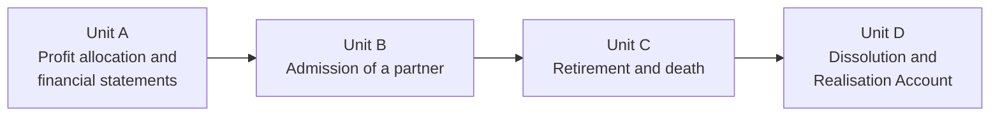

---
{"dg-publish":true,"permalink":"/study/3rd-semester/intermediate-accounting/partnership-accounting-bangladesh-lecture-note-05-11-2026/","title":"Partnership Accounting (Bangladesh) - Lecture Note 05/11/2026","tags":["study","intermediate-accounting","partnership","realisation-account","goodwill"],"dg-note-properties":{"title":"Partnership Accounting (Bangladesh) - Lecture Note 05/11/2026","subject":"Intermediate Accounting","semester":"3rd Semester","source":"Partnership_Accounting_Bangladesh_Lecture_Note_05_11_2026.pdf","tags":["study","intermediate-accounting","partnership","realisation-account","goodwill"]}}
---

# Partnership Accounting (Bangladesh)

> [!info] About this note
> Rewritten from the 16-page teaching note (PSTU Accounting & Information Systems, November 2026) for studying. All amounts are in **Bangladesh taka (Tk)**, taxes are ignored, and the examples are illustrative. I re-calculated every worked example and exercise and they all agree with the lecture note. Callouts titled **Added**, **Memory aid**, **Check** and **Review questions** are mine unless they say "from the note". The lecture note is a teaching note, not legal or tax advice.

## The big picture (read this first)

The note follows a firm through its life in four units:

- **Units A to C** change the *relationship* between partners but the business carries on (**reconstitution**).
- **Unit D** ends the partnership: assets are sold, liabilities paid, and what is left goes to the partners (**dissolution**).

> [!tip] Note in one sentence
> Partners share profit by the deed (or equally by default), every change in partners is settled through capital accounts using the **old ratio for what was earned before** and the **new ratio for what is earned after**, and on dissolution you pay **outsiders first, then partner loans, then capital**.

---

## Key terms cheat sheet

| Term | Meaning in one line |
|---|---|
| Partnership deed | Written agreement on name, capital, profit ratio, salaries, interest, admission, retirement, goodwill, dissolution |
| Fixed-capital method | Capital changes only for permanent contributions or reductions; salary, interest, profit share and drawings go through **current accounts** |
| Fluctuating-capital method | Everything goes through the **capital account**; usually no current accounts |
| Profit and Loss Appropriation A/c | Schedule that **shares out** the profit among partners; not an operating expense |
| Partner's salary allowance | A **share of profit** (an appropriation), unlike an employee's salary, which is an expense before profit |
| Interest on capital | Appropriation of profit, payable **only out of profits** (s.13(c)) |
| Interest on drawings | Charged **to the partner**; an income to the appropriation account |
| Partner's loan | A **liability** of the firm; its interest is a **finance expense**, not an appropriation |
| Drawings | Withdrawals for personal use; **not** an expense of the firm |
| Bonus method | New partner's capital credit equals his agreed share of total capital; the difference is moved between **capital accounts**, with no goodwill |
| Goodwill method | Goodwill is raised and credited to the old partners in the old ratio |
| Revaluation | Re-measuring assets and liabilities before a change in partners; gain or loss goes to **old partners in the old ratio** |
| Sacrificing / gaining ratio | Share given up by old partners on admission / share gained by continuing partners on retirement |
| Realisation Account | Closing account that measures gain or loss when non-cash assets are sold and outside liabilities settled |
| Capital deficiency | A **debit** capital balance after losses; the partner owes that amount to the firm |

---

## Legal scope (Partnership Act, 1932)

| Rule / issue | Position in Bangladesh |
|---|---|
| Definition (s.4) | Persons agree to share profits of a business carried on by all, or any acting for all |
| Partners' agreement (s.11) | Mutual rights and duties are mainly set by their agreement, subject to law |
| Default profit sharing (s.13(b)) | **Equal** sharing of profits **and losses** unless they agree otherwise |
| Remuneration (s.13(a)) | **No salary** for managing the firm unless agreed |
| Interest on capital (s.13(c)) | If agreed, payable **only out of profits** |
| Partner advances (s.13(d)) | An advance beyond agreed capital earns **6% a year** unless the agreement says otherwise |
| Admission (s.31) | Needs **consent of all existing partners** unless the contract says otherwise |
| Retirement (s.32) | By agreed terms, consent, or notice (partnership at will); **public notice** matters for third-party liability |
| Death (s.42) | Dissolves the firm by default unless a contrary agreement lets the survivors continue |
| Dissolution settlement (s.48) | Third-party debts; then partner advances; then partner capital; then any surplus |

Other sections cited: s.29 (transfer of an interest is not admission as a partner), s.37 (outgoing partner's rights to profits or 6% interest if the firm keeps using his property and accounts are not settled).

---

## Unit A: Profit allocation and financial statements

### A1. Partners' accounts

| Account | Nature | Treatment |
|---|---|---|
| Partner's capital | Ownership interest | **Credit** contributions and profit allocations; **debit** withdrawals, losses, settlements |
| Partner's current | Movements other than fixed capital | Holds salary, interest, appropriations and drawings under the fixed-capital method |
| Drawings | Withdrawals for personal use | Debit drawings, current or capital; **not** an operating expense |
| Loan from partner | Debt owed by the firm | Separate liability; interest is a finance expense |
| Loan to partner | Receivable | Separate asset; do **not** call it drawings |
| Appropriation A/c | Allocation schedule | Shares distributable profit by the deed |

### A2. Fixed vs fluctuating capital
- **Fixed:** capital moves only for permanent additions or agreed reductions; routine items use current accounts.
- **Fluctuating:** salary, interest, profit/loss share, drawings and contributions all hit capital accounts.

### A3. Interest, drawings and loans

| Transaction | Rule | Entry |
|---|---|---|
| Interest on capital | Rate × qualifying capital × time; only out of profit | Dr Appropriation, Cr Partner's Current |
| Partner salary or commission | Only as agreed; allocate **before** residual sharing | Dr Appropriation, Cr Partner's Current |
| Interest on drawings | Rate × drawing × months outstanding ÷ 12 | Dr Partner's Current, Cr Appropriation |
| Drawings | Money or goods for personal use | Dr Partner's Current, Cr Cash or Purchases/Inventory |
| Loan received from partner | Contractual advance apart from capital | Dr Bank, Cr Loan from Partner |
| Interest on partner's loan | Agreed rate, or **6%** under s.13(d) | Dr Loan Interest Expense, Cr Bank or Interest Payable |

**Average period for equal monthly drawings over a full year:** 6.5 months (taken at the **start** of each month), 6 months (**mid-month**), 5.5 months (**end** of month). Use exact dates when known.

**If profit is too small** to cover the agreed salary or interest on capital, follow the deed's order of priority and any guarantee terms. s.13(c) does **not** make interest on capital an expense payable regardless of profit.

> [!warning] Check (from the note)
> Do not treat drawings as a charge against net profit. Check that interest on capital is limited to available profit and that salary is authorised by agreement.

### A4. Worked example: sharing the annual profit

**Facts.** Ayesha, Biplob, Chandan: fixed capital Tk 600,000 / 400,000 / 200,000; residual profit shared **3:2:1**. Profit **before** loan interest Tk 360,000. Biplob lent Tk 200,000 on 1 July at 6%. Deed: salary Ayesha Tk 60,000 and Chandan Tk 36,000; interest on capital 10%; interest on drawings Tk 5,000 / 4,000 / 3,000; drawings Tk 50,000 / 40,000 / 30,000. Opening current accounts are zero.

**Step 1: loan interest** = 200,000 × 6% × 6/12 = **Tk 6,000**. Profit after it = **Tk 354,000**.

| Profit and Loss Appropriation Account | Tk |
|---|---|
| Profit available after loan interest | 354,000 |
| Add: interest charged on drawings | 12,000 |
| **Total available for appropriation** | **366,000** |
| Less: partners' salary allowances | (96,000) |
| Less: interest on capital | (120,000) |
| **Residual profit to share 3:2:1** | **150,000** |

| Partner | Ayesha | Biplob | Chandan | Total |
|---|---|---|---|---|
| Salary allowance | 60,000 | not entitled | 36,000 | 96,000 |
| Interest on capital (10%) | 60,000 | 40,000 | 20,000 | 120,000 |
| Residual share | 75,000 | 50,000 | 25,000 | 150,000 |
| **Gross credits to current account** | **195,000** | **90,000** | **81,000** | **366,000** |
| Less: interest on drawings | (5,000) | (4,000) | (3,000) | (12,000) |
| Less: drawings | (50,000) | (40,000) | (30,000) | (120,000) |
| **Closing current-account credit** | **140,000** | **46,000** | **48,000** | **234,000** |

> [!success] Check (from the note)
> Profit after loan interest 354,000 − drawings 120,000 = **234,000**, which equals the total current-account credits. The appropriation account also balances: 354,000 + 12,000 = 96,000 + 120,000 + 150,000 = 366,000.

**Journal entries (summary).**

| No. | Entry | Dr | Cr |
|---|---|---|---|
| 1 | Loan Interest Expense / Bank (loan interest paid) | 6,000 | 6,000 |
| 2 | P&L A/c / P&L Appropriation A/c (net profit transferred) | 354,000 | 354,000 |
| 3 | Partners' Current A/cs (5,000 / 4,000 / 3,000) / P&L Appropriation A/c (interest on drawings) | 12,000 | 12,000 |
| 4 | P&L Appropriation A/c / Ayesha 60,000, Chandan 36,000 | 96,000 | 96,000 |
| 5 | P&L Appropriation A/c / Ayesha 60,000, Biplob 40,000, Chandan 20,000 | 120,000 | 120,000 |
| 6 | P&L Appropriation A/c / Ayesha 75,000, Biplob 50,000, Chandan 25,000 (residual 3:2:1) | 150,000 | 150,000 |
| 7 | Partners' Current A/cs / Bank (drawings) | 120,000 | 120,000 |

> [!bug] Error in the note: wrong narrations
> Entry 4 (Tk 96,000, split 60,000 and 36,000) is the **salary** entry, but the note's narration says "interest on capital credited". Entry 5 (Tk 120,000, split 60,000, 40,000, 20,000) is the **interest on capital** entry, but its narration says "salaries credited". The amounts are right; swap the two narrations.

### A5. Financial statements of the firm
Prepare in this order: **statement of profit or loss, appropriation account and partner capital/current schedules, statement of financial position**. The appropriation account is a partnership allocation schedule, not an operating expense.

| Statement of profit or loss | Tk |
|---|---|
| Sales revenue | 1,800,000 |
| Less: cost of sales | (1,100,000) |
| **Gross profit** | **700,000** |
| Less: other operating expenses | (340,000) |
| Profit before partner-loan interest | 360,000 |
| Less: partner-loan interest | (6,000) |
| **Profit available for appropriation** | **354,000** |

| Statement of financial position | Tk |
|---|---|
| Property, plant and equipment | 630,000 |
| Inventory 620,000 + Trade receivables 480,000 + Cash at bank 304,000 | 1,404,000 |
| **Total assets** | **2,034,000** |
| Partners' fixed capital | 1,200,000 |
| Partners' current accounts (credit) | 234,000 |
| Biplob's separate loan (non-current) | 200,000 |
| Trade creditors | 400,000 |
| **Total equity and liabilities** | **2,034,000** |

The loan is shown as non-current assuming it is not repayable within 12 months; if it falls due within the year, move it to **current liabilities**. The statement is meant to show the equity-versus-loan distinction, not to derive a cash flow statement.

---

## Unit B: Admission of a partner

### B1. Three different transactions

| Transaction | Who gets the money | Firm's books |
|---|---|---|
| New partner **buys an existing partner's interest** | Selling partner(s), **personally** | No new cash in the firm; only capital is reassigned |
| New partner **invests directly in the firm** | **The partnership** | Dr Bank, Cr Incoming Partner's Capital, plus any bonus or revaluation adjustments |
| Partner acquires **profit rights only**, not admitted | Assigning partner personally | A transfer of economic interest does **not** give management rights or partner status (s.29) |

s.31 normally needs **all existing partners' consent** to admit a new partner. Liability for past acts has its own statutory rules; do not assume it from capital entries.

### B2. Buying part of the existing interest
A and B: capital Tk 600,000 and Tk 400,000, profit ratio 3:2. With consent, **C buys 25% of the total interest from A and B in their 3:2 proportion**, paying them personally.

- 25% of Tk 1,000,000 = Tk 250,000: A gives up **150,000**, B gives up **100,000**.
- Entry: **Dr A's Capital 150,000, Dr B's Capital 100,000, Cr C's Capital 250,000**.
- New capitals: A **450,000**, B **300,000**, C **250,000** (total unchanged at 1,000,000, and firm cash is unchanged).
- New profit shares (same proportions): A 3/5 × 75% = **45%**, B 2/5 × 75% = **30%**, C **25%**, i.e. **9:6:5**.
- If C paid the sellers Tk 300,000 in total, that **premium is a private payment**, not a firm receipt, and is **not automatically goodwill** in the firm's books.

### B3. Investment in the firm: bonus vs goodwill
A and B: capitals Tk 600,000 / 400,000, old ratio 3:2. **C pays Tk 400,000 into the firm for a 25% capital interest.**

| | Bonus method | Goodwill method |
|---|---|---|
| Idea | C's capital credit = 25% of the new total capital; excess is a bonus to old partners | C's payment implies a whole-firm value; the difference is goodwill |
| Calculation | Total capital after investment 600 + 400 + 400 = **1,400,000**; C's 25% = **350,000**; bonus = 400,000 − 350,000 = **50,000** | 400,000 ÷ 25% = **1,600,000** total value; goodwill = 1,600,000 − 1,400,000 = **200,000** |
| Old partners get | 50,000 in 3:2 = **A 30,000, B 20,000** | 200,000 in 3:2 = **A 120,000, B 80,000** |
| Entries | Dr Bank 400,000, Cr C's Capital 400,000; then Dr C's Capital 50,000, Cr A 30,000, Cr B 20,000 | Dr Bank 400,000, Cr C's Capital 400,000; then Dr Goodwill 200,000, Cr A 120,000, Cr B 80,000 |
| Capitals after | **A 630,000, B 420,000, C 350,000** (total 1,400,000) | **A 720,000, B 480,000, C 400,000** (total 1,600,000) |

> [!warning] Reporting caution (from the note)
> **IAS 38 prohibits recognising internally generated goodwill as an asset.** The goodwill method is a traditional classroom capital-settlement convention, not an instruction to capitalise goodwill in IFRS-compliant statements. The bonus method (or an agreed off-books settlement) avoids the conflict. The two methods are **alternatives, not additions**.

### B4. Revaluation before admission and the post-admission balance sheet
A and B (3:2), capitals Tk 600,000 and Tk 400,000. Before admitting C: PPE 700,000; inventory 300,000; receivables 200,000; cash 100,000; trade payables 300,000. Agreed: **PPE up 100,000, inventory down 20,000, litigation provision 30,000**. C then pays **Tk 350,000** for 25%.

| Revaluation | Tk |
|---|---|
| PPE fair-value increase | +100,000 |
| Inventory write-down | (20,000) |
| Litigation provision | (30,000) |
| **Net revaluation gain** | **50,000** |
| A (3/5) | 30,000 |
| B (2/5) | 20,000 |

Entries: Dr PPE 100,000, Cr Revaluation; Dr Revaluation 20,000, Cr Inventory; Dr Revaluation 30,000, Cr Litigation Provision; Dr Revaluation 50,000, Cr A's Capital 30,000, Cr B's Capital 20,000; Dr Bank 350,000, Cr C's Capital 350,000.

| Post-admission statement of financial position | Tk |
|---|---|
| PPE | 800,000 |
| Inventory | 280,000 |
| Receivables | 200,000 |
| Bank (100,000 + 350,000) | 450,000 |
| **Total assets** | **1,730,000** |
| A's capital 630,000 + B's capital 420,000 + C's capital 350,000 | 1,400,000 |
| Trade payables 300,000 + Litigation provision 30,000 | 330,000 |
| **Total equity and liabilities** | **1,730,000** |

> [!success] Check (from the note)
> Net assets = 1,730,000 − 330,000 = **1,400,000** = total of the three capital accounts.

### B5. Which ratio applies where
- **Old ratio:** revaluation gains/losses and goodwill relating to the business **before** admission.
- **New ratio:** profit earned **after** admission.
- Do not confuse (i) **new profit share**, (ii) **percentage of book capital**, and (iii) **private cash paid to selling partners**.

> [!tip] Added: sacrificing ratio
> Sacrificing ratio = old share − new share (for each old partner). It shows who gave up future profit to the newcomer, and it is the basis for sharing any goodwill the new partner pays for when the deed says so.

---

## Unit C: Retirement and death of a partner

### C1. Retirement: the six steps
1. Fix the **retirement date** and the **old profit ratio**.
2. Record unrecorded assets/liabilities and **revaluation** gains or losses among the old partners.
3. Apply the deed's **goodwill** treatment (credited to the outgoing partner; if not recorded, charged to continuing partners in the **gaining ratio**).
4. Credit salary, interest and profit share accrued to retirement; **debit drawings and previous losses**.
5. Settle any separate partner **loan**, decide the **cash payable now**, and move the unpaid amount to a **retiring-partner loan account**.
6. Record the cash settlement and any new capital or profit ratios.

Retirement is governed by s.32. If accounts are not settled and the firm keeps using the outgoing partner's property, **s.37** gives default rights to attributable profits or 6% interest.

### C2. Worked example: amount due to a retiring partner
A, B, C share **5:3:2**; capital Tk 500,000 / 300,000 / 200,000. **C retires.** Revaluation gain Tk 50,000. Agreed goodwill Tk 100,000 is **not recorded**; A and B compensate C in their **gaining ratio 5:3**. C's drawings Tk 10,000; C has a separate **loan Tk 30,000**. The firm pays **Tk 150,000 now**, rest later.

| Retiring C: settlement schedule | Tk |
|---|---|
| Opening capital | 200,000 |
| Plus: revaluation gain 50,000 × 2/10 | 10,000 |
| Plus: goodwill 100,000 × 2/10 | 20,000 |
| Less: drawings | (10,000) |
| **Capital settlement due** | **220,000** |
| Plus: separate loan | 30,000 |
| **Total amount due** | **250,000** |
| Less: cash paid immediately | (150,000) |
| **Balance transferred to settlement loan** | **100,000** |

Entries: Dr Revaluation 50,000, Cr A 25,000, B 15,000, C 10,000 (old ratio 5:3:2) · **Dr A 12,500, Dr B 7,500, Cr C 20,000** (goodwill, gaining ratio 5:3) · Dr C's Capital 10,000, Cr Drawings 10,000 · **Dr C's Capital 220,000, Dr C's Loan 30,000, Cr Bank 150,000, Cr Retiring C's Loan 100,000**.

Practice check: A's capital = 500,000 + 25,000 − 12,500 = **512,500**; B's = 300,000 + 15,000 − 7,500 = **307,500**. The unpaid 100,000 is a **liability**, not partner capital.

### C3. Admission-cum-retirement
Treat as **two separate steps**: first settle the outgoing partner at the old ratio, then record the incoming partner's investment and the new ratio. A payment by the newcomer to the retiree **personally** is not cash paid into the business.

Quick illustration: A 355,000 and B 270,000 after adjustments. B retires and is paid 270,000; C pays **200,000 into the firm**; new ratio A:C = 2:1. Post-event capitals: **A 355,000, C 200,000** (unless the deed requires alignment). Firm's cash change = −270,000 + 200,000 = **−70,000**.

### C4. Death of a partner
- s.42(c): death **dissolves** the firm unless the deed allows continuation. If it does, the deceased's interest is calculated and **settled with the estate**.
- An executor or nominee does **not** automatically become a partner.
- **Estate entitlement** = opening capital + accrued salary/interest + profit share to date of death + revaluation gain + goodwill share − drawings − revaluation loss − other amounts owed to the firm + any separate loan claim.

**Worked example.** A, B, C share **3:2:1**. **B dies on 30 September** (9 months of the year); deed allows continuation. B's capital 300,000; drawings 40,000; capital interest 8% a year; goodwill 180,000 (old-ratio share); net revaluation **loss** 60,000; distributable profit to death 180,000. The estate is paid Tk 100,000 now.

| B's estate calculation | Tk |
|---|---|
| Opening capital | 300,000 |
| Profit share 180,000 × 2/6 | 60,000 |
| Capital interest 300,000 × 8% × 9/12 | 18,000 |
| Goodwill 180,000 × 2/6 | 60,000 |
| Revaluation loss 60,000 × 2/6 | (20,000) |
| Drawings | (40,000) |
| **Amount due to estate** | **378,000** |
| Paid immediately | (100,000) |
| **Transferred to Estate Loan** | **278,000** |

Entry: **Dr B's Capital 378,000, Cr Bank 100,000, Cr B's Estate Loan 278,000.** It assumes all earlier adjustments are already posted to B's capital. If the deed prescribes another profit estimate (e.g. based on the prior year's sales), use that instead of the nine-month estimate.

---

## Unit D: Dissolution and the Realisation Account

### D1. Reconstitution vs dissolution
Admission, retirement or death (with continuation allowed) **reconstitutes** the partnership and the business goes on. **Dissolution of the firm** ends the partnership among **all** partners: assets are realised, liabilities settled, balances distributed.

The **Realisation Account** is a textbook closing account measuring the difference between book values and actual results. It normally **excludes cash/bank and partner capital/current accounts** and records non-cash assets transferred, outside liabilities, sale proceeds, payments of liabilities and realisation expenses.

### D2. Order of payment (s.48)
1. List assets, external liabilities, partner loans/advances and partner capitals.
2. Turn non-cash assets into cash and settle liabilities; record the gain or loss in the Realisation Account.
3. Share the realisation profit or loss in the **agreed ratio**; cover capital deficiencies under the agreement and law.
4. Pay **outsiders** first.
5. Repay **partners' advances/loans** (distinct from capital).
6. Return **partner capital** as far as possible; distribute any residual profit by the profit-sharing ratio.

A partner with a **debit capital balance owes** that amount to the firm. Under s.48(a), losses (including capital deficiencies) fall **first on profits, then on capital, and lastly on partners individually in the profit-sharing ratio**, subject to agreement.

> [!warning] Insolvent partner (from the note)
> Do not mechanically apply a *Garner v Murray* allocation. State the agreement and the legal basis.

> [!tip] Added: what Garner v Murray means
> The usual rule from that case is that when one partner cannot pay his deficiency, the **solvent partners bear it in proportion to their last agreed capitals**, not their profit ratio. The note's example D7 instead uses a **stated agreement** to share it in the profit ratio, so know which one your teacher expects.

### D3. Standard realisation journal template

| No. | Entry | Amount |
|---|---|---|
| 1 | Dr Realisation A/c, Cr Non-cash Assets A/cs | Book value |
| 2 | Dr Trade Creditors / External Liabilities, Cr Realisation A/c | Book value |
| 3 | Dr Bank, Cr Realisation A/c | Sale proceeds |
| 4 | Dr Realisation A/c, Cr Bank | Amount paid to settle outside liabilities |
| 5 | Dr Realisation A/c, Cr Bank | Realisation expenses |
| 6 | Dr Realisation A/c, Cr Partners' Capital (profit ratio) | Net **profit** |
| 7 | Dr Partners' Capital (loss ratio), Cr Realisation A/c | Net **loss** |
| 8 | Dr Bank, Cr Deficient Partner's Capital A/c | Cash brought in to cover a deficiency |

### D4. Example 1: gain on realisation
A, B, C share **3:2:1**; capital Tk 400,000 / 300,000 / 200,000; Bank 100,000; non-cash assets 1,200,000; creditors 400,000. Assets realise **1,340,000**; creditors paid in full; expenses **20,000**.

| Realisation account | Debit | Credit |
|---|---|---|
| Non-cash assets transferred | 1,200,000 | |
| External creditors transferred | | 400,000 |
| Sale proceeds | | 1,340,000 |
| Creditors paid | 400,000 | |
| Realisation expenses | 20,000 | |
| **Profit transferred to partners** | 120,000 | |
| **Total** | **1,740,000** | **1,740,000** |

| Final settlement | A | B | C | Total |
|---|---|---|---|---|
| Opening capital | 400,000 | 300,000 | 200,000 | 900,000 |
| Realisation profit (3:2:1) | 60,000 | 40,000 | 20,000 | 120,000 |
| **Cash paid** | **460,000** | **340,000** | **220,000** | **1,020,000** |

Cash check: 100,000 + 1,340,000 − 400,000 − 20,000 = **1,020,000**.

### D5. Example 2: loss, no capital deficiency
A, B, C share **3:2:1**; capital 300,000 / 200,000 / 100,000; Bank 50,000; non-cash assets 800,000; creditors 250,000. Assets sold for **640,000**; creditors paid 250,000; expenses 20,000.

Loss = 800,000 − 640,000 + 20,000 = **180,000** → A 90,000, B 60,000, C 30,000.

| Final settlement | A | B | C | Total |
|---|---|---|---|---|
| Opening capital | 300,000 | 200,000 | 100,000 | 600,000 |
| Realisation loss | (90,000) | (60,000) | (30,000) | (180,000) |
| **Cash paid** | **210,000** | **140,000** | **70,000** | **420,000** |

Cash check: 50,000 + 640,000 − 250,000 − 20,000 = **420,000**. All capitals stay credit balances, so no extra capital is requested.

### D6. Example 3: loss creating deficiencies (partners solvent)
A, B, C share losses **3:2:1**; capital 200,000 / 100,000 / 50,000; Bank 50,000; non-cash assets 600,000; creditors 300,000. Assets sold for **240,000**; expenses 30,000.

Loss = 600,000 − 240,000 + 30,000 = **390,000** → A 195,000, B 130,000, C 65,000.

| | A | B | C |
|---|---|---|---|
| Initial capital | 200,000 | 100,000 | 50,000 |
| Loss share | (195,000) | (130,000) | (65,000) |
| **Balance after loss** | **5,000** | **(30,000)** | **(15,000)** |
| Cash contribution required | n/a | 30,000 | 15,000 |
| **Final cash paid** | **5,000** | n/a | n/a |

Entries: Dr Bank, Cr B's Capital 30,000 · Dr Bank, Cr C's Capital 15,000 · Dr A's Capital 5,000, Cr Bank 5,000.
Bank check: 50,000 + 240,000 + 45,000 − 30,000 − 300,000 = **5,000** paid to A.

### D7. Example 4: partner unable to pay (insolvent)
A, B, C share losses **3:2:1**; capital 300,000 / 150,000 / 50,000; creditors 200,000; Bank 50,000; non-cash assets 650,000 realise **310,000**; expenses 20,000. **C is insolvent.** For this example only, **A and B expressly agree to bear C's shortfall in their 3:2 profit ratio.**

Loss = 650,000 − 310,000 + 20,000 = **360,000** → A 180,000, B 120,000, C 60,000. C's capital is a **debit of 10,000**, unrecoverable.

| | A | B | C |
|---|---|---|---|
| Capital after loss | 120,000 | 30,000 | (10,000) |
| Shortfall shared 3:2 | (6,000) | (4,000) | 10,000 |
| **Final capital paid** | **114,000** | **26,000** | **0** |

Entries: Dr A's Capital 6,000, Dr B's Capital 4,000, Cr C's Capital 10,000 · Dr A's Capital 114,000, Dr B's Capital 26,000, Cr Bank 140,000.
Bank check: 50,000 + 310,000 − 20,000 − 200,000 = **140,000** = 114,000 + 26,000.

> [!warning] From the note
> The 3:2 sharing of the insolvent partner's debit is an **explicit agreement for this example only**. Other agreements, asset positions or legal rules can give a different result. It is **not** an automatic Bangladesh statutory rule or a *Garner v Murray* rule.

### D8. Final dissolution checklist (from the note)
- Book assets must equal external liabilities + partner advances + partner capital at the start.
- Put non-cash assets in the Realisation Account at **book value**, not proceeds.
- Record realised gains and losses **once**, in the agreed **loss ratio**.
- Keep partner loans separate from capital; pay external creditors first, then advances.
- If a capital account is a debit, decide whether the partner can pay and document any shortfall agreement.
- Reconcile: opening bank + proceeds + contributions = settlements + expenses + ending bank (usually zero).

---

## Practice exercises (answers from the note)

> [!question]- Exercise 1: profit appropriation
> Nila and Asif share residual profit **2:1**, capital Tk 300,000 / 150,000. Profit after external expenses Tk 150,000. Deed: salary to Nila Tk 24,000; capital interest 8%; interest on drawings Nila Tk 2,000, Asif Tk 1,000. Prepare the appropriation and the gross credits to each current account.
> **Answer:** interest on capital 24,000 and 12,000; interest on drawings 3,000. Residual = 150,000 + 3,000 − 24,000 − 36,000 = **93,000**, shared Nila **62,000**, Asif **31,000**. Gross credits: **Nila 110,000** (24,000 + 24,000 + 62,000); **Asif 43,000** (12,000 + 31,000).

> [!question]- Exercise 2: bonus on admission
> A:B capitals Tk 500,000 : 300,000, profit ratio 5:3. C invests Tk 200,000 for a 25% capital interest. Apply the bonus method.
> **Answer:** total capital 1,000,000; C's 25% = **250,000**; bonus **50,000** from old partners in 5:3. **A 468,750** (−31,250), **B 281,250** (−18,750), **C 250,000**.

> [!question]- Exercise 3: retiring partner
> P, Q, R share **2:2:1**. R's capital 180,000; agreed goodwill 100,000 (not recorded); revaluation gain 50,000; R owes the firm 20,000 drawings. Find R's capital settlement (before any loan).
> **Answer:** goodwill 20,000; revaluation gain 10,000; due = 180,000 + 20,000 + 10,000 − 20,000 = **190,000**.

> [!question]- Exercise 4: dissolution
> S and T share losses **3:2**; capital 180,000 / 120,000. Non-cash assets with book value 500,000 realise 400,000; expenses 20,000. Find the loss and closing capitals.
> **Answer:** loss **120,000**; S bears **72,000**, T **48,000**. Closing capital: **S 108,000, T 72,000**.

---

## Things to check

> [!bug] Slips in the lecture note
> - **Narrations swapped in A4:** entry 4 is salaries and entry 5 is interest on capital (see Unit A).
> - **Insolvent partner (D7):** the profit-ratio sharing is an example-specific agreement; the usual *Garner v Murray* rule shares by capital ratio. Check which your exam expects.

> [!tip] Memory aid (mine)
> - **Appropriation order:** take loan interest off first (it is an expense), add interest on drawings, then share out **S**alary, **I**nterest on capital, **R**esidual ("**SIR**").
> - **Dissolution payment order: O-A-C** = **O**utsiders, **A**dvances (partner loans), **C**apital.
> - **Old ratio = past** (revaluation, goodwill, accumulated profits); **new ratio = future** (profit after the event).
> - **Admission:** bonus = **adjust capitals only**, goodwill = **raise an asset**.
> - **Loss ratio** shares the realisation loss; **cash paid** to a partner = capital ± realisation result.

> [!question]- Review questions (mine)
> 1. What does the Partnership Act say about profit sharing, salary, interest on capital and partner advances when the deed is silent?
> 2. Why is a partner's salary allowance not an expense, but interest on a partner's loan is?
> 3. Contrast the fixed and fluctuating capital methods.
> 4. A partner draws Tk 60,000 on 1 October. The year ends on 31 December and interest on drawings is 10% a year. How much interest is charged?
> 5. What is the difference between a partner buying an existing interest and investing directly in the firm?
> 6. Using the numbers in B3, show why the bonus and goodwill methods give different total capital.
> 7. Why does IAS 38 matter for the goodwill method?
> 8. In a retirement settlement, who bears the goodwill if it is not recorded and in what ratio?
> 9. What does the estate of a deceased partner receive, and who is **not** automatically a partner?
> 10. State the s.48 order of payment on dissolution and explain what happens to a debit capital balance.
