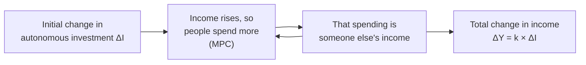

---
{"dg-publish":true,"permalink":"/study/3rd-semester/macroeconomics/the-multiplier/","tags":["study","economics","macroeconomics","multiplier"],"dg-note-properties":{"tags":["study","economics","macroeconomics","multiplier"],"semester":"3rd","source":"2.multiplier-1.ppt"}}
---

# The Multiplier

> [!info] About this note
> Rewritten from the 37-slide lecture deck `2.multiplier-1.ppt` (24-25 session sheet) for studying. The old `.ppt` was converted before reading. The deck's equations are images in the original, so I rebuilt them in LaTeX and re-checked every calculation. Callouts titled **Added**, **Memory aid**, **Check** and **Review questions** are mine; everything else follows the slides. Last year's deck of the same name has essentially the same content.
> Previous: [[Study/3rd Semester/Macroeconomics/Introduction to Macroeconomics\|Introduction to Macroeconomics]]

## Contents

1. [[Study/3rd Semester/Macroeconomics/The Multiplier#The big picture (read this first)\|#The big picture (read this first)]]
2. [[Study/3rd Semester/Macroeconomics/The Multiplier#Definition of the multiplier\|#Definition of the multiplier]]
3. [[Study/3rd Semester/Macroeconomics/The Multiplier#Marginal propensity to consume (MPC)\|#Marginal propensity to consume (MPC)]]
4. [[Study/3rd Semester/Macroeconomics/The Multiplier#Relationship between MPC and the multiplier\|#Relationship between MPC and the multiplier]]
5. [[Study/3rd Semester/Macroeconomics/The Multiplier#Importance of the multiplier\|#Importance of the multiplier]]
6. [[Study/3rd Semester/Macroeconomics/The Multiplier#Uses of the multiplier\|#Uses of the multiplier]]
7. [[Study/3rd Semester/Macroeconomics/The Multiplier#Worked illustrations\|#Worked illustrations]]
8. [[Study/3rd Semester/Macroeconomics/The Multiplier#Key terms\|#Key terms]]
9. [[Study/3rd Semester/Macroeconomics/The Multiplier#Things to check\|#Things to check]]
10. [[Study/3rd Semester/Macroeconomics/The Multiplier#Review questions\|#Review questions]]

---

## The big picture (read this first)

An initial change in **autonomous spending** (investment, government spending, exports) leads to a **larger** change in national income. The ratio of the two is the **multiplier**. Its size depends on how much of each extra taka people **consume**, the **MPC**.

$$k=\frac{\Delta Y}{\Delta I}=\frac{1}{1-\text{MPC}}=\frac{1}{\text{MPS}}$$

> [!tip] Note in one sentence
> The multiplier tells you how many times income rises (or falls) for each unit change in autonomous spending, and the higher the MPC the bigger it is.

---

## Definition of the multiplier

- A number that indicates the **magnitude** of a particular macroeconomic policy measure.
- It is the process by which an initial change in **autonomous spending** (investment, government expenditure or exports) leads to a larger change in **national income (GDP)**.
- **Simple definition:** it shows **how many times** national income increases (or decreases) as a result of a change in autonomous spending.

The slides open with an arithmetic analogy: in **6 × 3 = 18**, 6 is the factor (the multiplier), 3 the multiplicand and 18 the product. In the same way an investment is multiplied into a larger income.

---

## Marginal propensity to consume (MPC)

- **Propensity to consume:** the proportion of **disposable income** people want to spend on consumption.
- **MPC:** the proportion of **additional income** a person wants to consume. It measures **induced consumption**, the rise in consumption that follows a rise in disposable income (income after taxes and transfers).
- Example from the slides: if a household earns one extra Tk and MPC = **0.65**, it spends **65 paisa** and saves **35 paisa**.

**Formula:** the MPC is the derivative of the consumption function with respect to disposable income, or in changes

$$\text{MPC}=\frac{dC}{dY_d}=\frac{\Delta C}{\Delta Y}$$

**Example (slide 7).**

| Income (Y) | Consumption (C) |
|---|---|
| 120 | 120 |
| 180 | 170 |

$\Delta C=170-120=50$ and $\Delta Y=180-120=60$, so MPC $=50/60=0.83$. People **consume 83% and save 17%**.

---

## Relationship between MPC and the multiplier

The value of the multiplier is **determined by the MPC**: **the higher the MPC, the higher the multiplier**, and vice versa.

**Derivation (slide 9).** Start with $Y=C+I$:

| Step | Equation |
|---|---|
| 1 | $\Delta Y=\Delta C+\Delta I$ |
| 2 | $\Delta C=c\,\Delta Y$ where $c$ is the MPC, so $\Delta Y=c\,\Delta Y+\Delta I$ |
| 3 | $\Delta Y-c\,\Delta Y=\Delta I$ |
| 4 | $\Delta Y(1-c)=\Delta I$ |
| 5 | $\Delta Y=\dfrac{\Delta I}{1-c}$ |
| 6 | $\dfrac{\Delta Y}{\Delta I}=\dfrac{1}{1-c}$ |

So the multiplier $K=\dfrac{1}{1-c}=\dfrac{\Delta Y}{\Delta I}$. Since $1-\text{MPC}=\text{MPS}$ (marginal propensity to save), **$K=1/\text{MPS}$**, the **reciprocal of the MPS**.

> [!warning] Added: how big can the multiplier get?
> MPC lies between 0 and 1, so $k$ lies between **1** (MPC = 0, nothing re-spent) and **infinity** (MPC close to 1). Slide 30 shows this pattern: MPC 0.80 gives $k=5$; 0.65 gives 2.86; 0.40 gives 1.67; 0.25 gives 1.33.

> [!warning] Added: the process in rounds
> The slides give only the final formula. Take $\Delta I=100$ and MPC $=0.8$:
>
> | Round | New income created | Cumulative |
> |---|---|---|
> | 1 (the investment) | 100 | 100 |
> | 2 (0.8 × 100) | 80 | 180 |
> | 3 (0.8 × 80) | 64 | 244 |
> | 4 | 51.2 | 295.2 |
> | ... | ... | tends to **500** |
>
> The total $= 100\times\dfrac{1}{1-0.8}=500$.

> [!tip] Memory aid (mine)
> - **"One over one minus c"**: $k=1/(1-c)$. If the MPC is 0.9 you can say "one over 0.1, which is 10".
> - **MPC + MPS = 1**, so the multiplier is also **one over the savings habit**.
> - **More saving, smaller multiplier** (savings are a leakage from the spending chain).

---

## Importance of the multiplier

1. **Saving-investment equality.** In the short run the consumption function is stable, so swings in income and employment come from swings in **investment**. A rise in investment causes a **cumulative rise** in income and employment (and the reverse). If saving and investment diverge, changes in investment move income through the multiplier until the two are **equal** again.
2. **Business cycles.** It explains and helps control the phases of the cycle. A **boom** is damped by cutting investment (a cumulative fall in income and employment). In a **depression**, more investment brings **revival**; if it continues a boom may follow.
3. **Formulating economic policy.** The government can decide how much investment to inject to cut unemployment. During a depression, **public works programmes are more effective than a cheap money policy** because of the multiplier effect of investment. Two cautions:
   - A rise in investment in one sector should **not** come with a fall in another sector. An **inter-sectoral transfer** does not raise the multiplier.
   - Investment must be **steady**: increments should be repeated at regular intervals to lift income and employment to **full employment**.
4. **Explains income and output determination** in the Keynesian framework: an initial rise in investment or government spending leads to **multiple rounds of income**.
5. **Guides fiscal policy.** Government spending in a recession can raise GDP by much more than the spending itself.
6. **Helps employment generation.** More income means more production and more demand for labour.
7. **Highlights consumption behaviour.** The multiplier's size depends on the MPC, so consumer behaviour affects how effective policy is.
8. **Useful for development planning.** In developing countries like Bangladesh it helps allocate resources to sectors where spending creates the most income and jobs.
9. **Explains interdependence in the economy.** Spending in one sector creates income in others.
10. **Assists demand management.** It helps manage aggregate demand, controlling inflation in booms and stimulating growth in downturns.

---

## Uses of the multiplier

- It occupies a very important place **in economic theory and in shaping policy**.
- It is an **instrument of income building**: a small rise in investment can cause a large rise in income.
- It is used to **control business cycles**.
- It gives guidelines for **income and employment policy**.
- It also **explains the expansion of the public sector** in modern times.

---

## Worked illustrations

### Illustration 1: equilibrium income and the multiplier
Consumption function $C=300+0.8Y$; investment $I=$ Tk 360 million. Find (1) equilibrium income, (2) equilibrium income when $I$ rises to 400 (an increase of 40), and (3) the multiplier.

**(1)** $Y=C+I=300+0.8Y+360$
$Y-0.8Y=660\Rightarrow 0.2Y=660\Rightarrow$ **$Y=3{,}300$**

**(2)** $Y=300+0.8Y+400\Rightarrow 0.2Y=700\Rightarrow$ **$Y=3{,}500$**

**(3)** Income rises from 3,300 to 3,500, an increase of **200**, for a rise in investment of 40. Multiplier $m=\dfrac{1}{1-b}=\dfrac{1}{1-0.8}=\dfrac{1}{0.2}=$ **5** (check: $200/40=5$).

### Illustration 2: a fall in investment (reverse multiplier)
MPC $=0.75$; autonomous investment **falls by 40 million**. Find the change in (1) equilibrium income, (2) consumption.

**(1)** $\Delta Y=\Delta I\times\dfrac{1}{1-b}=-40\times\dfrac{1}{1-0.75}=-40\times4=$ **−160**. Income falls by **160 million**. This is the **reverse multiplier**.

**(2)** $\Delta Y=\Delta C+\Delta I\Rightarrow -160=\Delta C-40\Rightarrow\Delta C=$ **−120**. Consumption falls by **120 million**.

### Illustration 3: multiplier values for different MPCs
Find $m$ for MPC = 0.80, 0.65, 0.40, 0.25, and the fall in income when autonomous investment falls by 60 million.

| MPC | $m=1/(1-\text{MPC})$ | Fall in income $=60\times m$ (slide) | Exact |
|---|---|---|---|
| 0.80 | 5 | 300 | 300 |
| 0.65 | 2.86 | 171.6 | 171.4 |
| 0.40 | 1.67 | 100.2 | 100 |
| 0.25 | 1.33 | 79.8 | 80 |

### Illustration 4: MPC of 0.50
Autonomous investment falls by 60 million.

**(1)** $\Delta Y=-60\times\dfrac{1}{1-0.5}=$ **−120**. Income falls by **120 million**.
**(2)** $-120=\Delta C-60\Rightarrow\Delta C=$ **−60**. Consumption falls by **60 million**.

### Illustration 5: how much investment is needed?
Two-sector economy: income Tk 1,000 million, MPC $=0.40$. The government wants income of **Tk 1,600 million** (a rise of 600).

$600=\Delta I\times\dfrac{1}{1-0.4}=\Delta I\times\dfrac{1}{0.6}=\Delta I\times1.6667$
$\Delta I=\dfrac{600}{1.6667}=$ **Tk 360 million**.

> [!tip] Memory aid (mine): recipe for any multiplier problem
> 1. Write the MPC ($b$) and compute $k=1/(1-b)$.
> 2. Use $\Delta Y=k\,\Delta I$ (find any one of $\Delta Y$, $k$, $\Delta I$ from the other two).
> 3. For consumption use $\Delta C=\text{MPC}\times\Delta Y$, or $\Delta C=\Delta Y-\Delta I$ (since $Y=C+I$).
> 4. Check signs: a **fall** in investment gives a **negative** $\Delta Y$.

---

## Key terms

| Term | Meaning |
|---|---|
| Multiplier ($k$ or $m$) | How many times income changes for a given change in autonomous spending: $\Delta Y/\Delta I$ |
| Autonomous spending | Spending that does not depend on current income: investment, government expenditure, exports |
| Disposable income | Income after taxes and transfers |
| Propensity to consume | The proportion of disposable income people want to consume |
| MPC | Extra consumption per extra unit of income, $\Delta C/\Delta Y$ |
| MPS | Extra saving per extra unit of income, $1-\text{MPC}$ |
| Induced consumption | Consumption that rises because income rises |
| Reverse multiplier | The magnified **fall** in income when autonomous spending falls |
| Equilibrium income | The income where $Y=C+I$ |

---

## Things to check

> [!bug] Slips in the slides
> - **Slide 29, Illustration 3 part (3):** it writes $m=\dfrac{1}{1-0.4}=\dfrac{1}{0.2}$. The denominator should be **0.6**, giving $m=1.67$ (the slide's final value is right).
> - **Rounded multipliers (slide 30):** it multiplies by the rounded values, so 171.6, 100.2 and 79.8 are off slightly. Exact answers are **171.4, 100 and 80**.
> - **Slide 3:** the "Example" is only the 6 × 3 = 18 picture; it is not a numerical example of the multiplier.

> [!question]- Review questions (mine)
> 1. Define the multiplier in one sentence and state its formula.
> 2. Derive $k=1/(1-\text{MPC})$ starting from $Y=C+I$.
> 3. MPC is 0.9. Find the multiplier. What happens to it if the MPC falls to 0.5?
> 4. What is the relationship between the multiplier and the MPS?
> 5. If $C=200+0.75Y$ and $I=100$, find equilibrium income. What is the new income if $I$ rises to 120?
> 6. Why are public works programmes more effective than a cheap money policy in a depression?
> 7. Explain the reverse multiplier with an example.
> 8. Why must investment increments be repeated at regular intervals, and why does an inter-sectoral transfer not raise the multiplier?
> 9. How does the multiplier help in controlling business cycles?
> 10. A government wants to raise income by Tk 500 million and the MPC is 0.75. How much extra autonomous investment is needed?
>
> **Answers to 3, 5 and 10:**
> - Q3: $k=1/(1-0.9)=10$; at MPC 0.5, $k=2$.
> - Q5: $Y=(200+100)/0.25=1{,}200$; with $I=120$, $Y=320/0.25=1{,}280$ (rise of 80 = 20 × 4).
> - Q10: $k=1/0.25=4$, so $\Delta I=500/4=$ Tk 125 million.
