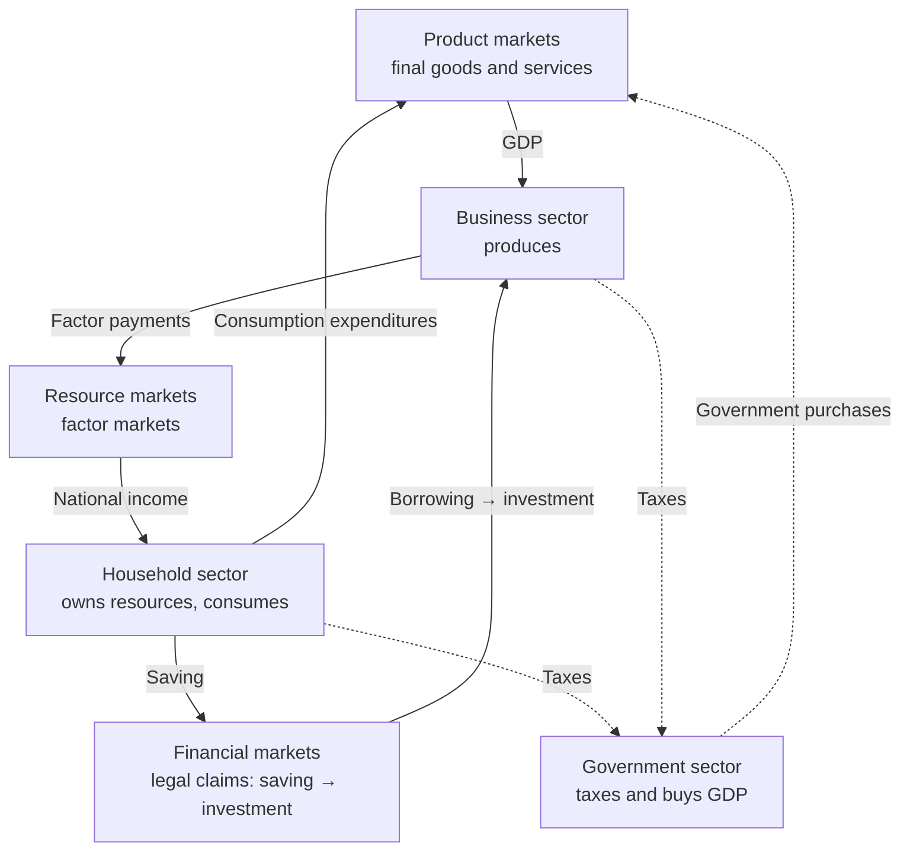

---
{"dg-publish":true,"permalink":"/study/3rd-semester/macroeconomics/three-sector-keynesian-model/","tags":["study","economics","macroeconomics","circular-flow","fiscal-policy"],"created":"2026-11-18T21:36:29.047+06:00","updated":"2026-11-18T21:46:05.839+06:00","dg-note-properties":{"tags":["study","economics","macroeconomics","circular-flow","fiscal-policy"],"semester":"3rd","source":"4.three-sectot-economy.ppt"}}
---

# Three-Sector Keynesian Model

> [!info] About this note
> Rewritten from the 16-slide lecture deck `4.three-sectot-economy.ppt` (23-24 session sheet). The deck's slide 8 diagram is kept as an image; the equations are rebuilt in LaTeX and every calculation was re-checked. Callouts titled **Added**, **Memory aid**, **Check** and **Self-test questions** are mine; everything else follows the slides. The deck is the direct continuation of [[Study/3rd Semester/Macroeconomics/Two-Sector Two-Market Circular Flow\|Two-Sector Two-Market Circular Flow]].
> Previous: [[Study/3rd Semester/Macroeconomics/Two-Sector Two-Market Circular Flow\|Two-Sector Two-Market Circular Flow]] · Next: [[Study/3rd Semester/Macroeconomics/Four-Sector Economy\|Four-Sector Economy]]

## Contents

1. [[Study/3rd Semester/Macroeconomics/Three-Sector Keynesian Model#The big picture (read this first)\|#The big picture (read this first)]]
2. [[Study/3rd Semester/Macroeconomics/Three-Sector Keynesian Model#What the three-sector model is\|#What the three-sector model is]]
3. [[Study/3rd Semester/Macroeconomics/Three-Sector Keynesian Model#Three sectors\|#Three sectors]]
4. [[Study/3rd Semester/Macroeconomics/Three-Sector Keynesian Model#Three markets, including financial markets\|#Three markets, including financial markets]]
5. [[Study/3rd Semester/Macroeconomics/Three-Sector Keynesian Model#The three-sector circular flow (diagram)\|#The three-sector circular flow (diagram)]]
6. [[Study/3rd Semester/Macroeconomics/Three-Sector Keynesian Model#Illustration 1: adding government spending\|#Illustration 1: adding government spending]]
7. [[Study/3rd Semester/Macroeconomics/Three-Sector Keynesian Model#Government expenditure and tax multipliers\|#Government expenditure and tax multipliers]]
8. [[Study/3rd Semester/Macroeconomics/Three-Sector Keynesian Model#Illustration 2: closing a full-employment gap\|#Illustration 2: closing a full-employment gap]]
9. [[Study/3rd Semester/Macroeconomics/Three-Sector Keynesian Model#Key terms\|#Key terms]]
10. [[Study/3rd Semester/Macroeconomics/Three-Sector Keynesian Model#Things to check\|#Things to check]]
11. [[Study/3rd Semester/Macroeconomics/Three-Sector Keynesian Model#Self-test questions\|#Self-test questions]]

## The big picture (read this first)

The two-sector model had households and businesses only. This one adds the **government sector (public sector)**, which does two things to the flow: it **buys** part of GDP and it **taxes** the other sectors. The new equilibrium condition becomes

$$Y=C+I+G$$

and government spending behaves like any other **injection** — it is multiplied by $1/(1-\text{MPC})$, exactly like investment. Taxes work the other way: an increase in tax **reduces** income, so the tax multiplier carries a **negative** sign.

> [!tip] Note in one sentence
> Adding government adds one injection (G) and one leakage (T); the spending multiplier is unchanged at $1/(1-b)$, and the tax multiplier is the same thing with a minus sign and a factor $b$.

## What the three-sector model is

The deck defines it as a **Keynesian model of the macro economy that includes the three domestic sectors** — household, business and government — i.e. the two-sector model plus government (slides 1–3).

It calls this "perhaps the most commonly used representation of Keynesian economics", because it contains the three components needed to analyse **business-cycle instability**:

| Component | From which sector | Role in the model |
|---|---|---|
| **Consumption expenditures** | Households | Capture **induced** expenditure (expenditure that responds to income) |
| **Investment expenditures** | Businesses | Capture **autonomous** private-sector expenditure changes, a prime source of cycles |
| **Government purchases and taxes** | Government | Highlight **policy actions** that address the instability |

> [!tip] Memory aid (mine)
> **Induced (C) + autonomous (I) + policy (G, T).** One of each, which is why this model is "enough" to talk about the business cycle.

## Three sectors

**Household sector** (slide 4) — everyone seeking to satisfy unlimited wants and needs; responsible for **consumption expenditures**; **owns all productive resources**. (Same as in the two-sector model.)

**Business sector** (slide 5) — the institutions (proprietorships, partnerships, corporations) that combine resources to produce goods and services; does the **production**; buys capital goods with **investment expenditures**. (Same as before.)

**Government sector** (slide 5, new) — the ruling bodies of federal, state and local government. **Regulation is its prime function**: passing laws, collecting taxes, and forcing the other sectors to do what they would not do voluntarily. It **buys a portion of GDP** as **government purchases**.

> [!warning] Added: what is *not* counted in G
> The deck counts only **government purchases** of goods and services (judges' services, arms and tanks, equipment, as the earlier deck puts it). **Transfer payments** — pensions, unemployment benefits — are *not* purchases of output, so they are not in $G$ directly; they raise household disposable income and only affect income through $C$. This matters when you are asked to "increase government expenditure".

## Three markets, including financial markets

**Product markets** (slide 6) — all markets exchanging final goods and services; the mechanism that exchanges GDP; also called **aggregate product markets / the aggregate market**.

**Resource markets** (slide 6) — all markets exchanging the services of the factors of production: labour, capital, land, entrepreneurship; also called **factor markets**.

**Financial markets** (slide 7, new) — the commodity exchanged is **legal claims**, which represent **ownership of physical assets** (capital and other goods). Because the exchange of legal claims involves a counter-flow of income, those who want to **save** buy legal claims and those who want to **borrow** sell legal claims.

> [!warning] Added: why financial markets appear in this model
> The two-sector model implicitly assumed households spend all income. With financial markets made explicit, **saving is a leakage** out of the income flow and **investment is an injection** back into it: households' saving buys legal claims, businesses sell legal claims to finance capital goods. This is the mechanism that makes $S=I$ an equilibrium condition rather than an assumption.

## The three-sector circular flow (diagram)

*Slide 8. The two-sector ring, with **financial markets** inserted just above the resource markets and the **government sector** in the very centre.*

**Reading the diagram (slide 9):** households at the far left, businesses at the far right, **product markets at the top**, **resource markets at the bottom**, **financial markets just above the resource markets** ("which divert saving to investment expenditures"), and the **government sector in the very centre**.

## Illustration 1: adding government spending

Two-sector economy: $C=200+0.8Y$, $I=300$ million, so equilibrium income is **2,500 million**. The government is then added with $G=100$ million. **(1)** Find the three-sector equilibrium income. **(2)** What is the multiplier effect of the government expenditure — is it the same size as the investment multiplier? **(3)** Now let $C=200+0.8Y_d$ and suppose a **balanced budget**: the whole of $G$ is financed by a lump-sum tax. Find the new equilibrium income.

**(1) Three-sector equilibrium**, with $Y=C+I+G$:

| Step | Working |
|---|---|
| Start | $Y=200+0.8Y+300+100$ |
| Collect constants | $Y=600+0.8Y$ |
| Move $0.8Y$ | $0.2Y=600$ |
| Result | $Y=600/0.2=\mathbf{3{,}000}$ million |

That is **500 million more** than the two-sector equilibrium of 2,500.

**(2) Government expenditure multiplier** (slide 12):

$$GM=\frac{\Delta Y}{\Delta G}=\frac{1}{1-b}=\frac{1}{1-0.8}=\mathbf{5}$$

and the investment multiplier is $m=\dfrac{\Delta Y}{\Delta I}=\dfrac{1}{1-b}$, also **5**. So **yes — the magnitude is the same**: a 100 million increase in either $G$ or $I$ raises income by 500 million ($100\times5=500$, which matches part 1).

**(3) Balanced budget** — $G=T=100$ million, and $Y_d=Y-T$ (slide 13):

| Step | Working |
|---|---|
| Consumption | $C=200+0.8(Y-100)$ |
| Expand | $C=200-80+0.8Y=120+0.8Y$ |
| Equilibrium | $Y=120+0.8Y+300+100$ |
| Collect | $Y-0.8Y=120+400$ |
| Solve | $0.2Y=520\Rightarrow Y=\mathbf{2{,}600}$ million |

> [!warning] Added: the balanced-budget multiplier is 1
> Compare the three cases: **2,500** with no government, **3,000** with $G=100$ only, **2,600** with $G=T=100$. Financing the spending with tax gives back four-fifths of the gain, so a **100** increase in both $G$ and $T$ raises income by exactly **100** — the **balanced-budget multiplier equals 1**. Reason: the government spends the whole 100 (worth $100\times5=500$) but the tax takes 100 out of household income, and households only cut consumption by $0.8\times100=80$, worth $80\times5=400$. Net $500-400=100$.

## Government expenditure and tax multipliers

**Government expenditure multiplier** (slide 12):

$$GM=\frac{\Delta Y}{\Delta G}=\frac{1}{1-b}$$

where $\Delta G$ = change in government expenditure, $b$ = MPC, $\Delta Y$ = change in income.

**Government tax multiplier** (slide 16):

$$GF=\frac{\Delta Y}{\Delta T}=\frac{-b}{1-b}$$

where $\Delta T$ = change in (lump-sum) tax. Because the numerator is negative, **an increase in tax lowers equilibrium income**; the tax multiplier is smaller in size than the spending multiplier ($b/(1-b)$ versus $1/(1-b)$) by the factor $b$, because only the consumed part of a tax change moves income.

> [!tip] Memory aid (mine)
> Three multipliers, one denominator:
> - **G:** $+\dfrac{1}{1-b} = 5$ when $b=0.8$
> - **T:** $-\dfrac{b}{1-b} = -4$ when $b=0.8$
> - **Balanced budget (G and T together):** $1$
>
> Notice $5-4=1$: the balanced-budget multiplier is just the sum of the other two.

## Illustration 2: closing a full-employment gap

Full-employment output is **2,000 million**, equilibrium output is currently **1,600 million**, MPC $=0.8$. Find the change needed in **(1)** government expenditure and **(2)** net lump-sum tax.

The gap is $\Delta Y=2{,}000-1{,}600=400$ million.

**(1) Government expenditure** (slide 15):

| Step | Working |
|---|---|
| Multiplier relation | $\dfrac{\Delta Y}{\Delta G}=\dfrac{1}{1-b}$ |
| Substitute | $\dfrac{400}{\Delta G}=\dfrac{1}{0.2}=5$ |
| Solve | $\Delta G=400\times0.2=\mathbf{80}$ million |

So government expenditure must **rise by 80 million**.

**(2) Tax** (slide 16), using $GF=\dfrac{-b}{1-b}$:

| Step | Working |
|---|---|
| Relation | $\dfrac{400}{\Delta T}=\dfrac{-0.80}{0.20}$ |
| Cross-multiply | $-0.8\,\Delta T=400\times0.20=80$ |
| Solve | $\Delta T=\mathbf{-100}$ million |

So lump-sum tax must **fall by 100 million**. The tax cut has to be bigger than the spending increase (100 vs 80) because only four-fifths of a tax cut is spent.

> [!tip] Memory aid (mine): which lever is cheaper?
> To move income by $\Delta Y$: **spend** $\Delta Y(1-b)$, or **cut tax** by $\Delta Y\dfrac{1-b}{b}$. With $b=0.8$ that is 20% of the gap through $G$ but 25% of the gap through $T$. Both close the same gap; the spending route is "more powerful per taka".

## Key terms

| Term | Meaning |
|---|---|
| Three-sector model | Households + businesses + government; $Y=C+I+G$ |
| Government sector | Ruling bodies of federal/state/local government; regulates, taxes and buys a portion of GDP |
| Government purchases ($G$) | Government spending on goods and services (part of GDP); excludes transfers |
| Transfer payments | Payments that boost incomes without buying output (pensions, unemployment benefits) |
| Financial markets | Markets where legal claims (ownership of physical assets) are exchanged; divert saving into investment |
| Legal claims | Paper/assets representing ownership of physical assets; bought by savers, sold by borrowers |
| Induced expenditure | Expenditure that changes with income — consumption |
| Autonomous expenditure | Expenditure independent of current income — investment, government purchases |
| Government expenditure multiplier | $\Delta Y/\Delta G=1/(1-b)$ |
| Tax multiplier | $\Delta Y/\Delta T=-b/(1-b)$; negative |
| Balanced-budget multiplier | Effect of raising $G$ and $T$ by the same amount; equals 1 |

## Things to check

> [!bug] Slips in the slides
> - **Slide 12:** the closing line reads "Thus the magnitude of the multiplier effect is the same as that of a change in government expenditure" — it is comparing the **investment** multiplier with the **government expenditure** multiplier, so the sentence has the two the wrong way round.
> - **Slide 11:** "The equilibrium level of income in the three sector economy is 3,000 millions, which is an increase by 500 millions" — correct, but the slide never states the two-sector equilibrium (2,500) it is compared with; it is on slide 10 only.
> - **Slide 13:** the balanced-budget case silently switches the consumption function from $C=200+0.8Y$ to $C=200+0.8Y_d$. The change of assumption is essential to the answer, so read slide 13 carefully before copying it.
> - **Slide 16:** the tax multiplier is printed as $\Delta Y/\Delta T=-b/(1-b)$ but the arithmetic line "$-0.8\,\Delta T=400(0.20)$" hides the cross-multiplication; written out it is $\Delta T=400\times\dfrac{0.2}{-0.8}=-100$.
> - **Slide 15:** the multiplier formulas are laid out with stray tabs, so $\dfrac{\Delta Y}{\Delta G}=\dfrac{1}{1-b}$ looks like three separate fractions.

## Self-test questions

> [!question]- 1. Which sector and which market does the three-sector model add to the two-sector model, and what does each do?
> The government sector — it regulates, collects taxes and buys a portion of GDP as government purchases — and financial markets, where legal claims are exchanged so that saving is diverted to investment expenditure.

> [!question]- 2. Why does the deck call the three-sector model "the most commonly used representation of Keynesian economics"?
> Because it contains the three components needed to analyse business-cycle instability: induced consumption (households), autonomous investment changes (businesses) and policy actions through government purchases and taxes.

> [!question]- 3. What are legal claims, and why do savers buy them while borrowers sell them?
> Legal claims are assets representing ownership of physical assets (capital and other goods). Their exchange involves a counter-flow of income, so people seeking to save income buy them and people wanting to borrow income sell them.

> [!question]- 4. Write the equilibrium condition for a three-sector economy and explain each term.
> $Y=C+I+G$: consumption expenditure by households (induced), investment expenditure by businesses (autonomous), and government purchases of goods and services (policy). Transfers are not included.

> [!question]- 5. Why is the tax multiplier negative, and why is it smaller than the spending multiplier?
> A tax rise cuts disposable income, so consumption and income fall — hence the minus sign. Its size is $b/(1-b)$ against $1/(1-b)$ for spending, because households change consumption by only the MPC times the tax, so a given tax change moves income by a factor $b$ less.

> [!question]- 6. $C=150+0.75Y$, $I=200$, $G=250$. Find $Y$.
> $Y=150+0.75Y+200+250\Rightarrow0.25Y=600\Rightarrow Y=2{,}400$.

> [!question]- 7. In question 6, income must rise by 200 to reach full employment. How much extra $G$ is needed? How much tax cut would do the same?
> Multiplier $=1/0.25=4$, so $\Delta G=200/4=50$. The tax multiplier is $-0.75/0.25=-3$, so $\Delta T=-200/3\approx-66.7$: the tax cut must be bigger.

> [!question]- 8. Prove that a balanced-budget increase of 100 raises income by 100 when $b=0.8$.
> $+100$ of $G$ raises income by $100\times5=500$; $+100$ of tax cuts consumption by $0.8\times100=80$, which lowers income by $80\times5=400$. Net $500-400=100$, so the balanced-budget multiplier is $\dfrac{1-b}{1-b}=1$.

> [!question]- 9. Are transfer payments part of $G$? Explain what they do to equilibrium income instead.
> No — they are not purchases of output. They raise household disposable income, so consumption rises by $b$ times the transfer and income by $b/(1-b)$ times the transfer: a transfer works like a tax cut of the same size.

> [!question]- 10. With $b=0.6$, compute the government expenditure multiplier, the tax multiplier and the balanced-budget multiplier.
> $GM=1/0.4=2.5$; $GF=-0.6/0.4=-1.5$; balanced budget $=2.5-1.5=1$.
