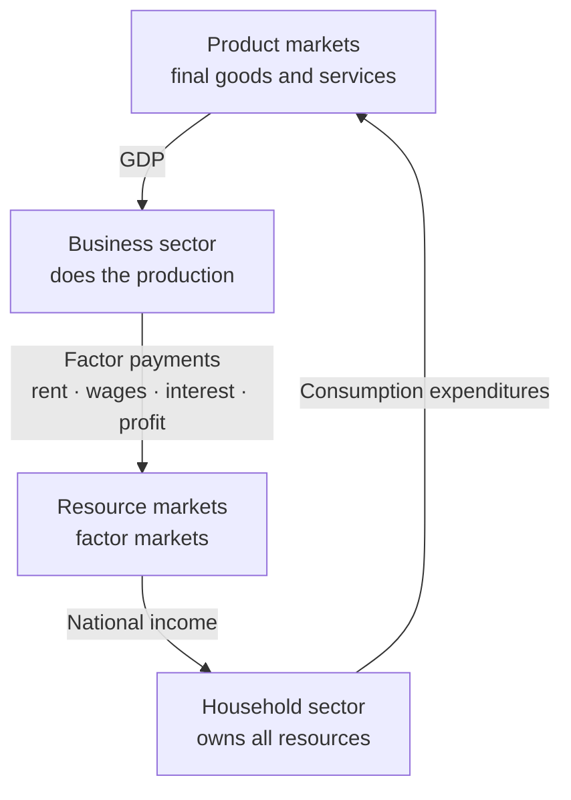

---
{"dg-publish":true,"permalink":"/study/3rd-semester/macroeconomics/two-sector-two-market-circular-flow/","tags":["study","economics","macroeconomics","circular-flow"],"created":"2026-11-18T21:30:58.240+06:00","updated":"2026-11-18T21:45:44.169+06:00","dg-note-properties":{"tags":["study","economics","macroeconomics","circular-flow"],"semester":"3rd","source":"3.two-sector-economy.ppt"}}
---

# Two-Sector, Two-Market Circular Flow

> [!info] About this note
> Rewritten from the 22-slide lecture deck `3.two-sector-economy.ppt` (24-25 session sheet). The file is named `.ppt` but is really a PowerPoint 2019 `.pptx`, so all 22 slides were read in full. Slide 7's circular-flow diagram is kept as an image; the equations are rebuilt in LaTeX and every calculation was re-checked. Callouts titled **Added**, **Memory aid**, **Check** and **Self-test questions** are mine; everything else follows the slides. The 23-24 session sheet has `3.two-sector-economy.pdf`, the same deck.
> Previous: [[Study/3rd Semester/Macroeconomics/The Multiplier\|The Multiplier]] · Next: [[Study/3rd Semester/Macroeconomics/Three-Sector Keynesian Model\|Three-Sector Keynesian Model]]

## Contents

1. [[Study/3rd Semester/Macroeconomics/Two-Sector Two-Market Circular Flow#The big picture (read this first)\|#The big picture (read this first)]]
2. [[Study/3rd Semester/Macroeconomics/Two-Sector Two-Market Circular Flow#Two sectors\|#Two sectors]]
3. [[Study/3rd Semester/Macroeconomics/Two-Sector Two-Market Circular Flow#Two markets\|#Two markets]]
4. [[Study/3rd Semester/Macroeconomics/Two-Sector Two-Market Circular Flow#The basic circular flow (diagram)\|#The basic circular flow (diagram)]]
5. [[Study/3rd Semester/Macroeconomics/Two-Sector Two-Market Circular Flow#The four segments of the flow\|#The four segments of the flow]]
6. [[Study/3rd Semester/Macroeconomics/Two-Sector Two-Market Circular Flow#Why the model matters\|#Why the model matters]]
7. [[Study/3rd Semester/Macroeconomics/Two-Sector Two-Market Circular Flow#Worked illustrations\|#Worked illustrations]]
8. [[Study/3rd Semester/Macroeconomics/Two-Sector Two-Market Circular Flow#Key terms\|#Key terms]]
9. [[Study/3rd Semester/Macroeconomics/Two-Sector Two-Market Circular Flow#Things to check\|#Things to check]]
10. [[Study/3rd Semester/Macroeconomics/Two-Sector Two-Market Circular Flow#Self-test questions\|#Self-test questions]]

## The big picture (read this first)

The two-sector, two-market circular flow is the **simplest** model of the macro economy. It has only two **sectors** — households and businesses — and two **markets** — product and resource (factor) — and it shows the **continuous movement of payments** for goods and services between producers and consumers. The same ring of payments goes round and round, and it is conveniently cut into **four segments**:

| Segment (clockwise from top) | Between | Represents |
|---|---|---|
| **GDP** | Product markets → Business sector | Revenue businesses receive for producing goods and services |
| **Factor payments** | Business sector → Resource markets | Payments to owners of land, labour, capital, entrepreneurship |
| **National income** | Resource markets → Household sector | Income earned by the factors of production, owned by households |
| **Consumption expenditures** | Household sector → Product markets | What households spend on final goods and services |

The four together are **consumption expenditures, GDP, factor payments and national income** — the slide 2 list.

> [!tip] Note in one sentence
> Households sell resources to businesses and buy their output, so the same money travels a full circle: spending → output (GDP) → factor payments → income → spending again.

## Two sectors

**Household sector** (slide 3)
- Includes **everyone** — all people seeking to satisfy unlimited wants and needs.
- Responsible for **consumption expenditures**.
- **Owns all productive resources** (land, labour, capital, entrepreneurship).

**Business sector** (slide 4)
- Includes the institutions — especially **proprietorships, partnerships and corporations** — that combine resources to produce goods and services.
- Does the **production**.
- Buys **capital goods** with **investment expenditures**.

> [!tip] Memory aid (mine)
> **Households own, businesses produce.** Everything the economy has to work with is owned by households; it only gets used through businesses.

## Two markets

**Product markets** (slide 5)
- All markets in the economy that exchange **final goods and services**.
- The mechanism that exchanges **gross domestic product**.
- Full name: **aggregate product markets**, shortened to the **aggregate market**.

**Resource markets** (slide 6)
- All markets that exchange the **services of the economy's resources**, i.e. the **factors of production**: land, labour, capital, entrepreneurship.
- Also called **factor markets**.

> [!tip] Memory aid (mine)
> **Product market = output goes out; resource market = inputs come in.** One is where GDP is sold, the other is where the ability to produce it is hired out.

## The basic circular flow (diagram)

*Slide 7, "The Basic Circular Flow". Householders on the left, businesses on the right, product markets at the top, resource markets at the bottom; the green arrows run clockwise.*

**Circulating around (slide 8):** this diagram is the simple two-sector, two-market circular flow — household sector at the far left containing people seeking consumption, business sector at the far right doing the production, **product markets at the top** exchanging final goods and services, **resource markets at the bottom** exchanging the services of scarce resources.

## The four segments of the flow

### Gross Domestic Product (slide 9)
Start with the **upper right-hand segment**, between the **product markets and the business sector**. It is the **revenue received by the business sector** for producing goods and services — officially **gross domestic product (GDP)**.

### Factor payments (slide 10)
Moving **clockwise**, the **lower right-hand segment**, between the **business sector and the factor markets**, is **factor payments**: payments to the owners of land, labour, capital and entrepreneurship for the productive services they provide. Depending on the resource involved they split into **rent** (land), **wages** (labour), **interest** (capital) and **profit** (entrepreneurship).

### National income (slide 11)
Continuing clockwise to the **lower left-hand segment**, between the **factor markets and the household sector**, is **national income** — definitionally, the income **earned by the factors of production**, which the household sector owns.

### Consumption expenditures (slide 11)
The **last segment**, between the **household sector and the product markets** in the **upper left-hand corner**, is **consumption expenditures** — and with it the circle closes, because that spending is again the revenue of businesses.

> [!warning] Added: what is missing from the two-sector model
> The deck's two-sector model leaves out three things, and it is worth knowing where they would go:
> - **Government** (a third sector) — taxes are a leakage from the flow, government spending an injection into it.
> - **Foreign sector** — imports are a leakage, exports an injection.
> - **Saving and investment as a separate loop** — in this model households own all income and spend it all, so saving is implicit. When saving is brought out it is a **leakage** (income not spent on the product market) and investment is an **injection**; equilibrium then requires **planned saving = planned investment**. Every worked illustration below uses exactly that condition, which is why they are really two-sector models *with* saving and investment.

## Why the model matters

- It is the **simplest way to show the inherent interrelationship between producers and consumers** in a macro economy (slide 2).
- It defines the basic national-accounting aggregates by their place in the flow: **GDP** on the product side, **national income** on the factor side — which is why "GDP = national income" for a closed two-sector economy with no saving.
- It is the base for the **three-sector** and **four-sector** models that later add government and foreign trade — same ring, more leakages and injections.

> [!tip] Memory aid (mine): the ring in one line
> **Spending → GDP → factor payments → income → spending** (clockwise, upper-left, upper-right, lower-right, lower-left).

## Worked illustrations

### Illustration 1 (slides 12–14)
Two-sector economy: consumption function $C=300+0.8Y$, investment function $I=400$. **(1)** Derive the saving function. **(2)** Find the equilibrium level of income by equating saving (leakages) to investment (injections).

**(1) Saving function.** Since $S=Y-C$:

| Step | Working |
|---|---|
| Start | $S=Y-C$ |
| Substitute $C$ | $S=Y-(300+0.8Y)$ |
| Expand | $S=Y-0.8Y-300$ |
| Result | $S=-300+0.2Y$ |

So **$S=-300+0.2Y$** (note the negative autonomous saving: at zero income households still consume 300).

**(2) Equilibrium by $S=I$:**

$$-300+0.2Y=400 \;\Rightarrow\; 0.2Y=700 \;\Rightarrow\; Y=\frac{700}{0.2}=\mathbf{3{,}500}$$

**Check:** $C=300+0.8(3{,}500)=300+2{,}800=3{,}100$; then $S=Y-C=3{,}500-3{,}100=400=I$. ✔

### Illustration 2 (slides 15–17)
Two-sector economy: $C=120+0.75Y$. **(1)** With investment of $70 million, find the equilibrium income. **(2)** If full-employment income is $920 million, what investment is needed to reach full-employment equilibrium?

**(1) Equilibrium income**, using $Y=C+I$:

| Step | Working |
|---|---|
| Start | $Y=120+0.75Y+70$ |
| Move $0.75Y$ | $Y-0.75Y=190$ |
| Simplify | $0.25Y=190$ |
| Result | $Y=190/0.25=\mathbf{760}$ million |

**Check:** $C=120+0.75(760)=690$; $Y-C=70=I$. ✔

**(2) Investment for full employment.** Investment must equal the **saving gap at full-employment income**:

| Step | Working |
|---|---|
| Saving function | $S=Y-C$ |
| At $Y=920$ | $S=920-120-0.75(920)$ |
| Simplify | $S=800-690$ |
| Result | $S=\mathbf{110}$ |

So **$I=110$ million** is needed for full-employment equilibrium — an increase of 40 over the current 70.

> [!warning] Added: the multiplier behind illustration 2
> The MPC is 0.75, so the multiplier is $k=1/(1-0.75)=4$. Income has to rise from 760 to 920, i.e. by **160**. The extra investment needed is $160/4=$ **40 million** — exactly the 70 → 110 increase found above. (See [[Study/3rd Semester/Macroeconomics/The Multiplier\|The Multiplier]].)

### Illustration 3 (slides 18–22)
Two-sector economy: $C=900+0.8Y$, $I=1{,}080$. **(1)** Find equilibrium income and consumption. **(2)** Derive the saving function and the saving at equilibrium. **(3)** Find equilibrium income by equating planned investment (to planned saving).

**(1) Equilibrium income**, using $Y=C+I$:

| Step | Working |
|---|---|
| Start | $Y=900+0.8Y+1{,}080$ |
| Combine constants | $Y=1{,}980+0.8Y$ |
| Move $0.8Y$ | $0.2Y=1{,}980$ |
| Result | $Y=1{,}980/0.2=\mathbf{9{,}900}$ |

**Equilibrium consumption** at $Y=9{,}900$: $C=900+0.8(9{,}900)=900+7{,}920=\mathbf{8{,}820}$.

**(2) Saving function and saving at equilibrium:**

$$S=Y-C=Y-(900+0.8Y)=0.2Y-900$$

$$S=0.2(9{,}900)-900=1{,}980-900=\mathbf{1{,}080}$$

**(3) Equilibrium by $S=I$:**

| Step | Working |
|---|---|
| Condition | $S=I$ |
| Substitute | $1{,}080=0.2Y-900$ |
| Rearrange | $0.2Y=1{,}980$ |
| Result | $Y=1{,}980/0.2=\mathbf{9{,}900}$ |

Same answer, as it must be: at equilibrium **planned saving equals planned investment** ($S=1{,}080=I$). ✔

> [!tip] Memory aid (mine): recipe for two-sector problems
> 1. Equilibrium income: $Y=C+I$, then collect $Y$ terms — the bracket is always $(1-\text{MPC})Y=\text{autonomous }C+I$.
> 2. Saving function: $S=Y-C$; if $C=a+bY$ then $S=-a+(1-b)Y$, so the **autonomous term flips sign** and the slope is the **MPS**.
> 3. Saving at equilibrium: compute $S$, and it must equal $I$ — use that as your check.
> 4. Never trust "productivity" as the name of $Y$: in these slides it means **income/output**.

## Key terms

| Term | Meaning |
|---|---|
| Circular flow | The continuous movement of payments between sectors and markets in the economy |
| Household sector | Everyone seeking to satisfy wants; owns all productive resources; does the consuming |
| Business sector | Firms (proprietorships, partnerships, corporations) that combine resources and produce |
| Product market (aggregate market) | All markets exchanging final goods and services; exchanges GDP |
| Resource / factor market | All markets exchanging the services of land, labour, capital and entrepreneurship |
| GDP | Revenue received by the business sector for producing goods and services |
| Factor payments | Payments to resource owners: rent, wages, interest, profit |
| National income | Income earned by the factors of production, owned by households |
| Consumption expenditures | Household spending on final goods and services |
| Leakage (withdrawal) | Income leaving the flow before it becomes spending — saving (also taxes, imports in bigger models) |
| Injection | Spending entering the flow from outside the household–business loop — investment (also government spending, exports) |
| Equilibrium | The income at which planned saving equals planned investment, equivalently $Y=C+I$ |

## Things to check

> [!bug] Slips in the slides
> - **Slide 12:** asks for "the equilibrium level of **productivity**", and slide 14 answers "equilibrium level of productivity is 3,500". It means **income (output) $Y$**. The same wording recurs on slides 15–17.
> - **Slide 14:** the rearrangement is written as $-300-400=-0.2Y$, then $-700=-0.2Y$, then $0.2Y=700$. Correct, but the more natural line is $-300+0.2Y=400\Rightarrow0.2Y=700$.
> - **Slide 18, part (3):** the instruction stops at "by equating planned investment" — it means equating planned **saving to planned investment** (as slide 22 does).
> - **Slides 11 and 17** each merge two questions into one slide (national income plus consumption expenditures; the saving gap plus the investment answer), so they read as if one flow.
> - **Slide 7's diagram** is drawn with PowerPoint shapes and lines, so its arrows are easy to misread: the labels sit between the two arrows of each segment. Read it as **households at left, businesses at right, product markets top, resource markets bottom, flow clockwise.**

## Self-test questions

> [!question]- 1. Name the two sectors and the two markets of the simple circular flow, and state what each does.
> Households consume, own all productive resources and supply them; businesses combine resources and produce, buying capital goods with investment. Product markets exchange final goods and services (GDP); resource (factor) markets exchange the services of land, labour, capital and entrepreneurship.

> [!question]- 2. List the four segments of the flow in clockwise order and say what each measures.
> GDP (product markets → business sector, the revenue from producing output) → factor payments (business sector → resource markets: rent, wages, interest, profit) → national income (resource markets → households, income earned by the factors) → consumption expenditures (households → product markets, spending on final output).

> [!question]- 3. Why is the business sector's revenue equal to GDP, and why is the factor market's payment equal to national income?
> Because the product markets exchange exactly the final goods and services produced, valued at market prices, so the revenue businesses receive for them is GDP by definition. The factor markets sell the services of the factors owned by households, so what households receive for them is the income earned by the factors — national income.

> [!question]- 4. Which resource earns rent, which wages, which interest and which profit?
> Land earns rent, labour earns wages, capital earns interest, entrepreneurship earns profit.

> [!question]- 5. In a two-sector economy $C=200+0.75Y$. Derive the saving function.
> $S=Y-C=Y-(200+0.75Y)=-200+0.25Y$; the autonomous term flips sign and the slope is the MPS, 0.25.

> [!question]- 6. With $C=200+0.75Y$ and $I=150$, find equilibrium income by (a) $Y=C+I$ and (b) $S=I$. Do they agree?
> (a) $Y=200+0.75Y+150\Rightarrow0.25Y=350\Rightarrow Y=1{,}400$. (b) $-200+0.25Y=150\Rightarrow0.25Y=350\Rightarrow Y=1{,}400$. They agree — same condition, two routes.

> [!question]- 7. Full-employment income is 1,600 in question 6 while current equilibrium is lower. How much extra investment is required?
> Income must rise from 1,400 to 1,600, i.e. by 200. The multiplier is $1/0.25=4$, so $\Delta I=200/4=50$.

> [!question]- 8. Why does equilibrium require planned saving equal to planned investment rather than actual saving equal to actual investment?
> Actual saving and investment are equal after the fact by construction, because unsold output counts as inventory investment. Equilibrium is about **planned** magnitudes: only when planned saving equals planned investment are there no unwanted inventory changes, so income stops rising or falling.

> [!question]- 9. What would have to be added to this model to include government and foreign trade, and where would each appear as a leakage or injection?
> A government sector (taxes are a leakage, government purchases an injection) and a foreign sector (imports are a leakage, exports an injection). Both add to the denominator of the multiplier, shrinking it.

> [!question]- 10. $C=500+0.8Y$ and $I=700$. Find $Y$, $C$ and $S$ at equilibrium.
> $0.2Y=1{,}200\Rightarrow Y=6{,}000$; $C=500+0.8(6{,}000)=5{,}300$; $S=6{,}000-5{,}300=700=I$. ✔
