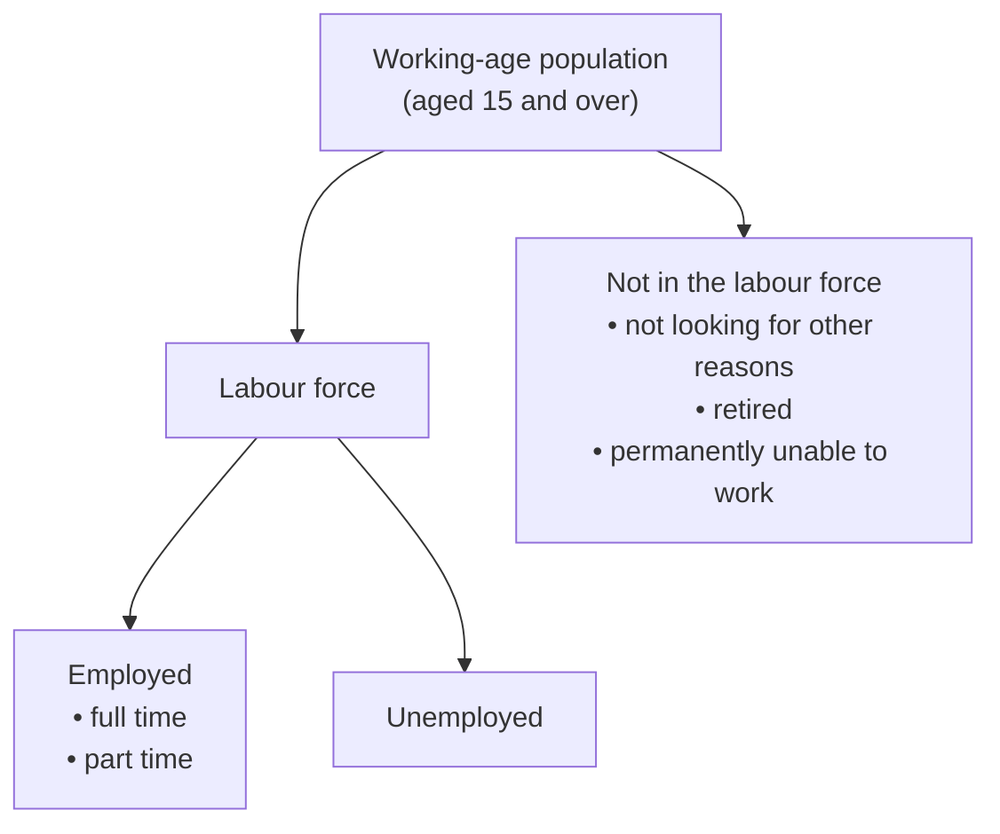

---
{"dg-publish":true,"permalink":"/study/3rd-semester/macroeconomics/unemployment-its-measurement-and-types/","tags":["study","economics","macroeconomics","unemployment","labour-market"],"created":"2026-11-18T21:38:06.797+06:00","updated":"2026-11-18T21:46:54.763+06:00","dg-note-properties":{"tags":["study","economics","macroeconomics","unemployment","labour-market"],"semester":"3rd","source":"unemployment-its-measurement-and-types.pdf"}}
---

# Unemployment - Its Measurement and Types

> [!info] About this note
> Rewritten from the 5-page Reserve Bank of Australia education explainer `unemployment-its-measurement-and-types.pdf` (23-24 session sheet), not a lecture deck — so the examples and institutions are **Australian** (ABS, RBA) even though the definitions are the standard ones. The "Groups in the Labour Market" diagram is rebuilt as a Mermaid chart; the two small schematic graphs on pages 4–5 are described rather than reproduced. Callouts titled **Added**, **Memory aid**, **Check** and **Self-test questions** are mine; everything else follows the explainer.
> Related: [[Study/3rd Semester/Macroeconomics/Introduction to Macroeconomics\|Introduction to Macroeconomics]] (unemployment as a macro objective), [[Study/3rd Semester/Macroeconomics/Inflation - Effects and Control Measures\|Inflation - Effects and Control Measures]] (the other half of the policy problem)

## Contents

1. [[Study/3rd Semester/Macroeconomics/Unemployment - Its Measurement and Types#The big picture (read this first)\|#The big picture (read this first)]]
2. [[Study/3rd Semester/Macroeconomics/Unemployment - Its Measurement and Types#What the labour market is and why the rate matters\|#What the labour market is and why the rate matters]]
3. [[Study/3rd Semester/Macroeconomics/Unemployment - Its Measurement and Types#Who counts as unemployed: the three groups\|#Who counts as unemployed: the three groups]]
4. [[Study/3rd Semester/Macroeconomics/Unemployment - Its Measurement and Types#The three labour market indicators\|#The three labour market indicators]]
5. [[Study/3rd Semester/Macroeconomics/Unemployment - Its Measurement and Types#Worked examples: the unemployment rate and the participation rate\|#Worked examples: the unemployment rate and the participation rate]]
6. [[Study/3rd Semester/Macroeconomics/Unemployment - Its Measurement and Types#The three main types of unemployment\|#The three main types of unemployment]]
7. [[Study/3rd Semester/Macroeconomics/Unemployment - Its Measurement and Types#How the three types interact\|#How the three types interact]]
8. [[Study/3rd Semester/Macroeconomics/Unemployment - Its Measurement and Types#Other types of unemployment\|#Other types of unemployment]]
9. [[Study/3rd Semester/Macroeconomics/Unemployment - Its Measurement and Types#Key terms\|#Key terms]]
10. [[Study/3rd Semester/Macroeconomics/Unemployment - Its Measurement and Types#Things to check\|#Things to check]]
11. [[Study/3rd Semester/Macroeconomics/Unemployment - Its Measurement and Types#Self-test questions\|#Self-test questions]]

## The big picture (read this first)

The **unemployment rate** is the most commonly used indicator of conditions in the labour market. It is the **percentage of the labour force that is unemployed**, and to measure it you must first decide who is in the **labour force**: the employed plus the unemployed, with everyone else "not in the labour force".

The explainer then covers two topics:

1. **How the unemployment rate is measured.**
2. **The main types of unemployment** — cyclical, structural and frictional — plus underemployment, hidden and seasonal unemployment.

> [!tip] Note in one sentence
> Unemployment needs three things at once — no paid job, **available**, and **actively looking** — and the rate can move because the numerator (unemployed) changes *or* because the denominator (labour force) changes.

## What the labour market is and why the rate matters

- The **labour market** is the term economists use for the **supply of labour (from households)** and the **demand for labour (by businesses and other organisations)**.
- The unemployment rate is the most commonly used indicator of labour market conditions, and it gives **insights into how the economy is performing more generally** — which makes it an important input into thinking about **monetary policy**.

## Who counts as unemployed: the three groups

In Australia the **Australian Bureau of Statistics (ABS)** collects the data, with a monthly **Labour Force Survey** of around **50,000 people**. It groups the **working-age population (aged 15 and over)** into three broad categories:

| Group | Definition (as in the explainer) |
|---|---|
| **Employed** | In a **paid job for one hour or more in a week** |
| **Unemployed** | **Not in a paid job, but actively looking for work** |
| **Not in the labour force** | Not in a paid job **and not looking for work** — e.g. studying, caring for children or family members voluntarily, retired, or permanently unable to work |

*The page-1 "Groups in the Labour Market" diagram, rebuilt (mine).*

> [!tip] Memory aid (mine)
> **Employed = 1 hour or more of paid work.** **Unemployed = no paid work + actively looking.** **Not in the labour force = no paid work + not looking.** The "actively looking" test is what separates the second row from the third.

## The three labour market indicators

Once the three groups are estimated (slides/pages 2–3):

| Indicator | Formula |
|---|---|
| **Labour force** | Employed $+$ Unemployed |
| **Unemployment rate** | $\dfrac{\text{Unemployed}}{\text{Labour force}}\times100$ |
| **Participation rate** | $\dfrac{\text{Labour force}}{\text{Working-age population}}\times100$ |

The explainer notes that deciding who is employed or unemployed involves **practical judgements** — for example, how much paid work someone must do to "have a job" (the ABS answer: one hour a week) — as well as actually counting people.

> [!warning] Added: what the participation rate is for
> The unemployment rate alone can mislead: people who **give up looking** leave the labour force, so the unemployment rate can *fall* while nothing improves. The participation rate is the companion measure — it tells you how much of the working-age population is actually in the market, which is why the explainer presents the two together.

## Worked examples: the unemployment rate and the participation rate

**Unemployment rate example** (page 2): 12.6 million employed, 0.7 million unemployed.

| Step | Working |
|---|---|
| Labour force | $12.6 + 0.7 = 13.3$ million |
| Unemployment rate | $\dfrac{0.7}{13.3}\times100 = \mathbf{5.3\%}$ |

**Participation rate example** (page 3): labour force 13.3 million, working-age population 20.0 million.

$$\text{Participation rate}=\frac{13.3}{20.0}\times100=\mathbf{66.5\%}$$

**What moves the rate** (pages 2–3):

- The **numerator** (number unemployed) moves with **cyclical** factors, such as people losing jobs in an economic downturn, or with more **structural** factors in the economy.
- The **denominator** (size of the labour force) also moves — and that is driven by the participation rate.
- **Participation typically moves with the business cycle**: when businesses hire more and pay higher wages, the incentive to look for work is greater; when they are not hiring and wage increases are small, the incentive is weaker.
- **Structural influences** on participation, independent of the cycle, include: more **part-time** work opportunities, an increase in **female participation**, and people working longer as they **delay retirement**.

> [!tip] Memory aid (mine)
> $\text{Rate}=\dfrac{U}{E+U}$. To make the rate fall you can either **shrink $U$** or **grow $E$** (denominator) — and growing the denominator by pulling discouraged workers back in *raises* the measured rate even though it is good news.

## The three main types of unemployment

The explainer stresses that these **cannot be measured directly** and **often overlap**, but they are a useful way of thinking about unemployment.

### Cyclical unemployment
- Occurs **with changes in economic activity over the business cycle**.
- In a **downturn**, a shortfall of demand for goods and services means **fewer jobs**; businesses with weaker demand **lay off workers or hire fewer**, and jobseekers find it harder to be hired. The opposite happens when demand strengthens.
- Described as **medium term in nature (one to 12 months)**.
- Examples: the sharp rise in the unemployment rate in the **early 1990s recession**, the decline to low levels by the **mid 2000s**, then the rise around the **global financial crisis**.
- A rise in cyclical unemployment suggests the economy is **operating below its potential**. With more people competing for jobs, businesses may offer **lower wage increases**, which contributes to **lower inflation**.
- **Policies that stimulate aggregate demand** — such as **expansionary monetary policy** — can reduce it, because businesses facing stronger demand employ more people.

### Structural unemployment
- Occurs when there is a **mismatch between the jobs available and the people looking for work** — a **skills** mismatch, or a **location** mismatch (the jobs are a long way from the jobseekers).
- Workers become unemployed if they are in **industries that are declining** or have **skills that can be automated** by large-scale technological advance; they may need **new skills** or to **move region**.
- Example: the noticeable **decline in routine manual jobs** over recent decades as some were automated; **manufacturing** has a high share of routine manual jobs and its size has declined, in both production and employment.
- Tends to be **longer lasting** than other types, because developing skills or moving takes years; such workers are more likely to face **long-term unemployment (more than 12 months)**.
- **Exists even when economic conditions are good**; in theory it should **not directly influence wages or inflation**, and is best addressed through policies focused on **skills and the supply of labour**.

### Frictional unemployment
- Occurs when people **move between jobs**, and when people **transition into and out of the labour force**.
- The **movement of workers is necessary for a flexible labour market** and helps achieve an **efficient allocation of labour**; but people do not find jobs immediately and must **invest time and effort searching**, and businesses also spend time **searching for suitable candidates**.
- So jobseekers are **not matched immediately with vacancies** and may have a spell of **temporary unemployment**.
- Generally **shorter term (less than one month)**; likely at **all points of the business cycle**; like structural unemployment, may **not influence wages or inflation**.

> [!tip] Memory aid (mine): the three types in one line
> **Cyclical = not enough demand. Structural = wrong skills or wrong place. Frictional = in transit.** Ask "would this person be unemployed even in a boom?" If yes, it is structural or frictional; if no, cyclical.
>
> Rough durations in the explainer: frictional **< 1 month**, cyclical **1–12 months**, structural **> 12 months**.

## How the three types interact

They are **not independent**. For example, a period of **high cyclical unemployment might lift structural unemployment**: if people are unemployed for so long that their **skills and productivity deteriorate**, they come to be seen as **less employable**, which reduces the probability they will be hired in future.

> [!warning] Added: this is "hysteresis"
> The feedback from cyclical into structural unemployment has a name — **hysteresis**: a temporary demand shock leaves a permanent scar on the labour market. It is the main argument for acting on cyclical unemployment quickly rather than waiting for the recovery.

## Other types of unemployment

Two complementary indicators, plus one seasonal category (page 5):

**Underemployment** — people are **employed but would like, and are available, to work more hours**. The ABS defines two categories:
1. **Part-time workers who would prefer to work additional hours.**
2. **People who usually work full time but are currently working part-time hours.**

Underemployment rates are generally **higher among groups with a larger proportion of part-time workers** — females, younger workers and older workers.

**Hidden unemployment** — people **not counted as unemployed** in the formal statistics but who **would probably work if they had the chance**. Example: someone who looked for work for a long time, **gave up hope and stopped looking**, but still wishes to work — the **"discouraged workers"**.

**Seasonal unemployment** — occurs at **different points over the year** because of seasonal patterns affecting jobs, e.g. **ski instructors, fruit pickers, holiday-related jobs**. The ABS publishes **seasonally adjusted** labour market statistics, which remove these seasonal patterns from the data.

> [!warning] Added: the two small graphs on pages 4–5
> The explainer prints two schematic two-axis charts (labelled *Economic Growth* against *Unemployment Rate*, and *Ease of Matching Workers and Jobs* against *Unemployment Rate*) as illustrations for cyclical and structural unemployment. They contain no data — just a single "x" marker each — so they are described here rather than reproduced: the first shows the **inverse relationship** between growth and cyclical unemployment, the second shows that **easier matching** between workers and vacancies lowers structural unemployment.

> [!warning] Added: Bangladesh equivalents (not in the source)
> The source is Australian. For this course the same definitions apply, but the data come from the **Bangladesh Bureau of Statistics (BBS) Labour Force Survey** rather than the ABS, and "working age" is usually reported as **15+**. The three categories and the two rate formulas are identical, so the exam answers transfer directly; only the institutional names change.

## Key terms

| Term | Meaning |
|---|---|
| Labour force | Employed + unemployed |
| Employed | In a paid job for one hour or more in a week (ABS definition) |
| Unemployed | Not in a paid job but **actively looking** for work |
| Not in the labour force | Not in a paid job and **not looking** (studying, caring, retired, permanently unable) |
| Unemployment rate | Unemployed ÷ labour force × 100 |
| Participation rate | Labour force ÷ working-age population × 100 |
| Working-age population | Population aged 15 and over (ABS) |
| Cyclical unemployment | Unemployment caused by the business cycle — a shortfall of aggregate demand |
| Structural unemployment | Mismatch between available jobs and jobseekers (skills or location); long lasting |
| Frictional unemployment | Temporary unemployment while moving between jobs or in/out of the labour force |
| Long-term unemployment | Unemployed for more than 12 months |
| Underemployment | Employed but wanting and available for more hours |
| Hidden unemployment | Discouraged workers not counted in official unemployment |
| Seasonal unemployment | Unemployment from seasonal patterns in jobs; removed by seasonal adjustment |
| Expansionary monetary policy | Policy that stimulates aggregate demand, used against cyclical unemployment |

## Things to check

> [!bug] Points worth flagging
> - The explainer gives **no data for Bangladesh** and no worked example beyond the two on pages 2–3; the illustrative numbers (12.6m, 0.7m, 20.0m) are Australian and round.
> - The **three types cannot be measured directly** — the explainer says so explicitly, so do not write "the ABS measures structural unemployment" in an exam.
> - **Frictional vs structural** are easy to confuse: both may not affect wages or inflation in theory, but frictional is **short (< 1 month)** and structural is **long (> 12 months)**.
> - The page-1 diagram labels the branches but leaves the equation arrows as handwriting-free graphics; the **labour force = employed + unemployed** relation is stated only in the text on page 2.

## Self-test questions

> [!question]- 1. Define the labour force and name its two components.
> The labour force is the sum of the employed and the unemployed — everyone who is either in a paid job or actively looking for one.

> [!question]- 2. Who is "not in the labour force"? Give three examples.
> People with no paid job who are **not looking** for work: students, people caring for children or family members voluntarily, retired people, and the permanently unable to work.

> [!question]- 3. State the formulas for the unemployment rate and the participation rate.
> Unemployment rate $=\dfrac{\text{Unemployed}}{\text{Labour force}}\times100$. Participation rate $=\dfrac{\text{Labour force}}{\text{Working-age population}}\times100$.

> [!question]- 4. 9.5 million employed and 0.5 million unemployed. Find the labour force and the unemployment rate.
> Labour force $=9.5+0.5=10.0$ million; unemployment rate $=0.5/10.0\times100=\mathbf{5.0\%}$.

> [!question]- 5. The working-age population in question 4 is 15 million. Find the participation rate.
> $10.0/15.0\times100=\mathbf{66.7\%}$.

> [!question]- 6. Explain how the unemployment rate can fall without any new jobs being created.
> Because the rate is a **ratio**, not a count. If unemployed people stop looking they leave the labour force, so numerator and denominator both shrink and the rate falls; workers retiring or emigrating out of the working-age population lower participation the same way.

> [!question]- 7. Distinguish cyclical, structural and frictional unemployment, with one example of each.
> Cyclical: caused by a shortfall of aggregate demand over the business cycle (e.g. the rise around the global financial crisis), medium term, 1–12 months. Structural: a mismatch of skills or location (e.g. routine manual jobs automated in declining manufacturing), longer lasting, over 12 months. Frictional: temporary, while moving between jobs or in and out of the labour force, under one month, and it exists at every stage of the cycle.

> [!question]- 8. Why is a rise in cyclical unemployment associated with lower inflation?
> With more people competing for the same jobs, businesses can offer smaller wage increases, which contributes to lower inflation. It also signals the economy is operating below its potential.

> [!question]- 9. What policy addresses cyclical unemployment, and what policy addresses structural unemployment?
> Cyclical: policies that stimulate aggregate demand, such as expansionary monetary policy (and fiscal policy). Structural: policies focused on skills and the supply of labour — training, retraining and help with moving region.

> [!question]- 10. Define underemployment, hidden unemployment and seasonal unemployment.
> Underemployment: people employed but wanting and available to work more hours (part-timers wanting more hours; full-timers currently on part-time hours). Hidden: discouraged workers not counted as unemployed who would work if they had the chance. Seasonal: unemployment from patterns that recur at points in the year (ski instructors, fruit pickers, holiday jobs).

> [!question]- 11. How can high cyclical unemployment turn into structural unemployment?
> Long spells erode **skills and productivity** and make workers appear less employable, so hiring becomes less likely — hysteresis.
