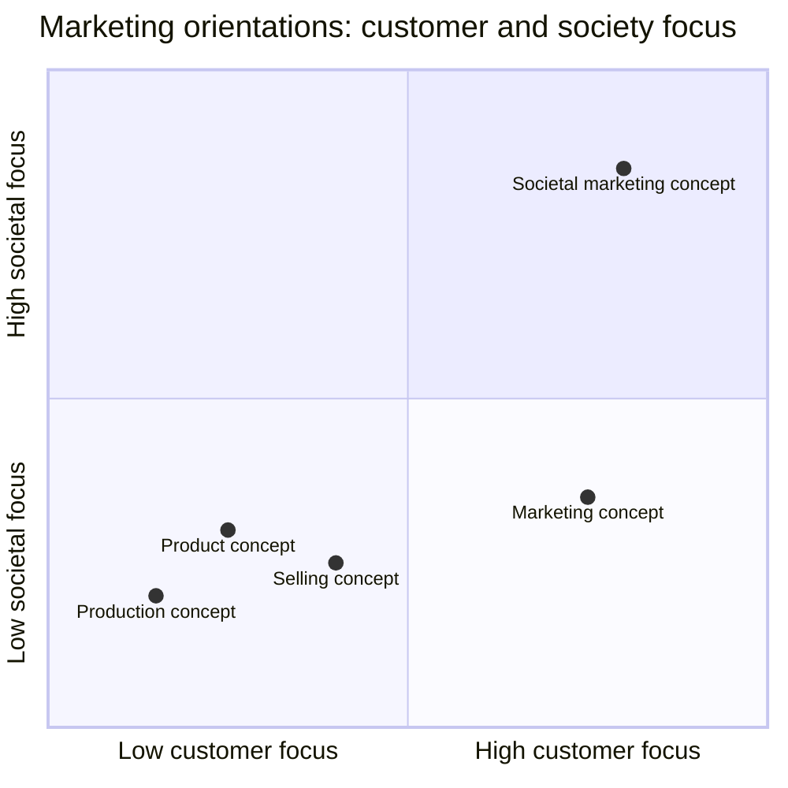

---
{"dg-publish":true,"permalink":"/study/3rd-semester/principles-of-marketing/chapter-1-marketing-creating-customer-value-and-engagement/","title":"Chapter 1 - Marketing Creating Customer Value and Engagement","tags":["study","marketing","chapter-1","customer-value","marketing-process"],"created":"2026-11-18T11:07:07.638+06:00","updated":"2026-11-19T00:59:41.150+06:00","dg-note-properties":{"title":"Chapter 1 - Marketing Creating Customer Value and Engagement","subject":"Marketing","semester":"3rd Semester","source":"Kotler-and-Armstrong-Principles-of-Marketing.pdf","chapter":1,"pdf-pages":"28-62","textbook-pages":"26-61","tags":["study","marketing","chapter-1","customer-value","marketing-process"]}}
---

# Chapter 1: Marketing: Creating Customer Value and Engagement

> [!info] About this note
> Rewritten for studying from Chapter 1 of *Principles of Marketing* by Kotler and Armstrong. The chapter covers the meaning of marketing, the five-step marketing process, core marketplace concepts, marketing management orientations, customer engagement, customer relationship management, and the changing marketing landscape. Added memory aids, a chapter map, and self-test questions are marked.

## The big picture (read this first)

Marketing creates **value for selected customers** and builds strong relationships with them. In return, the company **captures value** through repeat sales, increased purchases, customer lifetime value, and customer equity.

<svg version="1.1" xmlns="http://www.w3.org/2000/svg" viewBox="0 0 4277.508907371838 4660.785322018422" width="4277.508907371838" height="4660.785322018422" class="excalidraw-svg" style="max-width: 100%; height: 0px; width: 100%;"><!-- svg-source:excalidraw --><metadata/><defs><clipPath id="whIbOz0e"><rect transform="translate(10 30.5) rotate(0 591.9346027223337 884.0575036444379)" width="1183.8692054446674" height="1768.1150072888759" rx="8" ry="8"/></clipPath><clipPath id="pB4Ht5xm"><rect transform="translate(1241.0098062708414 2559.943515364849) rotate(0 1513.2495505504983 135.56081366773742)" width="3026.4991011009965" height="271.12162733547484" rx="8" ry="8"/></clipPath><clipPath id="DCWMUMAv"><rect transform="translate(1578.373077098629 3541.4962756668983) rotate(0 324.7080947436892 554.644523175762)" width="649.4161894873783" height="1109.289046351524" rx="8" ry="8"/></clipPath></defs><rect x="0" y="0" width="4277.508907371838" height="4660.785322018422" fill="#ffffff"/><g xmlns:ns1="http://www.w3.org/2000/svg" ns1:clip-path="url(#whIbOz0e)"><g stroke-linecap="round" transform="translate(190.552743634953 309.784389815924) rotate(0 411.5939778584732 78.20433419666597)"><path d="M32 0 C324.61 -5.21, 614.7 -1.8, 791.19 0 C812.8 -5.38, 827.15 10.94, 823.19 32 C820.98 63.38, 824.21 95.5, 823.19 124.41 C819.56 140.3, 814.96 152.1, 791.19 156.41 C598.35 160.45, 405.13 160.42, 32 156.41 C15.1 156.57, -3.98 151.23, 0 124.41 C-3.41 90.87, -4.39 65.04, 0 32 C-5.35 5.88, 5.54 1.8, 32 0" stroke="none" stroke-width="0" fill="#a5d8ff"/><path d="M32 0 C240.77 -0.93, 446.07 0.06, 791.19 0 M32 0 C242.71 -3.06, 452.89 -3.03, 791.19 0 M791.19 0 C810.02 1.26, 826.03 9.12, 823.19 32 M791.19 0 C815.48 -0.49, 824.8 8.34, 823.19 32 M823.19 32 C821.11 67.65, 819.72 104.98, 823.19 124.41 M823.19 32 C824.1 56.2, 824.51 81.11, 823.19 124.41 M823.19 124.41 C821.54 148.4, 810.63 156.05, 791.19 156.41 M823.19 124.41 C821.75 144, 814.13 158.79, 791.19 156.41 M791.19 156.41 C525.88 151.02, 258.78 150.62, 32 156.41 M791.19 156.41 C614.96 156.89, 437 156.71, 32 156.41 M32 156.41 C8.03 158.3, -3.11 148.44, 0 124.41 M32 156.41 C6.2 159.04, -1.21 141.98, 0 124.41 M0 124.41 C1.41 86.71, -1.57 55.39, 0 32 M0 124.41 C-0.07 95.67, 1.11 68.72, 0 32 M0 32 C2.04 9.65, 7.32 -3.87, 32 0 M0 32 C0.23 15.14, 8.06 -1.02, 32 0" stroke="#1e1e1e" stroke-width="2" fill="none"/></g></g><g xmlns:ns2="http://www.w3.org/2000/svg" ns2:clip-path="url(#whIbOz0e)"><g transform="translate(211.5819021574889 367.41963105822083) rotate(0 390.5648193359375 20.56909295436901)"><text x="390.5648193359375" y="28.99419342847863" font-family="Excalifont, Xiaolai, sans-serif, Segoe UI Emoji" font-size="32.9105487269905px" fill="#1e1e1e" text-anchor="middle" style="white-space: pre;" direction="ltr" dominant-baseline="alphabetic">Understand the marketplace and customer needs</text></g></g><g xmlns:ns3="http://www.w3.org/2000/svg" ns3:clip-path="url(#whIbOz0e)"><g stroke-linecap="round" transform="translate(26 46.5) rotate(0 575.9346027223337 82.27637181747627)"><path d="M32 0 C278.95 -11.81, 527.26 -9.54, 1119.87 0 C1142.89 1.08, 1152.44 7.97, 1151.87 32 C1148.51 58.29, 1154.57 91.15, 1151.87 132.55 C1149.28 152.56, 1142.57 163.98, 1119.87 164.55 C699.27 175.16, 273.54 177.29, 32 164.55 C11.69 167.03, -0.71 151.62, 0 132.55 C-3.72 105.02, -3.49 88.87, 0 32 C-0.05 9.94, 7.24 -2.74, 32 0" stroke="none" stroke-width="0" fill="#a5d8ff"/><path d="M32 0 C361.58 -4.32, 692.7 -5.13, 1119.87 0 M32 0 C356.41 0.04, 682.39 -0.52, 1119.87 0 M1119.87 0 C1143.78 -0.43, 1153.27 8.64, 1151.87 32 M1119.87 0 C1145.49 -3.3, 1150.78 9.8, 1151.87 32 M1151.87 32 C1149.32 63.47, 1154.17 87.92, 1151.87 132.55 M1151.87 32 C1150.97 62.94, 1150.85 91.05, 1151.87 132.55 M1151.87 132.55 C1150.62 152.37, 1142.6 166.62, 1119.87 164.55 M1151.87 132.55 C1154.16 151.91, 1137.38 165.26, 1119.87 164.55 M1119.87 164.55 C815.06 160.04, 512.52 161.94, 32 164.55 M1119.87 164.55 C794.67 162.85, 469.9 163.01, 32 164.55 M32 164.55 C6.79 166.84, -1.06 150.62, 0 132.55 M32 164.55 C14.35 166.78, 2.38 156.53, 0 132.55 M0 132.55 C0.58 109.76, 2.97 85.87, 0 32 M0 132.55 C-0.51 104.24, -3.21 75.01, 0 32 M0 32 C0.2 14.56, 8.4 -0.89, 32 0 M0 32 C3.88 12.25, 12.6 1.84, 32 0" stroke="#1e1e1e" stroke-width="2" fill="none"/></g></g><g xmlns:ns4="http://www.w3.org/2000/svg" ns4:clip-path="url(#whIbOz0e)"><g transform="translate(282.28280828873994 108.20727886310715) rotate(0 319.65179443359375 20.56909295436901)"><text x="319.65179443359375" y="28.99419342847863" font-family="Excalifont, Xiaolai, sans-serif, Segoe UI Emoji" font-size="32.9105487269905px" fill="#1e1e1e" text-anchor="middle" style="white-space: pre;" direction="ltr" dominant-baseline="alphabetic">Chapter 1 - Marketing Process Overview</text></g></g><g xmlns:ns5="http://www.w3.org/2000/svg" ns5:clip-path="url(#whIbOz0e)"><g stroke-linecap="round" transform="translate(190.552743634953 573.068779631848) rotate(0 411.5939778584732 78.20433419666597)"><path d="M32 0 C187.53 0.01, 341.94 -1.5, 791.19 0 C813.39 0.52, 825.66 7.04, 823.19 32 C821.72 49.43, 825.68 68.93, 823.19 124.41 C828.13 143.63, 817.37 160.84, 791.19 156.41 C561.68 165.73, 331.07 163.84, 32 156.41 C6.53 153.16, -0.56 140.39, 0 124.41 C2.32 103.85, -1.06 82.01, 0 32 C2.38 7.27, 5.69 1.45, 32 0" stroke="none" stroke-width="0" fill="#a5d8ff"/><path d="M32 0 C325.29 -2.1, 618.66 -3.17, 791.19 0 M32 0 C284.15 2.26, 535.56 1.94, 791.19 0 M791.19 0 C816.25 -2.87, 822.24 9.91, 823.19 32 M791.19 0 C811.73 -2.46, 823.55 8.97, 823.19 32 M823.19 32 C824.53 66.57, 825.72 99.78, 823.19 124.41 M823.19 32 C821.69 65.1, 823.01 100.75, 823.19 124.41 M823.19 124.41 C825.18 144.03, 809.19 157.02, 791.19 156.41 M823.19 124.41 C822.23 142.02, 810.41 153.33, 791.19 156.41 M791.19 156.41 C588.43 160.93, 385.33 160.58, 32 156.41 M791.19 156.41 C526.81 160.96, 263.78 159.84, 32 156.41 M32 156.41 C13.87 158.34, 2.07 148.04, 0 124.41 M32 156.41 C7.7 155.63, 1.41 146.01, 0 124.41 M0 124.41 C-2.15 97.68, 0.5 66.88, 0 32 M0 124.41 C1.65 100.99, 0.42 73.23, 0 32 M0 32 C3.37 12.04, 12.35 1.6, 32 0 M0 32 C-3.36 9.17, 14.31 0.23, 32 0" stroke="#1e1e1e" stroke-width="2" fill="none"/></g></g><g xmlns:ns6="http://www.w3.org/2000/svg" ns6:clip-path="url(#whIbOz0e)"><g transform="translate(197.3993765227233 630.7040208741449) rotate(0 404.7473449707031 20.56909295436907)"><text x="404.7473449707031" y="28.99419342847863" font-family="Excalifont, Xiaolai, sans-serif, Segoe UI Emoji" font-size="32.9105487269905px" fill="#1e1e1e" text-anchor="middle" style="white-space: pre;" direction="ltr" dominant-baseline="alphabetic">Design a customer value-driven marketing strategy</text></g></g><g xmlns:ns7="http://www.w3.org/2000/svg" ns7:clip-path="url(#whIbOz0e)"><g stroke-linecap="round" transform="translate(190.552743634953 836.353169447772) rotate(0 411.5939778584732 78.20433419666597)"><path d="M32 0 C274.72 4.31, 517.73 2.65, 791.19 0 C807.08 2.44, 818.88 8.07, 823.19 32 C828.76 55.42, 828.66 87.51, 823.19 124.41 C823.35 141.77, 818.01 157.43, 791.19 156.41 C528.2 151.66, 268.3 150.82, 32 156.41 C5.88 151.28, 1.8 145.69, 0 124.41 C3.96 94.49, -3.39 72.82, 0 32 C3.73 14, 15.49 4.4, 32 0" stroke="none" stroke-width="0" fill="#a5d8ff"/><path d="M32 0 C263.32 4.94, 493.02 4.83, 791.19 0 M32 0 C252.41 2.5, 471.14 2.92, 791.19 0 M791.19 0 C811.84 -2.14, 823.5 9.19, 823.19 32 M791.19 0 C816 3.88, 822.07 10.41, 823.19 32 M823.19 32 C826.29 57.49, 823.28 85.52, 823.19 124.41 M823.19 32 C824.83 55.36, 822.17 80.75, 823.19 124.41 M823.19 124.41 C822.36 142.51, 810.69 153.73, 791.19 156.41 M823.19 124.41 C821.67 146.12, 816.48 156.34, 791.19 156.41 M791.19 156.41 C597.48 151.16, 403.34 150.85, 32 156.41 M791.19 156.41 C520.66 151.83, 249.27 151.9, 32 156.41 M32 156.41 C8.09 155.73, 1.22 145.98, 0 124.41 M32 156.41 C11.7 159.43, 0.79 144.66, 0 124.41 M0 124.41 C-1.81 86.28, -4.66 55.05, 0 32 M0 124.41 C2.73 88.39, 1.89 51.79, 0 32 M0 32 C-2.92 9.37, 13.84 0.2, 32 0 M0 32 C-4.42 13.92, 10.89 1.39, 32 0" stroke="#1e1e1e" stroke-width="2" fill="none"/></g></g><g xmlns:ns8="http://www.w3.org/2000/svg" ns8:clip-path="url(#whIbOz0e)"><g transform="translate(257.58501495045766 893.9884106900689) rotate(0 344.56170654296875 20.56909295436907)"><text x="344.56170654296875" y="28.99419342847863" font-family="Excalifont, Xiaolai, sans-serif, Segoe UI Emoji" font-size="32.9105487269905px" fill="#1e1e1e" text-anchor="middle" style="white-space: pre;" direction="ltr" dominant-baseline="alphabetic">Construct an integrated marketing program</text></g></g><g xmlns:ns9="http://www.w3.org/2000/svg" ns9:clip-path="url(#whIbOz0e)"><g stroke-linecap="round" transform="translate(190.552743634953 1099.637559263696) rotate(0 411.5939778584732 78.204334196666)"><path d="M32 0 C264.66 6.48, 499.95 4.47, 791.19 0 C811.2 1.36, 822.62 15.61, 823.19 32 C825.59 52.26, 830.92 81.49, 823.19 124.41 C825.66 145.03, 810.25 152.28, 791.19 156.41 C605.58 146.23, 424.52 148.26, 32 156.41 C9.94 152.98, -2.74 148.12, 0 124.41 C6.03 105.63, 7.13 84.58, 0 32 C2.03 12.22, 11.09 -1.53, 32 0" stroke="none" stroke-width="0" fill="#a5d8ff"/><path d="M32 0 C313.55 -3.35, 594.64 -2.42, 791.19 0 M32 0 C205.19 0.72, 378.72 0.86, 791.19 0 M791.19 0 C815.55 3.37, 822.22 10.45, 823.19 32 M791.19 0 C812.35 1.12, 821.3 13.72, 823.19 32 M823.19 32 C821.51 56.74, 825.09 80.68, 823.19 124.41 M823.19 32 C821.23 54.14, 820.73 78.18, 823.19 124.41 M823.19 124.41 C821.87 146.07, 815.96 156.35, 791.19 156.41 M823.19 124.41 C821.17 144.64, 809.49 158.58, 791.19 156.41 M791.19 156.41 C623.43 150.09, 452.54 151.8, 32 156.41 M791.19 156.41 C526.18 159.77, 262.45 159.95, 32 156.41 M32 156.41 C11.56 159.04, 0.69 144.8, 0 124.41 M32 156.41 C14.18 158.38, 2.35 144.57, 0 124.41 M0 124.41 C5.68 102.16, 0.9 87.81, 0 32 M0 124.41 C-2.24 92.86, 0.81 62.72, 0 32 M0 32 C-3.84 13.5, 10.86 1.21, 32 0 M0 32 C0.89 11.14, 8.45 0.71, 32 0" stroke="#1e1e1e" stroke-width="2" fill="none"/></g></g><g xmlns:ns10="http://www.w3.org/2000/svg" ns10:clip-path="url(#whIbOz0e)"><g transform="translate(296.46367705983266 1136.703707551624) rotate(0 305.68304443359375 41.13818590873811)"><text x="305.68304443359375" y="28.99419342847863" font-family="Excalifont, Xiaolai, sans-serif, Segoe UI Emoji" font-size="32.9105487269905px" fill="#1e1e1e" text-anchor="middle" style="white-space: pre;" direction="ltr" dominant-baseline="alphabetic">Engage customers and build profitable</text><text x="305.68304443359375" y="70.13237933721675" font-family="Excalifont, Xiaolai, sans-serif, Segoe UI Emoji" font-size="32.9105487269905px" fill="#1e1e1e" text-anchor="middle" style="white-space: pre;" direction="ltr" dominant-baseline="alphabetic">relationships</text></g></g><g xmlns:ns11="http://www.w3.org/2000/svg" ns11:clip-path="url(#whIbOz0e)"><g stroke-linecap="round" transform="translate(190.552743634953 1362.92194907962) rotate(0 411.5939778584732 78.204334196666)"><path d="M32 0 C292.34 4.48, 553.51 5.91, 791.19 0 C810.41 4.84, 827.62 10.83, 823.19 32 C828.2 52.45, 823.45 70.19, 823.19 124.41 C819.94 145.18, 807.17 151.62, 791.19 156.41 C632.66 154.96, 473.62 157.28, 32 156.41 C7.27 151.43, 1.45 149.48, 0 124.41 C-0.2 92.74, -1.8 56.44, 0 32 C-2.86 11.59, 10.77 -4.79, 32 0" stroke="none" stroke-width="0" fill="#a5d8ff"/><path d="M32 0 C285.2 -6.04, 540.4 -5.93, 791.19 0 M32 0 C219.76 2.92, 406.11 2.2, 791.19 0 M791.19 0 C812.37 0.97, 821.54 13.32, 823.19 32 M791.19 0 C810.34 -0.41, 821.75 8.92, 823.19 32 M823.19 32 C822.43 59.63, 824.76 93.08, 823.19 124.41 M823.19 32 C821.68 52.42, 824.06 72.48, 823.19 124.41 M823.19 124.41 C821.43 144.79, 809.88 158.3, 791.19 156.41 M823.19 124.41 C819.61 148.84, 808.06 159.04, 791.19 156.41 M791.19 156.41 C584.25 162.1, 376.68 160.24, 32 156.41 M791.19 156.41 C576.45 157.29, 361.5 156.58, 32 156.41 M32 156.41 C13.72 158.12, 2.04 144.72, 0 124.41 M32 156.41 C6.81 151.95, 0.23 150.22, 0 124.41 M0 124.41 C1.78 103.6, 2.01 76.5, 0 32 M0 124.41 C-3.39 101.1, -1.37 75.57, 0 32 M0 32 C0.77 11.07, 8.74 0.62, 32 0 M0 32 C0.43 12.7, 7.69 -4.47, 32 0" stroke="#1e1e1e" stroke-width="2" fill="none"/></g></g><g xmlns:ns12="http://www.w3.org/2000/svg" ns12:clip-path="url(#whIbOz0e)"><g transform="translate(364.7607809416686 1420.5571903219168) rotate(0 237.3859405517578 20.569092954369054)"><text x="237.3859405517578" y="28.99419342847863" font-family="Excalifont, Xiaolai, sans-serif, Segoe UI Emoji" font-size="32.9105487269905px" fill="#1e1e1e" text-anchor="middle" style="white-space: pre;" direction="ltr" dominant-baseline="alphabetic">Capture value from customers</text></g></g><g xmlns:ns13="http://www.w3.org/2000/svg" ns13:clip-path="url(#whIbOz0e)"><g stroke-linecap="round" transform="translate(190.552743634953 1626.206338895544) rotate(0 411.5939778584732 78.204334196666)"><path d="M32 0 C277.38 -5.57, 526.23 -7.44, 791.19 0 C808.54 5.49, 824.21 13.14, 823.19 32 C818.89 57.99, 816.79 80.31, 823.19 124.41 C818.06 147.54, 812.47 155.68, 791.19 156.41 C608.52 158.03, 429.15 161.52, 32 156.41 C14 161.24, 4.4 147.78, 0 124.41 C-3.06 95.04, -0.09 59.04, 0 32 C-3.64 10.12, 15.05 -2.71, 32 0" stroke="none" stroke-width="0" fill="#a5d8ff"/><path d="M32 0 C240.85 1.16, 450.81 2.25, 791.19 0 M32 0 C323.75 0.53, 615.23 0.87, 791.19 0 M791.19 0 C810.63 -0.35, 821.94 9.15, 823.19 32 M791.19 0 C814.13 2.38, 825.48 8.69, 823.19 32 M823.19 32 C820.24 50.2, 820.79 70.75, 823.19 124.41 M823.19 32 C823.9 60, 823.46 89.9, 823.19 124.41 M823.19 124.41 C820.07 148.44, 808.64 158.7, 791.19 156.41 M823.19 124.41 C821.97 141.98, 816.2 158.63, 791.19 156.41 M791.19 156.41 C523.91 152.98, 257.27 152.85, 32 156.41 M791.19 156.41 C514.18 155.32, 236.36 154.78, 32 156.41 M32 156.41 C7.32 152.54, 0.2 149.63, 0 124.41 M32 156.41 C8.06 155.39, 3.88 147.32, 0 124.41 M0 124.41 C-2.04 95.97, -0.54 57.36, 0 32 M0 124.41 C0.29 90.35, -1.06 56.2, 0 32 M0 32 C0.37 12.43, 8.08 -3.88, 32 0 M0 32 C2.01 7.13, 8.54 -1.09, 32 0" stroke="#1e1e1e" stroke-width="2" fill="none"/></g></g><g xmlns:ns14="http://www.w3.org/2000/svg" ns14:clip-path="url(#whIbOz0e)"><g transform="translate(375.6691366545592 1683.8415801378408) rotate(0 226.4775848388672 20.569092954369065)"><text x="226.4775848388672" y="28.99419342847863" font-family="Excalifont, Xiaolai, sans-serif, Segoe UI Emoji" font-size="32.9105487269905px" fill="#1e1e1e" text-anchor="middle" style="white-space: pre;" direction="ltr" dominant-baseline="alphabetic">Profits and customer equity</text></g></g><g stroke-linecap="round"><g transform="translate(602.229040288998 1525.3306174729519) rotate(0 0.4358115574345902 47.20442812126587)"><path d="M-1.7 -0.4 C-1.59 16.02, 1.77 81.21, 2.52 97.49 M2.57 -3.08 C2.36 12.71, 1.66 77.88, 1.65 93.9" stroke="#1e1e1e" stroke-width="2" fill="none"/></g><g transform="translate(602.229040288998 1525.3306174729519) rotate(0 0.4358115574345902 47.20442812126587)"><path d="M-7.03 72.15 C-1.88 81.03, 1.03 86.37, 0.04 93.54 M-5.98 70.09 C-4.89 79.04, -2.18 85.58, 1.31 94.39" stroke="#1e1e1e" stroke-width="2" fill="none"/></g><g transform="translate(602.229040288998 1525.3306174729519) rotate(0 0.4358115574345902 47.20442812126587)"><path d="M10.07 72.27 C8.94 81, 5.58 86.3, 0.04 93.54 M11.12 70.2 C6.58 79.01, 3.65 85.51, 1.31 94.39" stroke="#1e1e1e" stroke-width="2" fill="none"/></g></g><mask/><g stroke-linecap="round"><g transform="translate(602.229040288998 1262.0462276570279) rotate(0 -0.05622785836476396 48.161440338683235)"><path d="M-0.23 1.18 C-0.64 17.31, -1.9 81.48, -1.76 96.96 M-3.8 -0.64 C-3.37 14.7, 3.2 76.86, 3.69 93.09" stroke="#1e1e1e" stroke-width="2" fill="none"/></g><g transform="translate(602.229040288998 1262.0462276570279) rotate(0 -0.05622785836476396 48.161440338683235)"><path d="M-5.67 69.01 C-1.69 78.12, -0.45 85.45, 4.01 91.59 M-6.45 70 C-3.22 74.92, -2.19 81.32, 4.06 93.34" stroke="#1e1e1e" stroke-width="2" fill="none"/></g><g transform="translate(602.229040288998 1262.0462276570279) rotate(0 -0.05622785836476396 48.161440338683235)"><path d="M11.39 67.79 C9.83 77.28, 5.53 85.01, 4.01 91.59 M10.61 68.78 C9.66 74.14, 6.5 80.84, 4.06 93.34" stroke="#1e1e1e" stroke-width="2" fill="none"/></g></g><mask/><g stroke-linecap="round"><g transform="translate(602.3479464605248 992.0263416838595) rotate(0 1.0389937226632355 51.8752998214934)"><path d="M1.61 2.49 C1.03 19.47, -1.73 83.09, -1.72 99.75 M-0.97 1.38 C-0.78 18.86, 3.51 86.36, 3.8 102.37" stroke="#1e1e1e" stroke-width="2" fill="none"/></g><g transform="translate(602.3479464605248 992.0263416838595) rotate(0 1.0389937226632355 51.8752998214934)"><path d="M-3.99 78.13 C-3.8 88.86, 1.62 97.49, 3.55 102.03 M-6.51 78.36 C-3.09 85.06, -0.33 91.26, 3.39 101.51" stroke="#1e1e1e" stroke-width="2" fill="none"/></g><g transform="translate(602.3479464605248 992.0263416838595) rotate(0 1.0389937226632355 51.8752998214934)"><path d="M13.09 77.37 C7.08 88.48, 6.31 97.38, 3.55 102.03 M10.57 77.61 C9.58 84.61, 7.92 91.01, 3.39 101.51" stroke="#1e1e1e" stroke-width="2" fill="none"/></g></g><mask/><g stroke-linecap="round"><g transform="translate(602.229040288998 735.4774480251799) rotate(0 -2.3995842148863176 46.38687999446404)"><path d="M-0.48 -0.72 C-0.64 14.89, -0.46 80.1, -0.55 96.35 M-4.18 -3.57 C-4.8 12.4, -3.22 76.16, -3.08 92.13" stroke="#1e1e1e" stroke-width="2" fill="none"/></g><g transform="translate(602.229040288998 735.4774480251799) rotate(0 -2.3995842148863176 46.38687999446404)"><path d="M-12.54 68.4 C-7.93 75.42, -4.82 83.9, -3.99 91.81 M-11.1 68.85 C-8.94 77.87, -5.48 87.23, -3.03 92.98" stroke="#1e1e1e" stroke-width="2" fill="none"/></g><g transform="translate(602.229040288998 735.4774480251799) rotate(0 -2.3995842148863176 46.38687999446404)"><path d="M4.56 68.11 C3.79 75.2, 1.52 83.76, -3.99 91.81 M6 68.56 C1.62 77.67, -1.46 87.14, -3.03 92.98" stroke="#1e1e1e" stroke-width="2" fill="none"/></g></g><mask/><g stroke-linecap="round"><g transform="translate(602.229040288998 472.1930582092559) rotate(0 0.6313795727489833 46.88229779080018)"><path d="M0.34 -2.41 C-0.02 13.19, -0.96 79.66, -1.44 96.18 M-2.92 2.45 C-2.41 18.41, 3.21 76.93, 4.18 91.87" stroke="#1e1e1e" stroke-width="2" fill="none"/></g><g transform="translate(602.229040288998 472.1930582092559) rotate(0 0.6313795727489833 46.88229779080018)"><path d="M-7.97 68.13 C-1.72 74.73, 2.02 82.33, 2.89 91.62 M-6.82 69.62 C-2.9 73.65, -2.01 79.73, 4.11 92.8" stroke="#1e1e1e" stroke-width="2" fill="none"/></g><g transform="translate(602.229040288998 472.1930582092559) rotate(0 0.6313795727489833 46.88229779080018)"><path d="M9.07 66.73 C9.8 73.81, 7.99 81.86, 2.89 91.62 M10.23 68.23 C10.01 72.76, 6.77 79.18, 4.11 92.8" stroke="#1e1e1e" stroke-width="2" fill="none"/></g></g><mask/><g stroke-linecap="round"><g transform="translate(600.4485692982998 209.9100847782422) rotate(0 0.4316147554352483 50.34886891891665)"><path d="M2.26 1.12 C2.4 18.49, 1.06 85.36, 1.12 101.43 M0.05 -0.73 C-0.26 16.03, -1.61 80.41, -1.39 97.07" stroke="#1e1e1e" stroke-width="2" fill="none"/></g><g transform="translate(600.4485692982998 209.9100847782422) rotate(0 0.4316147554352483 50.34886891891665)"><path d="M-8.99 73.18 C-6.56 81.49, -6.73 88.51, -2.57 99.01 M-9.87 73.4 C-7.55 79.81, -6.6 83.83, -1.6 96.92" stroke="#1e1e1e" stroke-width="2" fill="none"/></g><g transform="translate(600.4485692982998 209.9100847782422) rotate(0 0.4316147554352483 50.34886891891665)"><path d="M8.11 73.28 C5.24 81.7, -0.22 88.69, -2.57 99.01 M7.23 73.5 C5.75 79.74, 2.9 83.73, -1.6 96.92" stroke="#1e1e1e" stroke-width="2" fill="none"/></g></g><mask/><g transform="translate(10 10) rotate(0 20.22412109375 8.75)"><text x="0" y="12.5302734375" font-family="Helvetica, sans-serif, Segoe UI Emoji" font-size="14px" fill="#858585" text-anchor="start" style="white-space: pre;" direction="ltr" dominant-baseline="alphabetic">Frame</text></g><rect transform="translate(10 30.5) rotate(0 591.9346027223337 884.0575036444379)" width="1183.8692054446674px" height="1768.1150072888759px" rx="8" ry="8" fill="none" stroke="#2B2B2B" stroke-width="#525252"/><g xmlns:ns15="http://www.w3.org/2000/svg" ns15:clip-path="url(#pB4Ht5xm)"><g stroke-linecap="round" transform="translate(1257.0098062708414 2629.114908015776) rotate(0 122.10042136596815 68.68038772761429)"><path d="M32 0 C91.93 -2.69, 145.87 3.05, 212.2 0 C232.64 -2.24, 244.53 6.21, 244.2 32 C241.34 44.92, 239.89 69.12, 244.2 105.36 C249.27 125.88, 238.76 141.27, 212.2 137.36 C165.71 136.36, 112.44 137.37, 32 137.36 C12.92 134.79, -3.62 125.37, 0 105.36 C2.34 84.79, -0.33 77.18, 0 32 C-1.79 12.28, 8.61 1.79, 32 0" stroke="none" stroke-width="0" fill="#ffec99"/><path d="M32 0 C72.58 -2.27, 109.2 -5.47, 212.2 0 M32 0 C85.14 -1.95, 140.55 -0.31, 212.2 0 M212.2 0 C235.43 -3.47, 241.84 8.59, 244.2 32 M212.2 0 C230.69 -2.22, 240.88 9.24, 244.2 32 M244.2 32 C240.13 62.25, 244.08 94.36, 244.2 105.36 M244.2 32 C242.73 56.84, 241.79 82.49, 244.2 105.36 M244.2 105.36 C247.97 125.93, 233.17 135.28, 212.2 137.36 M244.2 105.36 C245.12 126.97, 230.06 138.36, 212.2 137.36 M212.2 137.36 C153.6 137.25, 94.03 137.13, 32 137.36 M212.2 137.36 C156.93 133.93, 99.62 134.5, 32 137.36 M32 137.36 C10.57 133.56, 1.82 129.7, 0 105.36 M32 137.36 C6.16 132.9, 2.52 128.41, 0 105.36 M0 105.36 C0.79 84.47, 4.17 71.75, 0 32 M0 105.36 C-2.17 86.69, -0.59 67.95, 0 32 M0 32 C-2.56 12.1, 14.14 1.62, 32 0 M0 32 C3.06 9.19, 15.17 -4.24, 32 0" stroke="#1e1e1e" stroke-width="2" fill="none"/></g></g><g xmlns:ns16="http://www.w3.org/2000/svg" ns16:clip-path="url(#pB4Ht5xm)"><g transform="translate(1324.7312603516532 2668.246360581358) rotate(0 54.37896728515625 29.54893516203208)"><text x="54.37896728515625" y="41.65217900440034" font-family="Excalifont, Xiaolai, sans-serif, Segoe UI Emoji" font-size="47.278296259251235px" fill="#1e1e1e" text-anchor="middle" style="white-space: pre;" direction="ltr" dominant-baseline="alphabetic">Need</text></g></g><g xmlns:ns17="http://www.w3.org/2000/svg" ns17:clip-path="url(#pB4Ht5xm)"><g stroke-linecap="round" transform="translate(1618.675808188826 2624.8660694324108) rotate(0 122.10042136596803 68.68038772761435)"><path d="M32 0 C83.09 -4.07, 121.74 2.2, 212.2 0 C230.31 -3.97, 239.23 9.79, 244.2 32 C240.33 52.83, 246.07 71.55, 244.2 105.36 C249.78 126, 230.1 141.34, 212.2 137.36 C162.95 136.78, 112.31 141.13, 32 137.36 C8.93 142.57, -3.41 131.23, 0 105.36 C-0.77 93.52, -4.01 71.93, 0 32 C2.63 6.18, 7.64 -4.39, 32 0" stroke="none" stroke-width="0" fill="#ffec99"/><path d="M32 0 C80.98 6.88, 135.02 2.76, 212.2 0 M32 0 C82.97 -2.52, 132.55 -3.91, 212.2 0 M212.2 0 C232.63 0.56, 247.04 7.6, 244.2 32 M212.2 0 C233 -3.1, 248.46 11.28, 244.2 32 M244.2 32 C240.3 58.77, 245.81 93.35, 244.2 105.36 M244.2 32 C246.01 57.41, 243.38 81.81, 244.2 105.36 M244.2 105.36 C245.05 125.14, 231.79 134.01, 212.2 137.36 M244.2 105.36 C246 127.59, 233.32 140.95, 212.2 137.36 M212.2 137.36 C142.78 135.23, 73.99 136.32, 32 137.36 M212.2 137.36 C165.59 139.64, 115.08 139.35, 32 137.36 M32 137.36 C11.76 137.54, -2.83 124.1, 0 105.36 M32 137.36 C10.41 132.91, -1.32 128.61, 0 105.36 M0 105.36 C0.92 85.57, -3.25 57.91, 0 32 M0 105.36 C0.81 81.59, -0.38 55.88, 0 32 M0 32 C1.05 9.69, 10.55 -2.16, 32 0 M0 32 C-0.38 9.78, 7.92 -3.24, 32 0" stroke="#1e1e1e" stroke-width="2" fill="none"/></g></g><g xmlns:ns18="http://www.w3.org/2000/svg" ns18:clip-path="url(#pB4Ht5xm)"><g transform="translate(1684.2704006973722 2663.9975219979933) rotate(0 56.505828857421875 29.54893516203208)"><text x="56.505828857421875" y="41.65217900440034" font-family="Excalifont, Xiaolai, sans-serif, Segoe UI Emoji" font-size="47.278296259251235px" fill="#1e1e1e" text-anchor="middle" style="white-space: pre;" direction="ltr" dominant-baseline="alphabetic">Want</text></g></g><g xmlns:ns19="http://www.w3.org/2000/svg" ns19:clip-path="url(#pB4Ht5xm)"><g stroke-linecap="round" transform="translate(1996.902178262836 2577.58777317316) rotate(0 236.39148129625616 118.1957406481281)"><path d="M32 0 C140.6 7.07, 244.14 6.44, 440.78 0 C460.26 2.52, 474.7 5.37, 472.78 32 C477.68 72.25, 473.87 118.42, 472.78 204.39 C469.07 226.3, 456.96 240.09, 440.78 236.39 C346.85 243.58, 247.19 243.42, 32 236.39 C14.63 236.66, 4.15 222.65, 0 204.39 C1.34 153.88, 4.39 100.21, 0 32 C-0.65 10.19, 13.43 -3.78, 32 0" stroke="none" stroke-width="0" fill="#ffec99"/><path d="M32 0 C122.04 -0.4, 210.98 -3.63, 440.78 0 M32 0 C134.17 -2.91, 236.65 -3, 440.78 0 M440.78 0 C464.45 -3.81, 473.01 11.63, 472.78 32 M440.78 0 C457.99 2.31, 475.34 11.36, 472.78 32 M472.78 32 C476.47 83.22, 474.71 126.71, 472.78 204.39 M472.78 32 C471.85 96.19, 469.77 157.07, 472.78 204.39 M472.78 204.39 C473.22 224.43, 461.03 233.01, 440.78 236.39 M472.78 204.39 C469.62 223.06, 465.69 240.94, 440.78 236.39 M440.78 236.39 C303.07 239.64, 169.34 240.91, 32 236.39 M440.78 236.39 C339.41 241.69, 237.15 241.25, 32 236.39 M32 236.39 C6.86 235.82, -1.19 222.21, 0 204.39 M32 236.39 C10.84 236.38, 4.34 224.76, 0 204.39 M0 204.39 C-0.37 144.1, -1.17 86.4, 0 32 M0 204.39 C-0.78 161.25, 2.53 121.1, 0 32 M0 32 C0.48 14.26, 6.73 -2.9, 32 0 M0 32 C2.73 14, 8.93 4.3, 32 0" stroke="#1e1e1e" stroke-width="2" fill="none"/></g></g><g xmlns:ns20="http://www.w3.org/2000/svg" ns20:clip-path="url(#pB4Ht5xm)"><g transform="translate(2023.3874400766704 2636.6856434972237) rotate(0 209.90621948242188 59.09787032406399)"><text x="209.90621948242188" y="41.65217900440034" font-family="Excalifont, Xiaolai, sans-serif, Segoe UI Emoji" font-size="47.278296259251235px" fill="#1e1e1e" text-anchor="middle" style="white-space: pre;" direction="ltr" dominant-baseline="alphabetic">Demand backed by</text><text x="209.90621948242188" y="100.75004932846439" font-family="Excalifont, Xiaolai, sans-serif, Segoe UI Emoji" font-size="47.278296259251235px" fill="#1e1e1e" text-anchor="middle" style="white-space: pre;" direction="ltr" dominant-baseline="alphabetic">purchasing power</text></g></g><g xmlns:ns21="http://www.w3.org/2000/svg" ns21:clip-path="url(#pB4Ht5xm)"><g stroke-linecap="round" transform="translate(2588.603094869303 2625.9519563289236) rotate(0 236.39148129625616 70.9174443888769)"><path d="M32 0 C136.4 -3.16, 244.14 -7.77, 440.78 0 C465.3 -3.54, 467.54 8.55, 472.78 32 C473.43 66.29, 469.64 95.98, 472.78 109.83 C474.39 126.95, 460.97 143.45, 440.78 141.83 C322.63 147.4, 205.67 144.79, 32 141.83 C15.56 140.22, 4.2 136.75, 0 109.83 C-6.47 86.06, -4.81 59.3, 0 32 C-4.9 14.04, 15.49 4.84, 32 0" stroke="none" stroke-width="0" fill="#ffec99"/><path d="M32 0 C174.21 0.64, 318.09 -1.72, 440.78 0 M32 0 C136.43 -0.71, 240.02 -2.01, 440.78 0 M440.78 0 C458.75 -2.25, 474.54 14.15, 472.78 32 M440.78 0 C465.58 -1.55, 475.43 12.81, 472.78 32 M472.78 32 C470.83 59.79, 474.55 83.29, 472.78 109.83 M472.78 32 C474.73 62.02, 475.04 87.97, 472.78 109.83 M472.78 109.83 C476.39 129.3, 463.44 141, 440.78 141.83 M472.78 109.83 C468.89 130.33, 462.59 143.1, 440.78 141.83 M440.78 141.83 C326.01 143.56, 213.66 144.83, 32 141.83 M440.78 141.83 C286.1 138.5, 133.83 137.53, 32 141.83 M32 141.83 C10.71 142.97, -2.46 131.88, 0 109.83 M32 141.83 C14.77 138.61, -2.62 135.33, 0 109.83 M0 109.83 C0.84 78.76, 2.55 54.8, 0 32 M0 109.83 C2.77 81.2, 3.08 49, 0 32 M0 32 C-1.66 10.76, 13.49 -1.97, 32 0 M0 32 C-4.4 11.81, 13.29 -1.38, 32 0" stroke="#1e1e1e" stroke-width="2" fill="none"/></g></g><g xmlns:ns22="http://www.w3.org/2000/svg" ns22:clip-path="url(#pB4Ht5xm)"><g transform="translate(2645.999962518098 2667.3204655557684) rotate(0 178.99461364746094 29.548935162031967)"><text x="178.99461364746094" y="41.65217900440034" font-family="Excalifont, Xiaolai, sans-serif, Segoe UI Emoji" font-size="47.278296259251235px" fill="#1e1e1e" text-anchor="middle" style="white-space: pre;" direction="ltr" dominant-baseline="alphabetic">Market offering</text></g></g><g xmlns:ns23="http://www.w3.org/2000/svg" ns23:clip-path="url(#pB4Ht5xm)"><g stroke-linecap="round" transform="translate(3179.3083859114186 2578.6736614040683) rotate(0 236.3914812962562 118.1957406481281)"><path d="M32 0 C122.58 -4.21, 219.93 -2.75, 440.78 0 C458.51 5.35, 470.74 5.96, 472.78 32 C472.72 94.97, 480.51 152.8, 472.78 204.39 C476.16 228.97, 464.52 233.61, 440.78 236.39 C281.91 232.02, 124.84 232.62, 32 236.39 C14.89 234.39, -2.4 228.18, 0 204.39 C-1.45 137.72, -4.11 78.29, 0 32 C1.41 8.33, 13.19 1.01, 32 0" stroke="none" stroke-width="0" fill="#ffec99"/><path d="M32 0 C177.8 -3.17, 328.69 -3.18, 440.78 0 M32 0 C186.36 0.61, 337.69 0.11, 440.78 0 M440.78 0 C460.22 -3.46, 469.29 13.08, 472.78 32 M440.78 0 C466.08 3.97, 474.22 11.11, 472.78 32 M472.78 32 C470.09 83.91, 477.61 132.87, 472.78 204.39 M472.78 32 C475.78 80.83, 473.95 128.82, 472.78 204.39 M472.78 204.39 C476.19 227.68, 458.52 238.89, 440.78 236.39 M472.78 204.39 C469.18 223.3, 458.83 240.85, 440.78 236.39 M440.78 236.39 C318.38 238.92, 196.33 242.25, 32 236.39 M440.78 236.39 C357.92 238.99, 275.64 239.37, 32 236.39 M32 236.39 C8.79 238.23, -3.92 229.37, 0 204.39 M32 236.39 C7.13 237.73, 3.06 229.78, 0 204.39 M0 204.39 C3.86 164.52, 4.78 133.12, 0 32 M0 204.39 C-1.89 149.17, -1.4 89.96, 0 32 M0 32 C2.39 7.95, 11.33 2.51, 32 0 M0 32 C1.87 14.81, 6.74 1.69, 32 0" stroke="#1e1e1e" stroke-width="2" fill="none"/></g></g><g xmlns:ns24="http://www.w3.org/2000/svg" ns24:clip-path="url(#pB4Ht5xm)"><g transform="translate(3194.1900252887294 2637.7715317281322) rotate(0 221.5098419189453 59.09787032406399)"><text x="221.5098419189453" y="41.65217900440034" font-family="Excalifont, Xiaolai, sans-serif, Segoe UI Emoji" font-size="47.278296259251235px" fill="#1e1e1e" text-anchor="middle" style="white-space: pre;" direction="ltr" dominant-baseline="alphabetic">Customer value and</text><text x="221.5098419189453" y="100.75004932846439" font-family="Excalifont, Xiaolai, sans-serif, Segoe UI Emoji" font-size="47.278296259251235px" fill="#1e1e1e" text-anchor="middle" style="white-space: pre;" direction="ltr" dominant-baseline="alphabetic">satisfaction</text></g></g><g xmlns:ns25="http://www.w3.org/2000/svg" ns25:clip-path="url(#pB4Ht5xm)"><g stroke-linecap="round" transform="translate(3778.725944779326 2575.943515364849) rotate(0 236.3914812962562 118.1957406481281)"><path d="M32 0 C173.5 -2, 313.82 -2.21, 440.78 0 C460.26 1.17, 473.22 9.8, 472.78 32 C466.8 72.67, 473.86 128.57, 472.78 204.39 C470.08 220.5, 466.68 233.4, 440.78 236.39 C317.82 239.36, 198.97 238.22, 32 236.39 C10.53 237.96, -2.26 230.12, 0 204.39 C-6.47 153.53, -9.45 102.56, 0 32 C2.03 6.82, 6.54 -0.04, 32 0" stroke="none" stroke-width="0" fill="#ffec99"/><path d="M32 0 C195.5 3.69, 353.6 3.44, 440.78 0 M32 0 C181.58 -4.48, 330.75 -3.17, 440.78 0 M440.78 0 C459.76 -1.7, 470.44 9.02, 472.78 32 M440.78 0 C459.3 0.3, 475.26 9.84, 472.78 32 M472.78 32 C466.69 66.91, 468.61 99.94, 472.78 204.39 M472.78 32 C473.73 93, 474.46 151.57, 472.78 204.39 M472.78 204.39 C471.5 228.96, 462.58 235.95, 440.78 236.39 M472.78 204.39 C470.46 221.47, 458.08 238.95, 440.78 236.39 M440.78 236.39 C316.51 235.88, 192.67 235.93, 32 236.39 M440.78 236.39 C351.16 231.38, 262.5 232.77, 32 236.39 M32 236.39 C12.89 234.06, 2.2 222.89, 0 204.39 M32 236.39 C8.52 234.83, 2.33 225.76, 0 204.39 M0 204.39 C-1.05 156.51, -2.63 105.05, 0 32 M0 204.39 C-0.88 137.36, 1.89 71.39, 0 32 M0 32 C2.05 11.91, 9.36 3.31, 32 0 M0 32 C-2.42 15.05, 7.03 1.68, 32 0" stroke="#1e1e1e" stroke-width="2" fill="none"/></g></g><g xmlns:ns26="http://www.w3.org/2000/svg" ns26:clip-path="url(#pB4Ht5xm)"><g transform="translate(3857.486871876363 2635.0413856889136) rotate(0 157.63055419921875 59.09787032406399)"><text x="157.63055419921875" y="41.65217900440034" font-family="Excalifont, Xiaolai, sans-serif, Segoe UI Emoji" font-size="47.278296259251235px" fill="#1e1e1e" text-anchor="middle" style="white-space: pre;" direction="ltr" dominant-baseline="alphabetic">Exchange and</text><text x="157.63055419921875" y="100.75004932846439" font-family="Excalifont, Xiaolai, sans-serif, Segoe UI Emoji" font-size="47.278296259251235px" fill="#1e1e1e" text-anchor="middle" style="white-space: pre;" direction="ltr" dominant-baseline="alphabetic">realationship</text></g></g><g stroke-linecap="round"><g transform="translate(1497.996341299465 2696.628242673394) rotate(0 53.05015686535455 -1.2183960728185639)"><path d="M-2.6 -0.43 C14.57 -0.45, 85.69 -2.93, 103.78 -2.85 M1.18 -3.14 C19.11 -2.43, 91.6 0.85, 108.7 0.7" stroke="#1e1e1e" stroke-width="2" fill="none"/></g><g transform="translate(1497.996341299465 2696.628242673394) rotate(0 53.05015686535455 -1.2183960728185639)"><path d="M84.71 6.76 C92.72 5.89, 102.48 2.81, 107.28 -0.79 M84.69 8.02 C92.29 6.52, 100.76 2.44, 109.49 0.97" stroke="#1e1e1e" stroke-width="2" fill="none"/></g><g transform="translate(1497.996341299465 2696.628242673394) rotate(0 53.05015686535455 -1.2183960728185639)"><path d="M85.1 -10.33 C92.81 -5.64, 102.45 -3.14, 107.28 -0.79 M85.08 -9.08 C92.5 -4.77, 100.83 -3.05, 109.49 0.97" stroke="#1e1e1e" stroke-width="2" fill="none"/></g></g><mask/><g stroke-linecap="round"><g transform="translate(1870.0353557869284 2698.1909755548977) rotate(0 53.3261835927255 -2.4747703944641444)"><path d="M-0.23 -0.58 C16.8 -1.52, 87.16 -4.26, 104.91 -4.37 M-3.8 -3.36 C13.91 -4.08, 92.43 -1.2, 110.45 -1.65" stroke="#1e1e1e" stroke-width="2" fill="none"/></g><g transform="translate(1870.0353557869284 2698.1909755548977) rotate(0 53.3261835927255 -2.4747703944641444)"><path d="M86.45 5.52 C95.01 3.19, 106.6 1.41, 111.86 -1.39 M87.03 6.02 C94.94 4.14, 102.29 1.68, 110.65 -1.48" stroke="#1e1e1e" stroke-width="2" fill="none"/></g><g transform="translate(1870.0353557869284 2698.1909755548977) rotate(0 53.3261835927255 -2.4747703944641444)"><path d="M86.64 -11.58 C95.2 -7.11, 106.72 -2.09, 111.86 -1.39 M87.21 -11.08 C95.22 -7.35, 102.52 -4.2, 110.65 -1.48" stroke="#1e1e1e" stroke-width="2" fill="none"/></g></g><mask/><g stroke-linecap="round"><g transform="translate(2471.4561740443114 2698.667821539888) rotate(0 54.040729177232805 -0.6248421511176048)"><path d="M-1.81 -1.31 C15.21 -2.4, 86.92 -5.15, 104.54 -5.4 M2.41 4.15 C20.1 3.2, 92.06 -2.58, 109.89 -3.24" stroke="#1e1e1e" stroke-width="2" fill="none"/></g><g transform="translate(2471.4561740443114 2698.667821539888) rotate(0 54.040729177232805 -0.6248421511176048)"><path d="M86.03 5.34 C93.88 1.18, 104.6 0.98, 109.41 -5.11 M86.38 6.42 C94.96 2.49, 103.38 -0.04, 109.02 -3.91" stroke="#1e1e1e" stroke-width="2" fill="none"/></g><g transform="translate(2471.4561740443114 2698.667821539888) rotate(0 54.040729177232805 -0.6248421511176048)"><path d="M84.98 -11.73 C93.3 -9.27, 104.43 -2.86, 109.41 -5.11 M85.33 -10.64 C94.46 -8.3, 103.27 -4.56, 109.02 -3.91" stroke="#1e1e1e" stroke-width="2" fill="none"/></g></g><mask/><g stroke-linecap="round"><g transform="translate(3063.171236822723 2701.5781988926256) rotate(0 52.36194914561881 -1.3838208590942713)"><path d="M-1.76 0.77 C15.98 0.23, 88.21 -2.87, 106.49 -3.54 M2.48 -1.28 C19.84 -1.39, 86.84 -0.5, 104.24 -0.36" stroke="#1e1e1e" stroke-width="2" fill="none"/></g><g transform="translate(3063.171236822723 2701.5781988926256) rotate(0 52.36194914561881 -1.3838208590942713)"><path d="M81.21 7.93 C87.18 6.6, 94.49 1.49, 103.9 0.07 M81.56 8.14 C89.4 4.3, 98.69 1.74, 103.64 -0.83" stroke="#1e1e1e" stroke-width="2" fill="none"/></g><g transform="translate(3063.171236822723 2701.5781988926256) rotate(0 52.36194914561881 -1.3838208590942713)"><path d="M81.39 -9.17 C87.29 -5.35, 94.55 -5.32, 103.9 0.07 M81.74 -8.96 C89.63 -6.02, 98.85 -1.8, 103.64 -0.83" stroke="#1e1e1e" stroke-width="2" fill="none"/></g></g><mask/><g stroke-linecap="round"><g transform="translate(3662.914883135196 2692.7190498459477) rotate(0 53.52689585031197 -0.9261171934504091)"><path d="M-2.79 1.19 C14.61 0.27, 86.07 -2.76, 104.52 -3.04 M0.89 -0.64 C19.17 0.11, 92.18 1.11, 109.85 0.41" stroke="#1e1e1e" stroke-width="2" fill="none"/></g><g transform="translate(3662.914883135196 2692.7190498459477) rotate(0 53.52689585031197 -0.9261171934504091)"><path d="M87.27 7.73 C93.22 7.74, 102.15 5.46, 108.19 -0.17 M86.17 8.28 C92.38 6.61, 98.71 4.64, 109.56 0.01" stroke="#1e1e1e" stroke-width="2" fill="none"/></g><g transform="translate(3662.914883135196 2692.7190498459477) rotate(0 53.52689585031197 -0.9261171934504091)"><path d="M87.13 -9.37 C93.28 -4.17, 102.25 -1.26, 108.19 -0.17 M86.03 -8.82 C92.21 -5.86, 98.58 -3.19, 109.56 0.01" stroke="#1e1e1e" stroke-width="2" fill="none"/></g></g><mask/><g transform="translate(1241.0098062708414 2539.443515364849) rotate(0 20.22412109375 8.75)"><text x="0" y="12.5302734375" font-family="Helvetica, sans-serif, Segoe UI Emoji" font-size="14px" fill="#858585" text-anchor="start" style="white-space: pre;" direction="ltr" dominant-baseline="alphabetic">Frame</text></g><rect transform="translate(1241.0098062708414 2559.943515364849) rotate(0 1513.2495505504983 135.56081366773742)" width="3026.4991011009965px" height="271.12162733547484px" rx="8" ry="8" fill="none" stroke="#2B2B2B" stroke-width="#525252"/><g xmlns:ns27="http://www.w3.org/2000/svg" ns27:clip-path="url(#DCWMUMAv)"><g stroke-linecap="round" transform="translate(1594.373077098629 3557.4962756668983) rotate(0 308.7080947436892 45.787055503905776)"><path d="M22.89 0 C158.85 -1.48, 296.9 -1.7, 594.52 0 C607.86 0.31, 616.25 3.29, 617.42 22.89 C612.72 43.5, 617.86 62.5, 617.42 68.68 C612.47 87.29, 608.2 93.94, 594.52 91.57 C441.96 92.82, 287.9 92.98, 22.89 91.57 C4.42 86.8, 2.67 84.94, 0 68.68 C-1.12 53.29, -5.98 43.46, 0 22.89 C-4.33 12.74, 5.05 -3.63, 22.89 0" stroke="none" stroke-width="0" fill="#a5d8ff"/><path d="M22.89 0 C144.09 5.32, 265.03 5.54, 594.52 0 M22.89 0 C159.93 -1.61, 296.48 -2.55, 594.52 0 M594.52 0 C609.35 -1.76, 618.45 3.73, 617.42 22.89 M594.52 0 C609.75 2, 617.62 5.11, 617.42 22.89 M617.42 22.89 C613.99 36.3, 614.69 50.84, 617.42 68.68 M617.42 22.89 C617.12 34.94, 619.12 49.23, 617.42 68.68 M617.42 68.68 C618.52 83.74, 607.94 90.69, 594.52 91.57 M617.42 68.68 C616.15 86.67, 608.16 91.42, 594.52 91.57 M594.52 91.57 C436.65 89.37, 278.63 88.21, 22.89 91.57 M594.52 91.57 C429.97 90.61, 264.29 91.36, 22.89 91.57 M22.89 91.57 C4.46 87.62, -3.92 87.02, 0 68.68 M22.89 91.57 C8.68 89.58, 1.83 86.15, 0 68.68 M0 68.68 C0.34 56.07, -0.65 37.84, 0 22.89 M0 68.68 C-0.07 54.96, -1.09 45.32, 0 22.89 M0 22.89 C1.8 10.11, 4.89 -1.33, 22.89 0 M0 22.89 C-0.36 4.64, 9.96 3.89, 22.89 0" stroke="#1e1e1e" stroke-width="2" fill="none"/></g></g><g xmlns:ns28="http://www.w3.org/2000/svg" ns28:clip-path="url(#DCWMUMAv)"><g transform="translate(1645.4514416177087 3590.7833311708046) rotate(0 257.6297302246094 12.5)"><text x="257.6297302246094" y="17.619999999999997" font-family="Excalifont, Xiaolai, sans-serif, Segoe UI Emoji" font-size="20px" fill="#1e1e1e" text-anchor="middle" style="white-space: pre;" direction="ltr" dominant-baseline="alphabetic">Marketing creates customer value and captures value</text></g></g><g xmlns:ns29="http://www.w3.org/2000/svg" ns29:clip-path="url(#DCWMUMAv)"><g stroke-linecap="round" transform="translate(1643.0811724134765 3743.211211010611) rotate(0 260 45.787055503905776)"><path d="M22.89 0 C177.38 -6.11, 334.73 -3.75, 497.11 0 C514.73 -4.22, 521.12 3.97, 520 22.89 C515.67 35.76, 518.9 59.63, 520 68.68 C517.24 85.74, 514.36 90.6, 497.11 91.57 C361.77 92.28, 222.68 92.15, 22.89 91.57 C11.52 95.22, -2.48 83.96, 0 68.68 C3.74 54.51, 0.86 49.99, 0 22.89 C3.68 9.02, 2.84 2.94, 22.89 0" stroke="none" stroke-width="0" fill="#b2f2bb"/><path d="M22.89 0 C119.02 -2.51, 216.94 -1.95, 497.11 0 M22.89 0 C200.52 -0.92, 376.87 -0.53, 497.11 0 M497.11 0 C515.81 -1.19, 518.93 5.88, 520 22.89 M497.11 0 C511.16 0.82, 520.68 6.96, 520 22.89 M520 22.89 C516.59 30.8, 516.53 40, 520 68.68 M520 22.89 C521.84 36.38, 521 51.87, 520 68.68 M520 68.68 C521.21 81.03, 510.03 92.74, 497.11 91.57 M520 68.68 C522.25 79.51, 510.17 94.2, 497.11 91.57 M497.11 91.57 C349 93.13, 201.77 94.34, 22.89 91.57 M497.11 91.57 C348.2 91.87, 200.55 91.56, 22.89 91.57 M22.89 91.57 C5.34 88.99, 2.77 82.08, 0 68.68 M22.89 91.57 C10.83 92.9, -1.13 80.94, 0 68.68 M0 68.68 C3.08 56.9, 3.14 48.85, 0 22.89 M0 68.68 C-2.07 56.42, 0.49 46.07, 0 22.89 M0 22.89 C-2.11 6.78, 11.27 -1.47, 22.89 0 M0 22.89 C1.57 11.06, 12.23 1.97, 22.89 0" stroke="#1e1e1e" stroke-width="2" fill="none"/></g></g><g xmlns:ns30="http://www.w3.org/2000/svg" ns30:clip-path="url(#DCWMUMAv)"><g transform="translate(1703.661372608789 3776.4982665145167) rotate(0 199.4197998046875 12.5)"><text x="199.4197998046875" y="17.619999999999997" font-family="Excalifont, Xiaolai, sans-serif, Segoe UI Emoji" font-size="20px" fill="#1e1e1e" text-anchor="middle" style="white-space: pre;" direction="ltr" dominant-baseline="alphabetic">1. Understand needs, wants and demands</text></g></g><g xmlns:ns31="http://www.w3.org/2000/svg" ns31:clip-path="url(#DCWMUMAv)"><g stroke-linecap="round" transform="translate(1643.0811724134765 3903.211211010611) rotate(0 260 45.787055503905776)"><path d="M22.89 0 C174.57 -0.34, 325.17 2.05, 497.11 0 C514.46 1.67, 517.92 10.21, 520 22.89 C524.82 37.23, 516.24 39.13, 520 68.68 C520.64 89.45, 508.2 90.46, 497.11 91.57 C381.01 94.77, 259.61 92.38, 22.89 91.57 C2.25 92.56, -5.58 83.99, 0 68.68 C5 53.16, 2.32 38.21, 0 22.89 C-2.31 10.91, 4.7 2.63, 22.89 0" stroke="none" stroke-width="0" fill="#b2f2bb"/><path d="M22.89 0 C141.96 1.67, 257.09 1.48, 497.11 0 M22.89 0 C198.32 1.34, 372.22 0.65, 497.11 0 M497.11 0 C516 -1.47, 521.36 10.62, 520 22.89 M497.11 0 C516.97 1.97, 521.21 6.66, 520 22.89 M520 22.89 C523.73 44.6, 521.59 56.48, 520 68.68 M520 22.89 C520.64 38.36, 517.57 50.61, 520 68.68 M520 68.68 C518.65 85.43, 510.4 92.86, 497.11 91.57 M520 68.68 C521.64 83.14, 511.8 92.46, 497.11 91.57 M497.11 91.57 C353.55 93.17, 213.7 93.92, 22.89 91.57 M497.11 91.57 C375.65 87.44, 255.2 87.41, 22.89 91.57 M22.89 91.57 C8 92.41, 2.63 84.94, 0 68.68 M22.89 91.57 C3.7 93.99, -4.14 85.98, 0 68.68 M0 68.68 C0.19 50.72, 0.54 42.39, 0 22.89 M0 68.68 C0.35 53.89, -1.23 40.48, 0 22.89 M0 22.89 C-3.41 9.55, 7.3 1.23, 22.89 0 M0 22.89 C-3.71 10.89, 12.21 0.46, 22.89 0" stroke="#1e1e1e" stroke-width="2" fill="none"/></g></g><g xmlns:ns32="http://www.w3.org/2000/svg" ns32:clip-path="url(#DCWMUMAv)"><g transform="translate(1747.841334766992 3936.4982665145167) rotate(0 155.23983764648438 12.5)"><text x="155.23983764648438" y="17.619999999999997" font-family="Excalifont, Xiaolai, sans-serif, Segoe UI Emoji" font-size="20px" fill="#1e1e1e" text-anchor="middle" style="white-space: pre;" direction="ltr" dominant-baseline="alphabetic">2. Segment, target and position</text></g></g><g xmlns:ns33="http://www.w3.org/2000/svg" ns33:clip-path="url(#DCWMUMAv)"><g stroke-linecap="round" transform="translate(1643.0811724134765 4063.211211010611) rotate(0 260 45.787055503905776)"><path d="M22.89 0 C150.67 -2.7, 277.49 -2.82, 497.11 0 C510.56 -1.59, 522.45 9.28, 520 22.89 C521.68 41.7, 521.55 55.53, 520 68.68 C520.43 83.74, 511.41 90.37, 497.11 91.57 C316.85 90.81, 135.78 88.8, 22.89 91.57 C12.82 92.4, 0.31 84.89, 0 68.68 C2.8 49.07, -4.63 35.43, 0 22.89 C-1.33 9.65, 6.08 -0.26, 22.89 0" stroke="none" stroke-width="0" fill="#b2f2bb"/><path d="M22.89 0 C119.44 -0.39, 216.06 2.33, 497.11 0 M22.89 0 C199.94 -0.28, 376.82 -1.85, 497.11 0 M497.11 0 C515.05 -2.93, 521.14 7.57, 520 22.89 M497.11 0 C508.15 -4.42, 517.31 7.94, 520 22.89 M520 22.89 C521.93 34.95, 516.52 47.73, 520 68.68 M520 22.89 C519.86 34.73, 519.73 51.46, 520 68.68 M520 68.68 C519.57 86.32, 510.52 93.35, 497.11 91.57 M520 68.68 C520.27 86.98, 509.65 87.19, 497.11 91.57 M497.11 91.57 C334.36 90.91, 171.66 90.17, 22.89 91.57 M497.11 91.57 C359.39 93.84, 223.14 94.35, 22.89 91.57 M22.89 91.57 C8.5 94.94, -2.96 84.14, 0 68.68 M22.89 91.57 C3.18 88.91, -0.02 86.3, 0 68.68 M0 68.68 C2.78 58.07, -0.84 44.26, 0 22.89 M0 68.68 C1.96 52.33, 2.05 39.68, 0 22.89 M0 22.89 C3.91 9.37, 5.16 -2.9, 22.89 0 M0 22.89 C-2.32 9.32, 8.53 -1.75, 22.89 0" stroke="#1e1e1e" stroke-width="2" fill="none"/></g></g><g xmlns:ns34="http://www.w3.org/2000/svg" ns34:clip-path="url(#DCWMUMAv)"><g transform="translate(1693.5113481947265 4083.9982665145167) rotate(0 209.56982421875 25)"><text x="209.56982421875" y="17.619999999999997" font-family="Excalifont, Xiaolai, sans-serif, Segoe UI Emoji" font-size="20px" fill="#1e1e1e" text-anchor="middle" style="white-space: pre;" direction="ltr" dominant-baseline="alphabetic">3. Deliver through product, price, place and</text><text x="209.56982421875" y="42.62" font-family="Excalifont, Xiaolai, sans-serif, Segoe UI Emoji" font-size="20px" fill="#1e1e1e" text-anchor="middle" style="white-space: pre;" direction="ltr" dominant-baseline="alphabetic">promotion</text></g></g><g xmlns:ns35="http://www.w3.org/2000/svg" ns35:clip-path="url(#DCWMUMAv)"><g stroke-linecap="round" transform="translate(1643.0811724134765 4223.211211010611) rotate(0 260 45.787055503905776)"><path d="M22.89 0 C213.36 -2.86, 400.21 1.37, 497.11 0 C510.92 3.9, 524.94 11.1, 520 22.89 C522.44 39.61, 520.93 52.71, 520 68.68 C516.29 82.25, 513.36 86.98, 497.11 91.57 C404.25 94.89, 308.7 92.85, 22.89 91.57 C13.11 86.26, 5.14 84.68, 0 68.68 C-1.53 50.73, 4.89 42.58, 0 22.89 C3.04 7.75, 6.8 0.01, 22.89 0" stroke="none" stroke-width="0" fill="#b2f2bb"/><path d="M22.89 0 C173.38 2.54, 325.78 2.36, 497.11 0 M22.89 0 C135 1.75, 247.88 1.77, 497.11 0 M497.11 0 C511.76 0.38, 521.34 9.73, 520 22.89 M497.11 0 C513.81 0.74, 520.36 7.46, 520 22.89 M520 22.89 C518.67 33.98, 521.56 52, 520 68.68 M520 22.89 C520.28 39.26, 520.33 56.17, 520 68.68 M520 68.68 C519.75 82.56, 514.32 88.63, 497.11 91.57 M520 68.68 C516.13 82.08, 511.27 93.23, 497.11 91.57 M497.11 91.57 C367.61 91.65, 238.23 93.66, 22.89 91.57 M497.11 91.57 C356.32 89.6, 213.37 89.59, 22.89 91.57 M22.89 91.57 C6.55 92.08, -0.42 80.33, 0 68.68 M22.89 91.57 C11.98 89.71, 0.49 87.09, 0 68.68 M0 68.68 C-2.64 48.56, -4.38 30.27, 0 22.89 M0 68.68 C-0.41 53.23, 0.15 34.72, 0 22.89 M0 22.89 C-0.37 10.14, 9.62 -3.89, 22.89 0 M0 22.89 C3.84 10.33, 9.74 -3.13, 22.89 0" stroke="#1e1e1e" stroke-width="2" fill="none"/></g></g><g xmlns:ns36="http://www.w3.org/2000/svg" ns36:clip-path="url(#DCWMUMAv)"><g transform="translate(1736.5713304945311 4256.498266514516) rotate(0 166.5098419189453 12.5)"><text x="166.5098419189453" y="17.619999999999997" font-family="Excalifont, Xiaolai, sans-serif, Segoe UI Emoji" font-size="20px" fill="#1e1e1e" text-anchor="middle" style="white-space: pre;" direction="ltr" dominant-baseline="alphabetic">4. Engage customers and partners</text></g></g><g xmlns:ns37="http://www.w3.org/2000/svg" ns37:clip-path="url(#DCWMUMAv)"><g stroke-linecap="round" transform="translate(1643.0811724134765 4383.211211010611) rotate(0 260 45.787055503905776)"><path d="M22.89 0 C135.32 1.39, 249.63 -0.66, 497.11 0 C511.82 4.4, 518.36 9.91, 520 22.89 C520.22 35.97, 517.77 38.46, 520 68.68 C518.05 87.84, 506.82 91.23, 497.11 91.57 C365.38 87.45, 232.57 87.27, 22.89 91.57 C8.57 88.59, 5.16 88.12, 0 68.68 C1.71 59.3, 1.9 38.31, 0 22.89 C-0.14 5.23, 4.47 2.12, 22.89 0" stroke="none" stroke-width="0" fill="#b2f2bb"/><path d="M22.89 0 C142.04 -0.75, 264.89 -2.44, 497.11 0 M22.89 0 C195.79 -0.29, 367.64 -0.23, 497.11 0 M497.11 0 C515.73 -3.46, 518.88 5.42, 520 22.89 M497.11 0 C516.93 -0.42, 523.87 12.12, 520 22.89 M520 22.89 C519.09 32.28, 519.81 44.79, 520 68.68 M520 22.89 C521.71 39.43, 520.11 59.49, 520 68.68 M520 68.68 C522.52 86.8, 512.58 89.65, 497.11 91.57 M520 68.68 C523.83 88.52, 510.09 94.94, 497.11 91.57 M497.11 91.57 C399.46 93.05, 303.26 91.1, 22.89 91.57 M497.11 91.57 C367.17 93.41, 237.64 92.9, 22.89 91.57 M22.89 91.57 C3.85 94.18, -0.76 82.49, 0 68.68 M22.89 91.57 C10.89 90.72, 1.07 83.11, 0 68.68 M0 68.68 C-3.3 59.04, -2.53 52.43, 0 22.89 M0 68.68 C1.56 53.08, -1.02 37.32, 0 22.89 M0 22.89 C0.56 8.35, 6.63 3.62, 22.89 0 M0 22.89 C2.98 4.51, 6.96 0.02, 22.89 0" stroke="#1e1e1e" stroke-width="2" fill="none"/></g></g><g xmlns:ns38="http://www.w3.org/2000/svg" ns38:clip-path="url(#DCWMUMAv)"><g transform="translate(1669.2713884779296 4403.998266514516) rotate(0 233.80978393554688 25)"><text x="233.80978393554688" y="17.619999999999997" font-family="Excalifont, Xiaolai, sans-serif, Segoe UI Emoji" font-size="20px" fill="#1e1e1e" text-anchor="middle" style="white-space: pre;" direction="ltr" dominant-baseline="alphabetic">5. Capture lifetime value, share of customer and</text><text x="233.80978393554688" y="42.62" font-family="Excalifont, Xiaolai, sans-serif, Segoe UI Emoji" font-size="20px" fill="#1e1e1e" text-anchor="middle" style="white-space: pre;" direction="ltr" dominant-baseline="alphabetic">customer equity</text></g></g><g xmlns:ns39="http://www.w3.org/2000/svg" ns39:clip-path="url(#DCWMUMAv)"><g stroke-linecap="round" transform="translate(1643.0811724134765 4543.211211010611) rotate(0 260 45.787055503905776)"><path d="M22.89 0 C145.37 0.21, 263.14 -0.42, 497.11 0 C508.67 4.55, 517.73 11.01, 520 22.89 C518.17 35.43, 522.77 58.22, 520 68.68 C516.73 88.53, 517.68 93.42, 497.11 91.57 C389.47 91.99, 278.87 88.64, 22.89 91.57 C8.83 86.56, -4.39 88.61, 0 68.68 C-2.97 52.14, -3.75 41.75, 0 22.89 C3.36 11.55, 3.84 -1.53, 22.89 0" stroke="none" stroke-width="0" fill="#ffc9c9"/><path d="M22.89 0 C174.86 -5.01, 324.28 -3.8, 497.11 0 M22.89 0 C136.43 1.11, 250.63 0.38, 497.11 0 M497.11 0 C511.97 3.14, 518.83 9.26, 520 22.89 M497.11 0 C509.17 -3.32, 520.37 8.58, 520 22.89 M520 22.89 C518.39 41.48, 515.82 54.25, 520 68.68 M520 22.89 C521.21 36.66, 520.79 49.28, 520 68.68 M520 68.68 C520.67 81.81, 516.05 94.56, 497.11 91.57 M520 68.68 C519.83 80.44, 514.98 92.18, 497.11 91.57 M497.11 91.57 C319.33 88.39, 140.64 89.83, 22.89 91.57 M497.11 91.57 C354.47 91.19, 211.53 91.74, 22.89 91.57 M22.89 91.57 C8.62 88.18, 2.5 86.29, 0 68.68 M22.89 91.57 C7.83 93.25, -2 86.94, 0 68.68 M0 68.68 C1.7 53.24, 1.07 45.48, 0 22.89 M0 68.68 C1.66 58.35, -1.13 48.49, 0 22.89 M0 22.89 C0.14 5.89, 5 0.65, 22.89 0 M0 22.89 C3.05 11.96, 6.49 2.88, 22.89 0" stroke="#1e1e1e" stroke-width="2" fill="none"/></g></g><g xmlns:ns40="http://www.w3.org/2000/svg" ns40:clip-path="url(#DCWMUMAv)"><g transform="translate(1701.5513567396483 4576.498266514516) rotate(0 201.52981567382812 12.5)"><text x="201.52981567382812" y="17.619999999999997" font-family="Excalifont, Xiaolai, sans-serif, Segoe UI Emoji" font-size="20px" fill="#1e1e1e" text-anchor="middle" style="white-space: pre;" direction="ltr" dominant-baseline="alphabetic">Digital, economic and sustainable changes</text></g></g><g stroke-linecap="round"><g transform="translate(1903.1331724134766 3840.7853220184224) rotate(0 1.2305654805276163 27.10870047465619)"><path d="M2.24 -0.67 C2.8 8.79, 2.12 48.37, 1.6 57.72 M0.01 -3.51 C0.5 5.04, 0.76 43.17, 0.23 53.42" stroke="#1e1e1e" stroke-width="2" fill="none"/></g><g transform="translate(1903.1331724134766 3840.7853220184224) rotate(0 1.2305654805276163 27.10870047465619)"><path d="M-8.37 30.92 C-4.96 34.69, -4.67 42.33, -0.95 53.53 M-7.76 29.84 C-5.33 37.43, -3.81 43.09, -0.1 52.53" stroke="#1e1e1e" stroke-width="2" fill="none"/></g><g transform="translate(1903.1331724134766 3840.7853220184224) rotate(0 1.2305654805276163 27.10870047465619)"><path d="M8.73 31.23 C8.08 35.07, 4.32 42.63, -0.95 53.53 M9.34 30.15 C6.77 37.58, 3.3 43.15, -0.1 52.53" stroke="#1e1e1e" stroke-width="2" fill="none"/></g></g><mask/><g stroke-linecap="round"><g transform="translate(1903.1331724134766 4000.7853220184224) rotate(0 -0.5045314287109477 28.212944496094224)"><path d="M0 0 C0.37 17.47, -1.22 38.44, 0 56.43 M0 0 C0.24 13.47, -2.51 31.09, 0 56.43" stroke="#1e1e1e" stroke-width="2" fill="none"/></g><g transform="translate(1903.1331724134766 4000.7853220184224) rotate(0 -0.5045314287109477 28.212944496094224)"><path d="M-9.34 33.47 C-7.23 42.46, -4.67 46.22, -1.47 57.47 M-8.86 32.63 C-7.74 38.54, -4.61 44.29, -0.54 57.3" stroke="#1e1e1e" stroke-width="2" fill="none"/></g><g transform="translate(1903.1331724134766 4000.7853220184224) rotate(0 -0.5045314287109477 28.212944496094224)"><path d="M7.74 32.59 C4.6 41.68, 1.91 45.72, -1.47 57.47 M8.22 31.75 C5.17 38.04, 4.14 44, -0.54 57.3" stroke="#1e1e1e" stroke-width="2" fill="none"/></g></g><mask/><g stroke-linecap="round"><g transform="translate(1903.1331724134766 4160.785322018422) rotate(0 0.9024734695389043 28.212944496093996)"><path d="M0 0 C0.06 13.72, 4.03 24.87, 0 56.43 M0 0 C0.94 17.55, 1.69 35.71, 0 56.43" stroke="#1e1e1e" stroke-width="2" fill="none"/></g><g transform="translate(1903.1331724134766 4160.785322018422) rotate(0 0.9024734695389043 28.212944496093996)"><path d="M-7.8 32.23 C-3.74 36.72, -2.82 44.67, 0.64 57.36 M-6.85 31.71 C-6.27 39.34, -2.67 43.58, 0.08 56.89" stroke="#1e1e1e" stroke-width="2" fill="none"/></g><g transform="translate(1903.1331724134766 4160.785322018422) rotate(0 0.9024734695389043 28.212944496093996)"><path d="M9.28 33.1 C8.99 37.35, 5.58 45.08, 0.64 57.36 M10.22 32.58 C6.55 39.87, 5.89 43.9, 0.08 56.89" stroke="#1e1e1e" stroke-width="2" fill="none"/></g></g><mask/><g stroke-linecap="round"><g transform="translate(1903.1331724134766 4320.785322018422) rotate(0 0.9659614528197835 28.212944496094224)"><path d="M0 0 C2.3 11.01, 2.84 31.93, 0 56.43 M0 0 C2.42 19.29, 0.44 38.69, 0 56.43" stroke="#1e1e1e" stroke-width="2" fill="none"/></g><g transform="translate(1903.1331724134766 4320.785322018422) rotate(0 0.9659614528197835 28.212944496094224)"><path d="M-6.77 30.76 C-4.39 40.12, -2.77 46.6, -1.79 57.99 M-6.75 32.96 C-5.1 40.16, -3.67 46.51, -0.09 55.75" stroke="#1e1e1e" stroke-width="2" fill="none"/></g><g transform="translate(1903.1331724134766 4320.785322018422) rotate(0 0.9659614528197835 28.212944496094224)"><path d="M10.32 31.44 C8.24 40.53, 5.41 46.83, -1.79 57.99 M10.33 33.64 C6.65 40.68, 2.73 46.82, -0.09 55.75" stroke="#1e1e1e" stroke-width="2" fill="none"/></g></g><mask/><g transform="translate(1578.373077098629 3520.9962756668983) rotate(0 20.22412109375 8.75)"><text x="0" y="12.5302734375" font-family="Helvetica, sans-serif, Segoe UI Emoji" font-size="14px" fill="#858585" text-anchor="start" style="white-space: pre;" direction="ltr" dominant-baseline="alphabetic">Frame</text></g><rect transform="translate(1578.373077098629 3541.4962756668983) rotate(0 324.7080947436892 554.644523175762)" width="649.4161894873783px" height="1109.289046351524px" rx="8" ry="8" fill="none" stroke="#2B2B2B" stroke-width="#525252"/></svg>

> [!tip] Chapter in one sentence
> Understand customers → choose whom to serve and how → deliver value through the marketing mix → engage and retain customers → capture value from them.

---

## Key terms cheat sheet

| Term | Meaning |
|---|---|
| **Marketing** | Creating value for customers and building strong customer relationships in order to capture value in return |
| **Needs** | States of felt deprivation, such as physical, social or individual needs |
| **Wants** | The form needs take when shaped by culture and individual personality |
| **Demands** | Wants backed by buying power |
| **Market offerings** | Products, services, information or experiences offered to satisfy needs or wants |
| **Marketing myopia** | Paying more attention to specific products than to the underlying customer benefits and experiences |
| **Exchange** | Obtaining a desired object by offering something in return |
| **Market** | A set of actual and potential buyers of a market offering |
| **Marketing management** | The art and science of choosing target markets and building profitable relationships with them |
| **Market segmentation** | Dividing a market into distinct groups with different needs, characteristics or behavior |
| **Target marketing** | Selecting one or more segments to cultivate |
| **Value proposition** | The benefits or values a company promises to deliver to consumers |
| **Differentiation** | Making a market offering differ so that it creates superior customer value |
| **Positioning** | Arranging an offering to occupy a clear, distinctive and desirable place in consumers' minds |
| **Marketing mix** | The 4Ps: product, price, place and promotion |
| **Customer relationship management (CRM)** | Engaging customers and building profitable relationships through superior customer value and satisfaction |
| **Customer-engagement marketing** | Making a brand meaningful to customers through direct and continuous involvement in brand conversations, experiences and community |
| **Customer lifetime value** | The value of all purchases a customer makes over the lifetime of the relationship |
| **Share of customer** | The portion of a customer's spending in a product category that a company captures |
| **Customer equity** | The total combined customer lifetime values of all current and potential customers |

---

## 1. What is marketing?

Marketing is not only advertising or selling. It is a process through which organizations:

1. Understand customer needs and wants.
2. Create and communicate value.
3. Build customer relationships.
4. Capture customer value in the form of sales, profits and long-term customer equity.

Marketing affects almost every aspect of a consumer's life and is used by **profit-making firms, non-profit organizations, government organizations and global businesses**.

### Marketing myopia

> [!warning] Easy exam concept
> **Marketing myopia** means focusing on existing products instead of the underlying customer needs.

- Railroad companies lost opportunity when they saw themselves as railroads rather than transportation providers.
- A company should ask: *What need does this product satisfy, and what better customer experience can satisfy it?*

---

## 2. The five-step marketing process

| Step | Purpose | Important questions |
|---|---|---|
| 1. Understand the marketplace and customer needs | Research customers and manage information | What do customers need, want and demand? |
| 2. Design a customer value-driven marketing strategy | Choose customers and define value | Which segments will we serve? How will we differentiate and position? |
| 3. Construct an integrated marketing program | Turn strategy into action | What product, price, place and promotion will deliver the value proposition? |
| 4. Engage customers and build relationships | Create satisfaction and long-term relationships | How do we create value-laden, profitable relationships? |
| 5. Capture value from customers | Earn returns for the firm | How much are customers worth over time, and how can share of customer grow? |

> [!tip] Memory aid (mine)
> **Understand → Decide → Deliver → Engage → Capture**.

The first four steps create customer value. The final step captures value from customers in return.

---

## 3. Understanding marketplace and customer needs

### 3.1 Needs, wants and demands

- **Needs** are states of felt deprivation.
- **Wants** are needs shaped by culture and personality.
- **Demands** are wants backed by buying power.

A consumer may need transportation. The same person may want a particular car brand. Whether that want becomes a demand depends on purchasing power and the cost of the offering.

### 3.2 Market offerings

A market offering is any combination of:

- tangible products
- services
- information
- experiences
- solutions

Consumers satisfy needs by choosing among market offerings.

> [!bug] Distinguish offerings from needs
> The need may remain while the market offering changes. A customer may still need convenience, entertainment or nutrition even as specific products become obsolete or new ones appear.

### 3.3 Customer value and satisfaction

Customers compare **expected value** with **perceived product performance**:

- Performance matches expectations → satisfaction.
- Performance exceeds expectations → delight.
- Performance falls short of expectations → dissatisfaction.

Marketers should create expectations that are high enough to attract customers but accurate enough to avoid disappointment.

### 3.4 Exchanges, relationships and markets

- **Exchange** is an agreement between parties to give and receive something of value.
- Marketing is built around **exchange relationships** with customers.
- A **market** consists of actual and potential buyers who share a particular need or want.

<svg version="1.1" xmlns="http://www.w3.org/2000/svg" viewBox="0 0 4277.508907371838 4660.785322018422" width="4277.508907371838" height="4660.785322018422" class="excalidraw-svg" style="max-width: 100%; height: 0px; width: 100%;"><!-- svg-source:excalidraw --><metadata/><defs><clipPath id="whIbOz0e"><rect transform="translate(10 30.5) rotate(0 591.9346027223337 884.0575036444379)" width="1183.8692054446674" height="1768.1150072888759" rx="8" ry="8"/></clipPath><clipPath id="pB4Ht5xm"><rect transform="translate(1241.0098062708414 2559.943515364849) rotate(0 1513.2495505504983 135.56081366773742)" width="3026.4991011009965" height="271.12162733547484" rx="8" ry="8"/></clipPath><clipPath id="DCWMUMAv"><rect transform="translate(1578.373077098629 3541.4962756668983) rotate(0 324.7080947436892 554.644523175762)" width="649.4161894873783" height="1109.289046351524" rx="8" ry="8"/></clipPath></defs><rect x="0" y="0" width="4277.508907371838" height="4660.785322018422" fill="#ffffff"/><g xmlns:ns1="http://www.w3.org/2000/svg" ns1:clip-path="url(#whIbOz0e)"><g stroke-linecap="round" transform="translate(190.552743634953 309.784389815924) rotate(0 411.5939778584732 78.20433419666597)"><path d="M32 0 C324.61 -5.21, 614.7 -1.8, 791.19 0 C812.8 -5.38, 827.15 10.94, 823.19 32 C820.98 63.38, 824.21 95.5, 823.19 124.41 C819.56 140.3, 814.96 152.1, 791.19 156.41 C598.35 160.45, 405.13 160.42, 32 156.41 C15.1 156.57, -3.98 151.23, 0 124.41 C-3.41 90.87, -4.39 65.04, 0 32 C-5.35 5.88, 5.54 1.8, 32 0" stroke="none" stroke-width="0" fill="#a5d8ff"/><path d="M32 0 C240.77 -0.93, 446.07 0.06, 791.19 0 M32 0 C242.71 -3.06, 452.89 -3.03, 791.19 0 M791.19 0 C810.02 1.26, 826.03 9.12, 823.19 32 M791.19 0 C815.48 -0.49, 824.8 8.34, 823.19 32 M823.19 32 C821.11 67.65, 819.72 104.98, 823.19 124.41 M823.19 32 C824.1 56.2, 824.51 81.11, 823.19 124.41 M823.19 124.41 C821.54 148.4, 810.63 156.05, 791.19 156.41 M823.19 124.41 C821.75 144, 814.13 158.79, 791.19 156.41 M791.19 156.41 C525.88 151.02, 258.78 150.62, 32 156.41 M791.19 156.41 C614.96 156.89, 437 156.71, 32 156.41 M32 156.41 C8.03 158.3, -3.11 148.44, 0 124.41 M32 156.41 C6.2 159.04, -1.21 141.98, 0 124.41 M0 124.41 C1.41 86.71, -1.57 55.39, 0 32 M0 124.41 C-0.07 95.67, 1.11 68.72, 0 32 M0 32 C2.04 9.65, 7.32 -3.87, 32 0 M0 32 C0.23 15.14, 8.06 -1.02, 32 0" stroke="#1e1e1e" stroke-width="2" fill="none"/></g></g><g xmlns:ns2="http://www.w3.org/2000/svg" ns2:clip-path="url(#whIbOz0e)"><g transform="translate(211.5819021574889 367.41963105822083) rotate(0 390.5648193359375 20.56909295436901)"><text x="390.5648193359375" y="28.99419342847863" font-family="Excalifont, Xiaolai, sans-serif, Segoe UI Emoji" font-size="32.9105487269905px" fill="#1e1e1e" text-anchor="middle" style="white-space: pre;" direction="ltr" dominant-baseline="alphabetic">Understand the marketplace and customer needs</text></g></g><g xmlns:ns3="http://www.w3.org/2000/svg" ns3:clip-path="url(#whIbOz0e)"><g stroke-linecap="round" transform="translate(26 46.5) rotate(0 575.9346027223337 82.27637181747627)"><path d="M32 0 C278.95 -11.81, 527.26 -9.54, 1119.87 0 C1142.89 1.08, 1152.44 7.97, 1151.87 32 C1148.51 58.29, 1154.57 91.15, 1151.87 132.55 C1149.28 152.56, 1142.57 163.98, 1119.87 164.55 C699.27 175.16, 273.54 177.29, 32 164.55 C11.69 167.03, -0.71 151.62, 0 132.55 C-3.72 105.02, -3.49 88.87, 0 32 C-0.05 9.94, 7.24 -2.74, 32 0" stroke="none" stroke-width="0" fill="#a5d8ff"/><path d="M32 0 C361.58 -4.32, 692.7 -5.13, 1119.87 0 M32 0 C356.41 0.04, 682.39 -0.52, 1119.87 0 M1119.87 0 C1143.78 -0.43, 1153.27 8.64, 1151.87 32 M1119.87 0 C1145.49 -3.3, 1150.78 9.8, 1151.87 32 M1151.87 32 C1149.32 63.47, 1154.17 87.92, 1151.87 132.55 M1151.87 32 C1150.97 62.94, 1150.85 91.05, 1151.87 132.55 M1151.87 132.55 C1150.62 152.37, 1142.6 166.62, 1119.87 164.55 M1151.87 132.55 C1154.16 151.91, 1137.38 165.26, 1119.87 164.55 M1119.87 164.55 C815.06 160.04, 512.52 161.94, 32 164.55 M1119.87 164.55 C794.67 162.85, 469.9 163.01, 32 164.55 M32 164.55 C6.79 166.84, -1.06 150.62, 0 132.55 M32 164.55 C14.35 166.78, 2.38 156.53, 0 132.55 M0 132.55 C0.58 109.76, 2.97 85.87, 0 32 M0 132.55 C-0.51 104.24, -3.21 75.01, 0 32 M0 32 C0.2 14.56, 8.4 -0.89, 32 0 M0 32 C3.88 12.25, 12.6 1.84, 32 0" stroke="#1e1e1e" stroke-width="2" fill="none"/></g></g><g xmlns:ns4="http://www.w3.org/2000/svg" ns4:clip-path="url(#whIbOz0e)"><g transform="translate(282.28280828873994 108.20727886310715) rotate(0 319.65179443359375 20.56909295436901)"><text x="319.65179443359375" y="28.99419342847863" font-family="Excalifont, Xiaolai, sans-serif, Segoe UI Emoji" font-size="32.9105487269905px" fill="#1e1e1e" text-anchor="middle" style="white-space: pre;" direction="ltr" dominant-baseline="alphabetic">Chapter 1 - Marketing Process Overview</text></g></g><g xmlns:ns5="http://www.w3.org/2000/svg" ns5:clip-path="url(#whIbOz0e)"><g stroke-linecap="round" transform="translate(190.552743634953 573.068779631848) rotate(0 411.5939778584732 78.20433419666597)"><path d="M32 0 C187.53 0.01, 341.94 -1.5, 791.19 0 C813.39 0.52, 825.66 7.04, 823.19 32 C821.72 49.43, 825.68 68.93, 823.19 124.41 C828.13 143.63, 817.37 160.84, 791.19 156.41 C561.68 165.73, 331.07 163.84, 32 156.41 C6.53 153.16, -0.56 140.39, 0 124.41 C2.32 103.85, -1.06 82.01, 0 32 C2.38 7.27, 5.69 1.45, 32 0" stroke="none" stroke-width="0" fill="#a5d8ff"/><path d="M32 0 C325.29 -2.1, 618.66 -3.17, 791.19 0 M32 0 C284.15 2.26, 535.56 1.94, 791.19 0 M791.19 0 C816.25 -2.87, 822.24 9.91, 823.19 32 M791.19 0 C811.73 -2.46, 823.55 8.97, 823.19 32 M823.19 32 C824.53 66.57, 825.72 99.78, 823.19 124.41 M823.19 32 C821.69 65.1, 823.01 100.75, 823.19 124.41 M823.19 124.41 C825.18 144.03, 809.19 157.02, 791.19 156.41 M823.19 124.41 C822.23 142.02, 810.41 153.33, 791.19 156.41 M791.19 156.41 C588.43 160.93, 385.33 160.58, 32 156.41 M791.19 156.41 C526.81 160.96, 263.78 159.84, 32 156.41 M32 156.41 C13.87 158.34, 2.07 148.04, 0 124.41 M32 156.41 C7.7 155.63, 1.41 146.01, 0 124.41 M0 124.41 C-2.15 97.68, 0.5 66.88, 0 32 M0 124.41 C1.65 100.99, 0.42 73.23, 0 32 M0 32 C3.37 12.04, 12.35 1.6, 32 0 M0 32 C-3.36 9.17, 14.31 0.23, 32 0" stroke="#1e1e1e" stroke-width="2" fill="none"/></g></g><g xmlns:ns6="http://www.w3.org/2000/svg" ns6:clip-path="url(#whIbOz0e)"><g transform="translate(197.3993765227233 630.7040208741449) rotate(0 404.7473449707031 20.56909295436907)"><text x="404.7473449707031" y="28.99419342847863" font-family="Excalifont, Xiaolai, sans-serif, Segoe UI Emoji" font-size="32.9105487269905px" fill="#1e1e1e" text-anchor="middle" style="white-space: pre;" direction="ltr" dominant-baseline="alphabetic">Design a customer value-driven marketing strategy</text></g></g><g xmlns:ns7="http://www.w3.org/2000/svg" ns7:clip-path="url(#whIbOz0e)"><g stroke-linecap="round" transform="translate(190.552743634953 836.353169447772) rotate(0 411.5939778584732 78.20433419666597)"><path d="M32 0 C274.72 4.31, 517.73 2.65, 791.19 0 C807.08 2.44, 818.88 8.07, 823.19 32 C828.76 55.42, 828.66 87.51, 823.19 124.41 C823.35 141.77, 818.01 157.43, 791.19 156.41 C528.2 151.66, 268.3 150.82, 32 156.41 C5.88 151.28, 1.8 145.69, 0 124.41 C3.96 94.49, -3.39 72.82, 0 32 C3.73 14, 15.49 4.4, 32 0" stroke="none" stroke-width="0" fill="#a5d8ff"/><path d="M32 0 C263.32 4.94, 493.02 4.83, 791.19 0 M32 0 C252.41 2.5, 471.14 2.92, 791.19 0 M791.19 0 C811.84 -2.14, 823.5 9.19, 823.19 32 M791.19 0 C816 3.88, 822.07 10.41, 823.19 32 M823.19 32 C826.29 57.49, 823.28 85.52, 823.19 124.41 M823.19 32 C824.83 55.36, 822.17 80.75, 823.19 124.41 M823.19 124.41 C822.36 142.51, 810.69 153.73, 791.19 156.41 M823.19 124.41 C821.67 146.12, 816.48 156.34, 791.19 156.41 M791.19 156.41 C597.48 151.16, 403.34 150.85, 32 156.41 M791.19 156.41 C520.66 151.83, 249.27 151.9, 32 156.41 M32 156.41 C8.09 155.73, 1.22 145.98, 0 124.41 M32 156.41 C11.7 159.43, 0.79 144.66, 0 124.41 M0 124.41 C-1.81 86.28, -4.66 55.05, 0 32 M0 124.41 C2.73 88.39, 1.89 51.79, 0 32 M0 32 C-2.92 9.37, 13.84 0.2, 32 0 M0 32 C-4.42 13.92, 10.89 1.39, 32 0" stroke="#1e1e1e" stroke-width="2" fill="none"/></g></g><g xmlns:ns8="http://www.w3.org/2000/svg" ns8:clip-path="url(#whIbOz0e)"><g transform="translate(257.58501495045766 893.9884106900689) rotate(0 344.56170654296875 20.56909295436907)"><text x="344.56170654296875" y="28.99419342847863" font-family="Excalifont, Xiaolai, sans-serif, Segoe UI Emoji" font-size="32.9105487269905px" fill="#1e1e1e" text-anchor="middle" style="white-space: pre;" direction="ltr" dominant-baseline="alphabetic">Construct an integrated marketing program</text></g></g><g xmlns:ns9="http://www.w3.org/2000/svg" ns9:clip-path="url(#whIbOz0e)"><g stroke-linecap="round" transform="translate(190.552743634953 1099.637559263696) rotate(0 411.5939778584732 78.204334196666)"><path d="M32 0 C264.66 6.48, 499.95 4.47, 791.19 0 C811.2 1.36, 822.62 15.61, 823.19 32 C825.59 52.26, 830.92 81.49, 823.19 124.41 C825.66 145.03, 810.25 152.28, 791.19 156.41 C605.58 146.23, 424.52 148.26, 32 156.41 C9.94 152.98, -2.74 148.12, 0 124.41 C6.03 105.63, 7.13 84.58, 0 32 C2.03 12.22, 11.09 -1.53, 32 0" stroke="none" stroke-width="0" fill="#a5d8ff"/><path d="M32 0 C313.55 -3.35, 594.64 -2.42, 791.19 0 M32 0 C205.19 0.72, 378.72 0.86, 791.19 0 M791.19 0 C815.55 3.37, 822.22 10.45, 823.19 32 M791.19 0 C812.35 1.12, 821.3 13.72, 823.19 32 M823.19 32 C821.51 56.74, 825.09 80.68, 823.19 124.41 M823.19 32 C821.23 54.14, 820.73 78.18, 823.19 124.41 M823.19 124.41 C821.87 146.07, 815.96 156.35, 791.19 156.41 M823.19 124.41 C821.17 144.64, 809.49 158.58, 791.19 156.41 M791.19 156.41 C623.43 150.09, 452.54 151.8, 32 156.41 M791.19 156.41 C526.18 159.77, 262.45 159.95, 32 156.41 M32 156.41 C11.56 159.04, 0.69 144.8, 0 124.41 M32 156.41 C14.18 158.38, 2.35 144.57, 0 124.41 M0 124.41 C5.68 102.16, 0.9 87.81, 0 32 M0 124.41 C-2.24 92.86, 0.81 62.72, 0 32 M0 32 C-3.84 13.5, 10.86 1.21, 32 0 M0 32 C0.89 11.14, 8.45 0.71, 32 0" stroke="#1e1e1e" stroke-width="2" fill="none"/></g></g><g xmlns:ns10="http://www.w3.org/2000/svg" ns10:clip-path="url(#whIbOz0e)"><g transform="translate(296.46367705983266 1136.703707551624) rotate(0 305.68304443359375 41.13818590873811)"><text x="305.68304443359375" y="28.99419342847863" font-family="Excalifont, Xiaolai, sans-serif, Segoe UI Emoji" font-size="32.9105487269905px" fill="#1e1e1e" text-anchor="middle" style="white-space: pre;" direction="ltr" dominant-baseline="alphabetic">Engage customers and build profitable</text><text x="305.68304443359375" y="70.13237933721675" font-family="Excalifont, Xiaolai, sans-serif, Segoe UI Emoji" font-size="32.9105487269905px" fill="#1e1e1e" text-anchor="middle" style="white-space: pre;" direction="ltr" dominant-baseline="alphabetic">relationships</text></g></g><g xmlns:ns11="http://www.w3.org/2000/svg" ns11:clip-path="url(#whIbOz0e)"><g stroke-linecap="round" transform="translate(190.552743634953 1362.92194907962) rotate(0 411.5939778584732 78.204334196666)"><path d="M32 0 C292.34 4.48, 553.51 5.91, 791.19 0 C810.41 4.84, 827.62 10.83, 823.19 32 C828.2 52.45, 823.45 70.19, 823.19 124.41 C819.94 145.18, 807.17 151.62, 791.19 156.41 C632.66 154.96, 473.62 157.28, 32 156.41 C7.27 151.43, 1.45 149.48, 0 124.41 C-0.2 92.74, -1.8 56.44, 0 32 C-2.86 11.59, 10.77 -4.79, 32 0" stroke="none" stroke-width="0" fill="#a5d8ff"/><path d="M32 0 C285.2 -6.04, 540.4 -5.93, 791.19 0 M32 0 C219.76 2.92, 406.11 2.2, 791.19 0 M791.19 0 C812.37 0.97, 821.54 13.32, 823.19 32 M791.19 0 C810.34 -0.41, 821.75 8.92, 823.19 32 M823.19 32 C822.43 59.63, 824.76 93.08, 823.19 124.41 M823.19 32 C821.68 52.42, 824.06 72.48, 823.19 124.41 M823.19 124.41 C821.43 144.79, 809.88 158.3, 791.19 156.41 M823.19 124.41 C819.61 148.84, 808.06 159.04, 791.19 156.41 M791.19 156.41 C584.25 162.1, 376.68 160.24, 32 156.41 M791.19 156.41 C576.45 157.29, 361.5 156.58, 32 156.41 M32 156.41 C13.72 158.12, 2.04 144.72, 0 124.41 M32 156.41 C6.81 151.95, 0.23 150.22, 0 124.41 M0 124.41 C1.78 103.6, 2.01 76.5, 0 32 M0 124.41 C-3.39 101.1, -1.37 75.57, 0 32 M0 32 C0.77 11.07, 8.74 0.62, 32 0 M0 32 C0.43 12.7, 7.69 -4.47, 32 0" stroke="#1e1e1e" stroke-width="2" fill="none"/></g></g><g xmlns:ns12="http://www.w3.org/2000/svg" ns12:clip-path="url(#whIbOz0e)"><g transform="translate(364.7607809416686 1420.5571903219168) rotate(0 237.3859405517578 20.569092954369054)"><text x="237.3859405517578" y="28.99419342847863" font-family="Excalifont, Xiaolai, sans-serif, Segoe UI Emoji" font-size="32.9105487269905px" fill="#1e1e1e" text-anchor="middle" style="white-space: pre;" direction="ltr" dominant-baseline="alphabetic">Capture value from customers</text></g></g><g xmlns:ns13="http://www.w3.org/2000/svg" ns13:clip-path="url(#whIbOz0e)"><g stroke-linecap="round" transform="translate(190.552743634953 1626.206338895544) rotate(0 411.5939778584732 78.204334196666)"><path d="M32 0 C277.38 -5.57, 526.23 -7.44, 791.19 0 C808.54 5.49, 824.21 13.14, 823.19 32 C818.89 57.99, 816.79 80.31, 823.19 124.41 C818.06 147.54, 812.47 155.68, 791.19 156.41 C608.52 158.03, 429.15 161.52, 32 156.41 C14 161.24, 4.4 147.78, 0 124.41 C-3.06 95.04, -0.09 59.04, 0 32 C-3.64 10.12, 15.05 -2.71, 32 0" stroke="none" stroke-width="0" fill="#a5d8ff"/><path d="M32 0 C240.85 1.16, 450.81 2.25, 791.19 0 M32 0 C323.75 0.53, 615.23 0.87, 791.19 0 M791.19 0 C810.63 -0.35, 821.94 9.15, 823.19 32 M791.19 0 C814.13 2.38, 825.48 8.69, 823.19 32 M823.19 32 C820.24 50.2, 820.79 70.75, 823.19 124.41 M823.19 32 C823.9 60, 823.46 89.9, 823.19 124.41 M823.19 124.41 C820.07 148.44, 808.64 158.7, 791.19 156.41 M823.19 124.41 C821.97 141.98, 816.2 158.63, 791.19 156.41 M791.19 156.41 C523.91 152.98, 257.27 152.85, 32 156.41 M791.19 156.41 C514.18 155.32, 236.36 154.78, 32 156.41 M32 156.41 C7.32 152.54, 0.2 149.63, 0 124.41 M32 156.41 C8.06 155.39, 3.88 147.32, 0 124.41 M0 124.41 C-2.04 95.97, -0.54 57.36, 0 32 M0 124.41 C0.29 90.35, -1.06 56.2, 0 32 M0 32 C0.37 12.43, 8.08 -3.88, 32 0 M0 32 C2.01 7.13, 8.54 -1.09, 32 0" stroke="#1e1e1e" stroke-width="2" fill="none"/></g></g><g xmlns:ns14="http://www.w3.org/2000/svg" ns14:clip-path="url(#whIbOz0e)"><g transform="translate(375.6691366545592 1683.8415801378408) rotate(0 226.4775848388672 20.569092954369065)"><text x="226.4775848388672" y="28.99419342847863" font-family="Excalifont, Xiaolai, sans-serif, Segoe UI Emoji" font-size="32.9105487269905px" fill="#1e1e1e" text-anchor="middle" style="white-space: pre;" direction="ltr" dominant-baseline="alphabetic">Profits and customer equity</text></g></g><g stroke-linecap="round"><g transform="translate(602.229040288998 1525.3306174729519) rotate(0 0.4358115574345902 47.20442812126587)"><path d="M-1.7 -0.4 C-1.59 16.02, 1.77 81.21, 2.52 97.49 M2.57 -3.08 C2.36 12.71, 1.66 77.88, 1.65 93.9" stroke="#1e1e1e" stroke-width="2" fill="none"/></g><g transform="translate(602.229040288998 1525.3306174729519) rotate(0 0.4358115574345902 47.20442812126587)"><path d="M-7.03 72.15 C-1.88 81.03, 1.03 86.37, 0.04 93.54 M-5.98 70.09 C-4.89 79.04, -2.18 85.58, 1.31 94.39" stroke="#1e1e1e" stroke-width="2" fill="none"/></g><g transform="translate(602.229040288998 1525.3306174729519) rotate(0 0.4358115574345902 47.20442812126587)"><path d="M10.07 72.27 C8.94 81, 5.58 86.3, 0.04 93.54 M11.12 70.2 C6.58 79.01, 3.65 85.51, 1.31 94.39" stroke="#1e1e1e" stroke-width="2" fill="none"/></g></g><mask/><g stroke-linecap="round"><g transform="translate(602.229040288998 1262.0462276570279) rotate(0 -0.05622785836476396 48.161440338683235)"><path d="M-0.23 1.18 C-0.64 17.31, -1.9 81.48, -1.76 96.96 M-3.8 -0.64 C-3.37 14.7, 3.2 76.86, 3.69 93.09" stroke="#1e1e1e" stroke-width="2" fill="none"/></g><g transform="translate(602.229040288998 1262.0462276570279) rotate(0 -0.05622785836476396 48.161440338683235)"><path d="M-5.67 69.01 C-1.69 78.12, -0.45 85.45, 4.01 91.59 M-6.45 70 C-3.22 74.92, -2.19 81.32, 4.06 93.34" stroke="#1e1e1e" stroke-width="2" fill="none"/></g><g transform="translate(602.229040288998 1262.0462276570279) rotate(0 -0.05622785836476396 48.161440338683235)"><path d="M11.39 67.79 C9.83 77.28, 5.53 85.01, 4.01 91.59 M10.61 68.78 C9.66 74.14, 6.5 80.84, 4.06 93.34" stroke="#1e1e1e" stroke-width="2" fill="none"/></g></g><mask/><g stroke-linecap="round"><g transform="translate(602.3479464605248 992.0263416838595) rotate(0 1.0389937226632355 51.8752998214934)"><path d="M1.61 2.49 C1.03 19.47, -1.73 83.09, -1.72 99.75 M-0.97 1.38 C-0.78 18.86, 3.51 86.36, 3.8 102.37" stroke="#1e1e1e" stroke-width="2" fill="none"/></g><g transform="translate(602.3479464605248 992.0263416838595) rotate(0 1.0389937226632355 51.8752998214934)"><path d="M-3.99 78.13 C-3.8 88.86, 1.62 97.49, 3.55 102.03 M-6.51 78.36 C-3.09 85.06, -0.33 91.26, 3.39 101.51" stroke="#1e1e1e" stroke-width="2" fill="none"/></g><g transform="translate(602.3479464605248 992.0263416838595) rotate(0 1.0389937226632355 51.8752998214934)"><path d="M13.09 77.37 C7.08 88.48, 6.31 97.38, 3.55 102.03 M10.57 77.61 C9.58 84.61, 7.92 91.01, 3.39 101.51" stroke="#1e1e1e" stroke-width="2" fill="none"/></g></g><mask/><g stroke-linecap="round"><g transform="translate(602.229040288998 735.4774480251799) rotate(0 -2.3995842148863176 46.38687999446404)"><path d="M-0.48 -0.72 C-0.64 14.89, -0.46 80.1, -0.55 96.35 M-4.18 -3.57 C-4.8 12.4, -3.22 76.16, -3.08 92.13" stroke="#1e1e1e" stroke-width="2" fill="none"/></g><g transform="translate(602.229040288998 735.4774480251799) rotate(0 -2.3995842148863176 46.38687999446404)"><path d="M-12.54 68.4 C-7.93 75.42, -4.82 83.9, -3.99 91.81 M-11.1 68.85 C-8.94 77.87, -5.48 87.23, -3.03 92.98" stroke="#1e1e1e" stroke-width="2" fill="none"/></g><g transform="translate(602.229040288998 735.4774480251799) rotate(0 -2.3995842148863176 46.38687999446404)"><path d="M4.56 68.11 C3.79 75.2, 1.52 83.76, -3.99 91.81 M6 68.56 C1.62 77.67, -1.46 87.14, -3.03 92.98" stroke="#1e1e1e" stroke-width="2" fill="none"/></g></g><mask/><g stroke-linecap="round"><g transform="translate(602.229040288998 472.1930582092559) rotate(0 0.6313795727489833 46.88229779080018)"><path d="M0.34 -2.41 C-0.02 13.19, -0.96 79.66, -1.44 96.18 M-2.92 2.45 C-2.41 18.41, 3.21 76.93, 4.18 91.87" stroke="#1e1e1e" stroke-width="2" fill="none"/></g><g transform="translate(602.229040288998 472.1930582092559) rotate(0 0.6313795727489833 46.88229779080018)"><path d="M-7.97 68.13 C-1.72 74.73, 2.02 82.33, 2.89 91.62 M-6.82 69.62 C-2.9 73.65, -2.01 79.73, 4.11 92.8" stroke="#1e1e1e" stroke-width="2" fill="none"/></g><g transform="translate(602.229040288998 472.1930582092559) rotate(0 0.6313795727489833 46.88229779080018)"><path d="M9.07 66.73 C9.8 73.81, 7.99 81.86, 2.89 91.62 M10.23 68.23 C10.01 72.76, 6.77 79.18, 4.11 92.8" stroke="#1e1e1e" stroke-width="2" fill="none"/></g></g><mask/><g stroke-linecap="round"><g transform="translate(600.4485692982998 209.9100847782422) rotate(0 0.4316147554352483 50.34886891891665)"><path d="M2.26 1.12 C2.4 18.49, 1.06 85.36, 1.12 101.43 M0.05 -0.73 C-0.26 16.03, -1.61 80.41, -1.39 97.07" stroke="#1e1e1e" stroke-width="2" fill="none"/></g><g transform="translate(600.4485692982998 209.9100847782422) rotate(0 0.4316147554352483 50.34886891891665)"><path d="M-8.99 73.18 C-6.56 81.49, -6.73 88.51, -2.57 99.01 M-9.87 73.4 C-7.55 79.81, -6.6 83.83, -1.6 96.92" stroke="#1e1e1e" stroke-width="2" fill="none"/></g><g transform="translate(600.4485692982998 209.9100847782422) rotate(0 0.4316147554352483 50.34886891891665)"><path d="M8.11 73.28 C5.24 81.7, -0.22 88.69, -2.57 99.01 M7.23 73.5 C5.75 79.74, 2.9 83.73, -1.6 96.92" stroke="#1e1e1e" stroke-width="2" fill="none"/></g></g><mask/><g transform="translate(10 10) rotate(0 20.22412109375 8.75)"><text x="0" y="12.5302734375" font-family="Helvetica, sans-serif, Segoe UI Emoji" font-size="14px" fill="#858585" text-anchor="start" style="white-space: pre;" direction="ltr" dominant-baseline="alphabetic">Frame</text></g><rect transform="translate(10 30.5) rotate(0 591.9346027223337 884.0575036444379)" width="1183.8692054446674px" height="1768.1150072888759px" rx="8" ry="8" fill="none" stroke="#2B2B2B" stroke-width="#525252"/><g xmlns:ns15="http://www.w3.org/2000/svg" ns15:clip-path="url(#pB4Ht5xm)"><g stroke-linecap="round" transform="translate(1257.0098062708414 2629.114908015776) rotate(0 122.10042136596815 68.68038772761429)"><path d="M32 0 C91.93 -2.69, 145.87 3.05, 212.2 0 C232.64 -2.24, 244.53 6.21, 244.2 32 C241.34 44.92, 239.89 69.12, 244.2 105.36 C249.27 125.88, 238.76 141.27, 212.2 137.36 C165.71 136.36, 112.44 137.37, 32 137.36 C12.92 134.79, -3.62 125.37, 0 105.36 C2.34 84.79, -0.33 77.18, 0 32 C-1.79 12.28, 8.61 1.79, 32 0" stroke="none" stroke-width="0" fill="#ffec99"/><path d="M32 0 C72.58 -2.27, 109.2 -5.47, 212.2 0 M32 0 C85.14 -1.95, 140.55 -0.31, 212.2 0 M212.2 0 C235.43 -3.47, 241.84 8.59, 244.2 32 M212.2 0 C230.69 -2.22, 240.88 9.24, 244.2 32 M244.2 32 C240.13 62.25, 244.08 94.36, 244.2 105.36 M244.2 32 C242.73 56.84, 241.79 82.49, 244.2 105.36 M244.2 105.36 C247.97 125.93, 233.17 135.28, 212.2 137.36 M244.2 105.36 C245.12 126.97, 230.06 138.36, 212.2 137.36 M212.2 137.36 C153.6 137.25, 94.03 137.13, 32 137.36 M212.2 137.36 C156.93 133.93, 99.62 134.5, 32 137.36 M32 137.36 C10.57 133.56, 1.82 129.7, 0 105.36 M32 137.36 C6.16 132.9, 2.52 128.41, 0 105.36 M0 105.36 C0.79 84.47, 4.17 71.75, 0 32 M0 105.36 C-2.17 86.69, -0.59 67.95, 0 32 M0 32 C-2.56 12.1, 14.14 1.62, 32 0 M0 32 C3.06 9.19, 15.17 -4.24, 32 0" stroke="#1e1e1e" stroke-width="2" fill="none"/></g></g><g xmlns:ns16="http://www.w3.org/2000/svg" ns16:clip-path="url(#pB4Ht5xm)"><g transform="translate(1324.7312603516532 2668.246360581358) rotate(0 54.37896728515625 29.54893516203208)"><text x="54.37896728515625" y="41.65217900440034" font-family="Excalifont, Xiaolai, sans-serif, Segoe UI Emoji" font-size="47.278296259251235px" fill="#1e1e1e" text-anchor="middle" style="white-space: pre;" direction="ltr" dominant-baseline="alphabetic">Need</text></g></g><g xmlns:ns17="http://www.w3.org/2000/svg" ns17:clip-path="url(#pB4Ht5xm)"><g stroke-linecap="round" transform="translate(1618.675808188826 2624.8660694324108) rotate(0 122.10042136596803 68.68038772761435)"><path d="M32 0 C83.09 -4.07, 121.74 2.2, 212.2 0 C230.31 -3.97, 239.23 9.79, 244.2 32 C240.33 52.83, 246.07 71.55, 244.2 105.36 C249.78 126, 230.1 141.34, 212.2 137.36 C162.95 136.78, 112.31 141.13, 32 137.36 C8.93 142.57, -3.41 131.23, 0 105.36 C-0.77 93.52, -4.01 71.93, 0 32 C2.63 6.18, 7.64 -4.39, 32 0" stroke="none" stroke-width="0" fill="#ffec99"/><path d="M32 0 C80.98 6.88, 135.02 2.76, 212.2 0 M32 0 C82.97 -2.52, 132.55 -3.91, 212.2 0 M212.2 0 C232.63 0.56, 247.04 7.6, 244.2 32 M212.2 0 C233 -3.1, 248.46 11.28, 244.2 32 M244.2 32 C240.3 58.77, 245.81 93.35, 244.2 105.36 M244.2 32 C246.01 57.41, 243.38 81.81, 244.2 105.36 M244.2 105.36 C245.05 125.14, 231.79 134.01, 212.2 137.36 M244.2 105.36 C246 127.59, 233.32 140.95, 212.2 137.36 M212.2 137.36 C142.78 135.23, 73.99 136.32, 32 137.36 M212.2 137.36 C165.59 139.64, 115.08 139.35, 32 137.36 M32 137.36 C11.76 137.54, -2.83 124.1, 0 105.36 M32 137.36 C10.41 132.91, -1.32 128.61, 0 105.36 M0 105.36 C0.92 85.57, -3.25 57.91, 0 32 M0 105.36 C0.81 81.59, -0.38 55.88, 0 32 M0 32 C1.05 9.69, 10.55 -2.16, 32 0 M0 32 C-0.38 9.78, 7.92 -3.24, 32 0" stroke="#1e1e1e" stroke-width="2" fill="none"/></g></g><g xmlns:ns18="http://www.w3.org/2000/svg" ns18:clip-path="url(#pB4Ht5xm)"><g transform="translate(1684.2704006973722 2663.9975219979933) rotate(0 56.505828857421875 29.54893516203208)"><text x="56.505828857421875" y="41.65217900440034" font-family="Excalifont, Xiaolai, sans-serif, Segoe UI Emoji" font-size="47.278296259251235px" fill="#1e1e1e" text-anchor="middle" style="white-space: pre;" direction="ltr" dominant-baseline="alphabetic">Want</text></g></g><g xmlns:ns19="http://www.w3.org/2000/svg" ns19:clip-path="url(#pB4Ht5xm)"><g stroke-linecap="round" transform="translate(1996.902178262836 2577.58777317316) rotate(0 236.39148129625616 118.1957406481281)"><path d="M32 0 C140.6 7.07, 244.14 6.44, 440.78 0 C460.26 2.52, 474.7 5.37, 472.78 32 C477.68 72.25, 473.87 118.42, 472.78 204.39 C469.07 226.3, 456.96 240.09, 440.78 236.39 C346.85 243.58, 247.19 243.42, 32 236.39 C14.63 236.66, 4.15 222.65, 0 204.39 C1.34 153.88, 4.39 100.21, 0 32 C-0.65 10.19, 13.43 -3.78, 32 0" stroke="none" stroke-width="0" fill="#ffec99"/><path d="M32 0 C122.04 -0.4, 210.98 -3.63, 440.78 0 M32 0 C134.17 -2.91, 236.65 -3, 440.78 0 M440.78 0 C464.45 -3.81, 473.01 11.63, 472.78 32 M440.78 0 C457.99 2.31, 475.34 11.36, 472.78 32 M472.78 32 C476.47 83.22, 474.71 126.71, 472.78 204.39 M472.78 32 C471.85 96.19, 469.77 157.07, 472.78 204.39 M472.78 204.39 C473.22 224.43, 461.03 233.01, 440.78 236.39 M472.78 204.39 C469.62 223.06, 465.69 240.94, 440.78 236.39 M440.78 236.39 C303.07 239.64, 169.34 240.91, 32 236.39 M440.78 236.39 C339.41 241.69, 237.15 241.25, 32 236.39 M32 236.39 C6.86 235.82, -1.19 222.21, 0 204.39 M32 236.39 C10.84 236.38, 4.34 224.76, 0 204.39 M0 204.39 C-0.37 144.1, -1.17 86.4, 0 32 M0 204.39 C-0.78 161.25, 2.53 121.1, 0 32 M0 32 C0.48 14.26, 6.73 -2.9, 32 0 M0 32 C2.73 14, 8.93 4.3, 32 0" stroke="#1e1e1e" stroke-width="2" fill="none"/></g></g><g xmlns:ns20="http://www.w3.org/2000/svg" ns20:clip-path="url(#pB4Ht5xm)"><g transform="translate(2023.3874400766704 2636.6856434972237) rotate(0 209.90621948242188 59.09787032406399)"><text x="209.90621948242188" y="41.65217900440034" font-family="Excalifont, Xiaolai, sans-serif, Segoe UI Emoji" font-size="47.278296259251235px" fill="#1e1e1e" text-anchor="middle" style="white-space: pre;" direction="ltr" dominant-baseline="alphabetic">Demand backed by</text><text x="209.90621948242188" y="100.75004932846439" font-family="Excalifont, Xiaolai, sans-serif, Segoe UI Emoji" font-size="47.278296259251235px" fill="#1e1e1e" text-anchor="middle" style="white-space: pre;" direction="ltr" dominant-baseline="alphabetic">purchasing power</text></g></g><g xmlns:ns21="http://www.w3.org/2000/svg" ns21:clip-path="url(#pB4Ht5xm)"><g stroke-linecap="round" transform="translate(2588.603094869303 2625.9519563289236) rotate(0 236.39148129625616 70.9174443888769)"><path d="M32 0 C136.4 -3.16, 244.14 -7.77, 440.78 0 C465.3 -3.54, 467.54 8.55, 472.78 32 C473.43 66.29, 469.64 95.98, 472.78 109.83 C474.39 126.95, 460.97 143.45, 440.78 141.83 C322.63 147.4, 205.67 144.79, 32 141.83 C15.56 140.22, 4.2 136.75, 0 109.83 C-6.47 86.06, -4.81 59.3, 0 32 C-4.9 14.04, 15.49 4.84, 32 0" stroke="none" stroke-width="0" fill="#ffec99"/><path d="M32 0 C174.21 0.64, 318.09 -1.72, 440.78 0 M32 0 C136.43 -0.71, 240.02 -2.01, 440.78 0 M440.78 0 C458.75 -2.25, 474.54 14.15, 472.78 32 M440.78 0 C465.58 -1.55, 475.43 12.81, 472.78 32 M472.78 32 C470.83 59.79, 474.55 83.29, 472.78 109.83 M472.78 32 C474.73 62.02, 475.04 87.97, 472.78 109.83 M472.78 109.83 C476.39 129.3, 463.44 141, 440.78 141.83 M472.78 109.83 C468.89 130.33, 462.59 143.1, 440.78 141.83 M440.78 141.83 C326.01 143.56, 213.66 144.83, 32 141.83 M440.78 141.83 C286.1 138.5, 133.83 137.53, 32 141.83 M32 141.83 C10.71 142.97, -2.46 131.88, 0 109.83 M32 141.83 C14.77 138.61, -2.62 135.33, 0 109.83 M0 109.83 C0.84 78.76, 2.55 54.8, 0 32 M0 109.83 C2.77 81.2, 3.08 49, 0 32 M0 32 C-1.66 10.76, 13.49 -1.97, 32 0 M0 32 C-4.4 11.81, 13.29 -1.38, 32 0" stroke="#1e1e1e" stroke-width="2" fill="none"/></g></g><g xmlns:ns22="http://www.w3.org/2000/svg" ns22:clip-path="url(#pB4Ht5xm)"><g transform="translate(2645.999962518098 2667.3204655557684) rotate(0 178.99461364746094 29.548935162031967)"><text x="178.99461364746094" y="41.65217900440034" font-family="Excalifont, Xiaolai, sans-serif, Segoe UI Emoji" font-size="47.278296259251235px" fill="#1e1e1e" text-anchor="middle" style="white-space: pre;" direction="ltr" dominant-baseline="alphabetic">Market offering</text></g></g><g xmlns:ns23="http://www.w3.org/2000/svg" ns23:clip-path="url(#pB4Ht5xm)"><g stroke-linecap="round" transform="translate(3179.3083859114186 2578.6736614040683) rotate(0 236.3914812962562 118.1957406481281)"><path d="M32 0 C122.58 -4.21, 219.93 -2.75, 440.78 0 C458.51 5.35, 470.74 5.96, 472.78 32 C472.72 94.97, 480.51 152.8, 472.78 204.39 C476.16 228.97, 464.52 233.61, 440.78 236.39 C281.91 232.02, 124.84 232.62, 32 236.39 C14.89 234.39, -2.4 228.18, 0 204.39 C-1.45 137.72, -4.11 78.29, 0 32 C1.41 8.33, 13.19 1.01, 32 0" stroke="none" stroke-width="0" fill="#ffec99"/><path d="M32 0 C177.8 -3.17, 328.69 -3.18, 440.78 0 M32 0 C186.36 0.61, 337.69 0.11, 440.78 0 M440.78 0 C460.22 -3.46, 469.29 13.08, 472.78 32 M440.78 0 C466.08 3.97, 474.22 11.11, 472.78 32 M472.78 32 C470.09 83.91, 477.61 132.87, 472.78 204.39 M472.78 32 C475.78 80.83, 473.95 128.82, 472.78 204.39 M472.78 204.39 C476.19 227.68, 458.52 238.89, 440.78 236.39 M472.78 204.39 C469.18 223.3, 458.83 240.85, 440.78 236.39 M440.78 236.39 C318.38 238.92, 196.33 242.25, 32 236.39 M440.78 236.39 C357.92 238.99, 275.64 239.37, 32 236.39 M32 236.39 C8.79 238.23, -3.92 229.37, 0 204.39 M32 236.39 C7.13 237.73, 3.06 229.78, 0 204.39 M0 204.39 C3.86 164.52, 4.78 133.12, 0 32 M0 204.39 C-1.89 149.17, -1.4 89.96, 0 32 M0 32 C2.39 7.95, 11.33 2.51, 32 0 M0 32 C1.87 14.81, 6.74 1.69, 32 0" stroke="#1e1e1e" stroke-width="2" fill="none"/></g></g><g xmlns:ns24="http://www.w3.org/2000/svg" ns24:clip-path="url(#pB4Ht5xm)"><g transform="translate(3194.1900252887294 2637.7715317281322) rotate(0 221.5098419189453 59.09787032406399)"><text x="221.5098419189453" y="41.65217900440034" font-family="Excalifont, Xiaolai, sans-serif, Segoe UI Emoji" font-size="47.278296259251235px" fill="#1e1e1e" text-anchor="middle" style="white-space: pre;" direction="ltr" dominant-baseline="alphabetic">Customer value and</text><text x="221.5098419189453" y="100.75004932846439" font-family="Excalifont, Xiaolai, sans-serif, Segoe UI Emoji" font-size="47.278296259251235px" fill="#1e1e1e" text-anchor="middle" style="white-space: pre;" direction="ltr" dominant-baseline="alphabetic">satisfaction</text></g></g><g xmlns:ns25="http://www.w3.org/2000/svg" ns25:clip-path="url(#pB4Ht5xm)"><g stroke-linecap="round" transform="translate(3778.725944779326 2575.943515364849) rotate(0 236.3914812962562 118.1957406481281)"><path d="M32 0 C173.5 -2, 313.82 -2.21, 440.78 0 C460.26 1.17, 473.22 9.8, 472.78 32 C466.8 72.67, 473.86 128.57, 472.78 204.39 C470.08 220.5, 466.68 233.4, 440.78 236.39 C317.82 239.36, 198.97 238.22, 32 236.39 C10.53 237.96, -2.26 230.12, 0 204.39 C-6.47 153.53, -9.45 102.56, 0 32 C2.03 6.82, 6.54 -0.04, 32 0" stroke="none" stroke-width="0" fill="#ffec99"/><path d="M32 0 C195.5 3.69, 353.6 3.44, 440.78 0 M32 0 C181.58 -4.48, 330.75 -3.17, 440.78 0 M440.78 0 C459.76 -1.7, 470.44 9.02, 472.78 32 M440.78 0 C459.3 0.3, 475.26 9.84, 472.78 32 M472.78 32 C466.69 66.91, 468.61 99.94, 472.78 204.39 M472.78 32 C473.73 93, 474.46 151.57, 472.78 204.39 M472.78 204.39 C471.5 228.96, 462.58 235.95, 440.78 236.39 M472.78 204.39 C470.46 221.47, 458.08 238.95, 440.78 236.39 M440.78 236.39 C316.51 235.88, 192.67 235.93, 32 236.39 M440.78 236.39 C351.16 231.38, 262.5 232.77, 32 236.39 M32 236.39 C12.89 234.06, 2.2 222.89, 0 204.39 M32 236.39 C8.52 234.83, 2.33 225.76, 0 204.39 M0 204.39 C-1.05 156.51, -2.63 105.05, 0 32 M0 204.39 C-0.88 137.36, 1.89 71.39, 0 32 M0 32 C2.05 11.91, 9.36 3.31, 32 0 M0 32 C-2.42 15.05, 7.03 1.68, 32 0" stroke="#1e1e1e" stroke-width="2" fill="none"/></g></g><g xmlns:ns26="http://www.w3.org/2000/svg" ns26:clip-path="url(#pB4Ht5xm)"><g transform="translate(3857.486871876363 2635.0413856889136) rotate(0 157.63055419921875 59.09787032406399)"><text x="157.63055419921875" y="41.65217900440034" font-family="Excalifont, Xiaolai, sans-serif, Segoe UI Emoji" font-size="47.278296259251235px" fill="#1e1e1e" text-anchor="middle" style="white-space: pre;" direction="ltr" dominant-baseline="alphabetic">Exchange and</text><text x="157.63055419921875" y="100.75004932846439" font-family="Excalifont, Xiaolai, sans-serif, Segoe UI Emoji" font-size="47.278296259251235px" fill="#1e1e1e" text-anchor="middle" style="white-space: pre;" direction="ltr" dominant-baseline="alphabetic">realationship</text></g></g><g stroke-linecap="round"><g transform="translate(1497.996341299465 2696.628242673394) rotate(0 53.05015686535455 -1.2183960728185639)"><path d="M-2.6 -0.43 C14.57 -0.45, 85.69 -2.93, 103.78 -2.85 M1.18 -3.14 C19.11 -2.43, 91.6 0.85, 108.7 0.7" stroke="#1e1e1e" stroke-width="2" fill="none"/></g><g transform="translate(1497.996341299465 2696.628242673394) rotate(0 53.05015686535455 -1.2183960728185639)"><path d="M84.71 6.76 C92.72 5.89, 102.48 2.81, 107.28 -0.79 M84.69 8.02 C92.29 6.52, 100.76 2.44, 109.49 0.97" stroke="#1e1e1e" stroke-width="2" fill="none"/></g><g transform="translate(1497.996341299465 2696.628242673394) rotate(0 53.05015686535455 -1.2183960728185639)"><path d="M85.1 -10.33 C92.81 -5.64, 102.45 -3.14, 107.28 -0.79 M85.08 -9.08 C92.5 -4.77, 100.83 -3.05, 109.49 0.97" stroke="#1e1e1e" stroke-width="2" fill="none"/></g></g><mask/><g stroke-linecap="round"><g transform="translate(1870.0353557869284 2698.1909755548977) rotate(0 53.3261835927255 -2.4747703944641444)"><path d="M-0.23 -0.58 C16.8 -1.52, 87.16 -4.26, 104.91 -4.37 M-3.8 -3.36 C13.91 -4.08, 92.43 -1.2, 110.45 -1.65" stroke="#1e1e1e" stroke-width="2" fill="none"/></g><g transform="translate(1870.0353557869284 2698.1909755548977) rotate(0 53.3261835927255 -2.4747703944641444)"><path d="M86.45 5.52 C95.01 3.19, 106.6 1.41, 111.86 -1.39 M87.03 6.02 C94.94 4.14, 102.29 1.68, 110.65 -1.48" stroke="#1e1e1e" stroke-width="2" fill="none"/></g><g transform="translate(1870.0353557869284 2698.1909755548977) rotate(0 53.3261835927255 -2.4747703944641444)"><path d="M86.64 -11.58 C95.2 -7.11, 106.72 -2.09, 111.86 -1.39 M87.21 -11.08 C95.22 -7.35, 102.52 -4.2, 110.65 -1.48" stroke="#1e1e1e" stroke-width="2" fill="none"/></g></g><mask/><g stroke-linecap="round"><g transform="translate(2471.4561740443114 2698.667821539888) rotate(0 54.040729177232805 -0.6248421511176048)"><path d="M-1.81 -1.31 C15.21 -2.4, 86.92 -5.15, 104.54 -5.4 M2.41 4.15 C20.1 3.2, 92.06 -2.58, 109.89 -3.24" stroke="#1e1e1e" stroke-width="2" fill="none"/></g><g transform="translate(2471.4561740443114 2698.667821539888) rotate(0 54.040729177232805 -0.6248421511176048)"><path d="M86.03 5.34 C93.88 1.18, 104.6 0.98, 109.41 -5.11 M86.38 6.42 C94.96 2.49, 103.38 -0.04, 109.02 -3.91" stroke="#1e1e1e" stroke-width="2" fill="none"/></g><g transform="translate(2471.4561740443114 2698.667821539888) rotate(0 54.040729177232805 -0.6248421511176048)"><path d="M84.98 -11.73 C93.3 -9.27, 104.43 -2.86, 109.41 -5.11 M85.33 -10.64 C94.46 -8.3, 103.27 -4.56, 109.02 -3.91" stroke="#1e1e1e" stroke-width="2" fill="none"/></g></g><mask/><g stroke-linecap="round"><g transform="translate(3063.171236822723 2701.5781988926256) rotate(0 52.36194914561881 -1.3838208590942713)"><path d="M-1.76 0.77 C15.98 0.23, 88.21 -2.87, 106.49 -3.54 M2.48 -1.28 C19.84 -1.39, 86.84 -0.5, 104.24 -0.36" stroke="#1e1e1e" stroke-width="2" fill="none"/></g><g transform="translate(3063.171236822723 2701.5781988926256) rotate(0 52.36194914561881 -1.3838208590942713)"><path d="M81.21 7.93 C87.18 6.6, 94.49 1.49, 103.9 0.07 M81.56 8.14 C89.4 4.3, 98.69 1.74, 103.64 -0.83" stroke="#1e1e1e" stroke-width="2" fill="none"/></g><g transform="translate(3063.171236822723 2701.5781988926256) rotate(0 52.36194914561881 -1.3838208590942713)"><path d="M81.39 -9.17 C87.29 -5.35, 94.55 -5.32, 103.9 0.07 M81.74 -8.96 C89.63 -6.02, 98.85 -1.8, 103.64 -0.83" stroke="#1e1e1e" stroke-width="2" fill="none"/></g></g><mask/><g stroke-linecap="round"><g transform="translate(3662.914883135196 2692.7190498459477) rotate(0 53.52689585031197 -0.9261171934504091)"><path d="M-2.79 1.19 C14.61 0.27, 86.07 -2.76, 104.52 -3.04 M0.89 -0.64 C19.17 0.11, 92.18 1.11, 109.85 0.41" stroke="#1e1e1e" stroke-width="2" fill="none"/></g><g transform="translate(3662.914883135196 2692.7190498459477) rotate(0 53.52689585031197 -0.9261171934504091)"><path d="M87.27 7.73 C93.22 7.74, 102.15 5.46, 108.19 -0.17 M86.17 8.28 C92.38 6.61, 98.71 4.64, 109.56 0.01" stroke="#1e1e1e" stroke-width="2" fill="none"/></g><g transform="translate(3662.914883135196 2692.7190498459477) rotate(0 53.52689585031197 -0.9261171934504091)"><path d="M87.13 -9.37 C93.28 -4.17, 102.25 -1.26, 108.19 -0.17 M86.03 -8.82 C92.21 -5.86, 98.58 -3.19, 109.56 0.01" stroke="#1e1e1e" stroke-width="2" fill="none"/></g></g><mask/><g transform="translate(1241.0098062708414 2539.443515364849) rotate(0 20.22412109375 8.75)"><text x="0" y="12.5302734375" font-family="Helvetica, sans-serif, Segoe UI Emoji" font-size="14px" fill="#858585" text-anchor="start" style="white-space: pre;" direction="ltr" dominant-baseline="alphabetic">Frame</text></g><rect transform="translate(1241.0098062708414 2559.943515364849) rotate(0 1513.2495505504983 135.56081366773742)" width="3026.4991011009965px" height="271.12162733547484px" rx="8" ry="8" fill="none" stroke="#2B2B2B" stroke-width="#525252"/><g xmlns:ns27="http://www.w3.org/2000/svg" ns27:clip-path="url(#DCWMUMAv)"><g stroke-linecap="round" transform="translate(1594.373077098629 3557.4962756668983) rotate(0 308.7080947436892 45.787055503905776)"><path d="M22.89 0 C158.85 -1.48, 296.9 -1.7, 594.52 0 C607.86 0.31, 616.25 3.29, 617.42 22.89 C612.72 43.5, 617.86 62.5, 617.42 68.68 C612.47 87.29, 608.2 93.94, 594.52 91.57 C441.96 92.82, 287.9 92.98, 22.89 91.57 C4.42 86.8, 2.67 84.94, 0 68.68 C-1.12 53.29, -5.98 43.46, 0 22.89 C-4.33 12.74, 5.05 -3.63, 22.89 0" stroke="none" stroke-width="0" fill="#a5d8ff"/><path d="M22.89 0 C144.09 5.32, 265.03 5.54, 594.52 0 M22.89 0 C159.93 -1.61, 296.48 -2.55, 594.52 0 M594.52 0 C609.35 -1.76, 618.45 3.73, 617.42 22.89 M594.52 0 C609.75 2, 617.62 5.11, 617.42 22.89 M617.42 22.89 C613.99 36.3, 614.69 50.84, 617.42 68.68 M617.42 22.89 C617.12 34.94, 619.12 49.23, 617.42 68.68 M617.42 68.68 C618.52 83.74, 607.94 90.69, 594.52 91.57 M617.42 68.68 C616.15 86.67, 608.16 91.42, 594.52 91.57 M594.52 91.57 C436.65 89.37, 278.63 88.21, 22.89 91.57 M594.52 91.57 C429.97 90.61, 264.29 91.36, 22.89 91.57 M22.89 91.57 C4.46 87.62, -3.92 87.02, 0 68.68 M22.89 91.57 C8.68 89.58, 1.83 86.15, 0 68.68 M0 68.68 C0.34 56.07, -0.65 37.84, 0 22.89 M0 68.68 C-0.07 54.96, -1.09 45.32, 0 22.89 M0 22.89 C1.8 10.11, 4.89 -1.33, 22.89 0 M0 22.89 C-0.36 4.64, 9.96 3.89, 22.89 0" stroke="#1e1e1e" stroke-width="2" fill="none"/></g></g><g xmlns:ns28="http://www.w3.org/2000/svg" ns28:clip-path="url(#DCWMUMAv)"><g transform="translate(1645.4514416177087 3590.7833311708046) rotate(0 257.6297302246094 12.5)"><text x="257.6297302246094" y="17.619999999999997" font-family="Excalifont, Xiaolai, sans-serif, Segoe UI Emoji" font-size="20px" fill="#1e1e1e" text-anchor="middle" style="white-space: pre;" direction="ltr" dominant-baseline="alphabetic">Marketing creates customer value and captures value</text></g></g><g xmlns:ns29="http://www.w3.org/2000/svg" ns29:clip-path="url(#DCWMUMAv)"><g stroke-linecap="round" transform="translate(1643.0811724134765 3743.211211010611) rotate(0 260 45.787055503905776)"><path d="M22.89 0 C177.38 -6.11, 334.73 -3.75, 497.11 0 C514.73 -4.22, 521.12 3.97, 520 22.89 C515.67 35.76, 518.9 59.63, 520 68.68 C517.24 85.74, 514.36 90.6, 497.11 91.57 C361.77 92.28, 222.68 92.15, 22.89 91.57 C11.52 95.22, -2.48 83.96, 0 68.68 C3.74 54.51, 0.86 49.99, 0 22.89 C3.68 9.02, 2.84 2.94, 22.89 0" stroke="none" stroke-width="0" fill="#b2f2bb"/><path d="M22.89 0 C119.02 -2.51, 216.94 -1.95, 497.11 0 M22.89 0 C200.52 -0.92, 376.87 -0.53, 497.11 0 M497.11 0 C515.81 -1.19, 518.93 5.88, 520 22.89 M497.11 0 C511.16 0.82, 520.68 6.96, 520 22.89 M520 22.89 C516.59 30.8, 516.53 40, 520 68.68 M520 22.89 C521.84 36.38, 521 51.87, 520 68.68 M520 68.68 C521.21 81.03, 510.03 92.74, 497.11 91.57 M520 68.68 C522.25 79.51, 510.17 94.2, 497.11 91.57 M497.11 91.57 C349 93.13, 201.77 94.34, 22.89 91.57 M497.11 91.57 C348.2 91.87, 200.55 91.56, 22.89 91.57 M22.89 91.57 C5.34 88.99, 2.77 82.08, 0 68.68 M22.89 91.57 C10.83 92.9, -1.13 80.94, 0 68.68 M0 68.68 C3.08 56.9, 3.14 48.85, 0 22.89 M0 68.68 C-2.07 56.42, 0.49 46.07, 0 22.89 M0 22.89 C-2.11 6.78, 11.27 -1.47, 22.89 0 M0 22.89 C1.57 11.06, 12.23 1.97, 22.89 0" stroke="#1e1e1e" stroke-width="2" fill="none"/></g></g><g xmlns:ns30="http://www.w3.org/2000/svg" ns30:clip-path="url(#DCWMUMAv)"><g transform="translate(1703.661372608789 3776.4982665145167) rotate(0 199.4197998046875 12.5)"><text x="199.4197998046875" y="17.619999999999997" font-family="Excalifont, Xiaolai, sans-serif, Segoe UI Emoji" font-size="20px" fill="#1e1e1e" text-anchor="middle" style="white-space: pre;" direction="ltr" dominant-baseline="alphabetic">1. Understand needs, wants and demands</text></g></g><g xmlns:ns31="http://www.w3.org/2000/svg" ns31:clip-path="url(#DCWMUMAv)"><g stroke-linecap="round" transform="translate(1643.0811724134765 3903.211211010611) rotate(0 260 45.787055503905776)"><path d="M22.89 0 C174.57 -0.34, 325.17 2.05, 497.11 0 C514.46 1.67, 517.92 10.21, 520 22.89 C524.82 37.23, 516.24 39.13, 520 68.68 C520.64 89.45, 508.2 90.46, 497.11 91.57 C381.01 94.77, 259.61 92.38, 22.89 91.57 C2.25 92.56, -5.58 83.99, 0 68.68 C5 53.16, 2.32 38.21, 0 22.89 C-2.31 10.91, 4.7 2.63, 22.89 0" stroke="none" stroke-width="0" fill="#b2f2bb"/><path d="M22.89 0 C141.96 1.67, 257.09 1.48, 497.11 0 M22.89 0 C198.32 1.34, 372.22 0.65, 497.11 0 M497.11 0 C516 -1.47, 521.36 10.62, 520 22.89 M497.11 0 C516.97 1.97, 521.21 6.66, 520 22.89 M520 22.89 C523.73 44.6, 521.59 56.48, 520 68.68 M520 22.89 C520.64 38.36, 517.57 50.61, 520 68.68 M520 68.68 C518.65 85.43, 510.4 92.86, 497.11 91.57 M520 68.68 C521.64 83.14, 511.8 92.46, 497.11 91.57 M497.11 91.57 C353.55 93.17, 213.7 93.92, 22.89 91.57 M497.11 91.57 C375.65 87.44, 255.2 87.41, 22.89 91.57 M22.89 91.57 C8 92.41, 2.63 84.94, 0 68.68 M22.89 91.57 C3.7 93.99, -4.14 85.98, 0 68.68 M0 68.68 C0.19 50.72, 0.54 42.39, 0 22.89 M0 68.68 C0.35 53.89, -1.23 40.48, 0 22.89 M0 22.89 C-3.41 9.55, 7.3 1.23, 22.89 0 M0 22.89 C-3.71 10.89, 12.21 0.46, 22.89 0" stroke="#1e1e1e" stroke-width="2" fill="none"/></g></g><g xmlns:ns32="http://www.w3.org/2000/svg" ns32:clip-path="url(#DCWMUMAv)"><g transform="translate(1747.841334766992 3936.4982665145167) rotate(0 155.23983764648438 12.5)"><text x="155.23983764648438" y="17.619999999999997" font-family="Excalifont, Xiaolai, sans-serif, Segoe UI Emoji" font-size="20px" fill="#1e1e1e" text-anchor="middle" style="white-space: pre;" direction="ltr" dominant-baseline="alphabetic">2. Segment, target and position</text></g></g><g xmlns:ns33="http://www.w3.org/2000/svg" ns33:clip-path="url(#DCWMUMAv)"><g stroke-linecap="round" transform="translate(1643.0811724134765 4063.211211010611) rotate(0 260 45.787055503905776)"><path d="M22.89 0 C150.67 -2.7, 277.49 -2.82, 497.11 0 C510.56 -1.59, 522.45 9.28, 520 22.89 C521.68 41.7, 521.55 55.53, 520 68.68 C520.43 83.74, 511.41 90.37, 497.11 91.57 C316.85 90.81, 135.78 88.8, 22.89 91.57 C12.82 92.4, 0.31 84.89, 0 68.68 C2.8 49.07, -4.63 35.43, 0 22.89 C-1.33 9.65, 6.08 -0.26, 22.89 0" stroke="none" stroke-width="0" fill="#b2f2bb"/><path d="M22.89 0 C119.44 -0.39, 216.06 2.33, 497.11 0 M22.89 0 C199.94 -0.28, 376.82 -1.85, 497.11 0 M497.11 0 C515.05 -2.93, 521.14 7.57, 520 22.89 M497.11 0 C508.15 -4.42, 517.31 7.94, 520 22.89 M520 22.89 C521.93 34.95, 516.52 47.73, 520 68.68 M520 22.89 C519.86 34.73, 519.73 51.46, 520 68.68 M520 68.68 C519.57 86.32, 510.52 93.35, 497.11 91.57 M520 68.68 C520.27 86.98, 509.65 87.19, 497.11 91.57 M497.11 91.57 C334.36 90.91, 171.66 90.17, 22.89 91.57 M497.11 91.57 C359.39 93.84, 223.14 94.35, 22.89 91.57 M22.89 91.57 C8.5 94.94, -2.96 84.14, 0 68.68 M22.89 91.57 C3.18 88.91, -0.02 86.3, 0 68.68 M0 68.68 C2.78 58.07, -0.84 44.26, 0 22.89 M0 68.68 C1.96 52.33, 2.05 39.68, 0 22.89 M0 22.89 C3.91 9.37, 5.16 -2.9, 22.89 0 M0 22.89 C-2.32 9.32, 8.53 -1.75, 22.89 0" stroke="#1e1e1e" stroke-width="2" fill="none"/></g></g><g xmlns:ns34="http://www.w3.org/2000/svg" ns34:clip-path="url(#DCWMUMAv)"><g transform="translate(1693.5113481947265 4083.9982665145167) rotate(0 209.56982421875 25)"><text x="209.56982421875" y="17.619999999999997" font-family="Excalifont, Xiaolai, sans-serif, Segoe UI Emoji" font-size="20px" fill="#1e1e1e" text-anchor="middle" style="white-space: pre;" direction="ltr" dominant-baseline="alphabetic">3. Deliver through product, price, place and</text><text x="209.56982421875" y="42.62" font-family="Excalifont, Xiaolai, sans-serif, Segoe UI Emoji" font-size="20px" fill="#1e1e1e" text-anchor="middle" style="white-space: pre;" direction="ltr" dominant-baseline="alphabetic">promotion</text></g></g><g xmlns:ns35="http://www.w3.org/2000/svg" ns35:clip-path="url(#DCWMUMAv)"><g stroke-linecap="round" transform="translate(1643.0811724134765 4223.211211010611) rotate(0 260 45.787055503905776)"><path d="M22.89 0 C213.36 -2.86, 400.21 1.37, 497.11 0 C510.92 3.9, 524.94 11.1, 520 22.89 C522.44 39.61, 520.93 52.71, 520 68.68 C516.29 82.25, 513.36 86.98, 497.11 91.57 C404.25 94.89, 308.7 92.85, 22.89 91.57 C13.11 86.26, 5.14 84.68, 0 68.68 C-1.53 50.73, 4.89 42.58, 0 22.89 C3.04 7.75, 6.8 0.01, 22.89 0" stroke="none" stroke-width="0" fill="#b2f2bb"/><path d="M22.89 0 C173.38 2.54, 325.78 2.36, 497.11 0 M22.89 0 C135 1.75, 247.88 1.77, 497.11 0 M497.11 0 C511.76 0.38, 521.34 9.73, 520 22.89 M497.11 0 C513.81 0.74, 520.36 7.46, 520 22.89 M520 22.89 C518.67 33.98, 521.56 52, 520 68.68 M520 22.89 C520.28 39.26, 520.33 56.17, 520 68.68 M520 68.68 C519.75 82.56, 514.32 88.63, 497.11 91.57 M520 68.68 C516.13 82.08, 511.27 93.23, 497.11 91.57 M497.11 91.57 C367.61 91.65, 238.23 93.66, 22.89 91.57 M497.11 91.57 C356.32 89.6, 213.37 89.59, 22.89 91.57 M22.89 91.57 C6.55 92.08, -0.42 80.33, 0 68.68 M22.89 91.57 C11.98 89.71, 0.49 87.09, 0 68.68 M0 68.68 C-2.64 48.56, -4.38 30.27, 0 22.89 M0 68.68 C-0.41 53.23, 0.15 34.72, 0 22.89 M0 22.89 C-0.37 10.14, 9.62 -3.89, 22.89 0 M0 22.89 C3.84 10.33, 9.74 -3.13, 22.89 0" stroke="#1e1e1e" stroke-width="2" fill="none"/></g></g><g xmlns:ns36="http://www.w3.org/2000/svg" ns36:clip-path="url(#DCWMUMAv)"><g transform="translate(1736.5713304945311 4256.498266514516) rotate(0 166.5098419189453 12.5)"><text x="166.5098419189453" y="17.619999999999997" font-family="Excalifont, Xiaolai, sans-serif, Segoe UI Emoji" font-size="20px" fill="#1e1e1e" text-anchor="middle" style="white-space: pre;" direction="ltr" dominant-baseline="alphabetic">4. Engage customers and partners</text></g></g><g xmlns:ns37="http://www.w3.org/2000/svg" ns37:clip-path="url(#DCWMUMAv)"><g stroke-linecap="round" transform="translate(1643.0811724134765 4383.211211010611) rotate(0 260 45.787055503905776)"><path d="M22.89 0 C135.32 1.39, 249.63 -0.66, 497.11 0 C511.82 4.4, 518.36 9.91, 520 22.89 C520.22 35.97, 517.77 38.46, 520 68.68 C518.05 87.84, 506.82 91.23, 497.11 91.57 C365.38 87.45, 232.57 87.27, 22.89 91.57 C8.57 88.59, 5.16 88.12, 0 68.68 C1.71 59.3, 1.9 38.31, 0 22.89 C-0.14 5.23, 4.47 2.12, 22.89 0" stroke="none" stroke-width="0" fill="#b2f2bb"/><path d="M22.89 0 C142.04 -0.75, 264.89 -2.44, 497.11 0 M22.89 0 C195.79 -0.29, 367.64 -0.23, 497.11 0 M497.11 0 C515.73 -3.46, 518.88 5.42, 520 22.89 M497.11 0 C516.93 -0.42, 523.87 12.12, 520 22.89 M520 22.89 C519.09 32.28, 519.81 44.79, 520 68.68 M520 22.89 C521.71 39.43, 520.11 59.49, 520 68.68 M520 68.68 C522.52 86.8, 512.58 89.65, 497.11 91.57 M520 68.68 C523.83 88.52, 510.09 94.94, 497.11 91.57 M497.11 91.57 C399.46 93.05, 303.26 91.1, 22.89 91.57 M497.11 91.57 C367.17 93.41, 237.64 92.9, 22.89 91.57 M22.89 91.57 C3.85 94.18, -0.76 82.49, 0 68.68 M22.89 91.57 C10.89 90.72, 1.07 83.11, 0 68.68 M0 68.68 C-3.3 59.04, -2.53 52.43, 0 22.89 M0 68.68 C1.56 53.08, -1.02 37.32, 0 22.89 M0 22.89 C0.56 8.35, 6.63 3.62, 22.89 0 M0 22.89 C2.98 4.51, 6.96 0.02, 22.89 0" stroke="#1e1e1e" stroke-width="2" fill="none"/></g></g><g xmlns:ns38="http://www.w3.org/2000/svg" ns38:clip-path="url(#DCWMUMAv)"><g transform="translate(1669.2713884779296 4403.998266514516) rotate(0 233.80978393554688 25)"><text x="233.80978393554688" y="17.619999999999997" font-family="Excalifont, Xiaolai, sans-serif, Segoe UI Emoji" font-size="20px" fill="#1e1e1e" text-anchor="middle" style="white-space: pre;" direction="ltr" dominant-baseline="alphabetic">5. Capture lifetime value, share of customer and</text><text x="233.80978393554688" y="42.62" font-family="Excalifont, Xiaolai, sans-serif, Segoe UI Emoji" font-size="20px" fill="#1e1e1e" text-anchor="middle" style="white-space: pre;" direction="ltr" dominant-baseline="alphabetic">customer equity</text></g></g><g xmlns:ns39="http://www.w3.org/2000/svg" ns39:clip-path="url(#DCWMUMAv)"><g stroke-linecap="round" transform="translate(1643.0811724134765 4543.211211010611) rotate(0 260 45.787055503905776)"><path d="M22.89 0 C145.37 0.21, 263.14 -0.42, 497.11 0 C508.67 4.55, 517.73 11.01, 520 22.89 C518.17 35.43, 522.77 58.22, 520 68.68 C516.73 88.53, 517.68 93.42, 497.11 91.57 C389.47 91.99, 278.87 88.64, 22.89 91.57 C8.83 86.56, -4.39 88.61, 0 68.68 C-2.97 52.14, -3.75 41.75, 0 22.89 C3.36 11.55, 3.84 -1.53, 22.89 0" stroke="none" stroke-width="0" fill="#ffc9c9"/><path d="M22.89 0 C174.86 -5.01, 324.28 -3.8, 497.11 0 M22.89 0 C136.43 1.11, 250.63 0.38, 497.11 0 M497.11 0 C511.97 3.14, 518.83 9.26, 520 22.89 M497.11 0 C509.17 -3.32, 520.37 8.58, 520 22.89 M520 22.89 C518.39 41.48, 515.82 54.25, 520 68.68 M520 22.89 C521.21 36.66, 520.79 49.28, 520 68.68 M520 68.68 C520.67 81.81, 516.05 94.56, 497.11 91.57 M520 68.68 C519.83 80.44, 514.98 92.18, 497.11 91.57 M497.11 91.57 C319.33 88.39, 140.64 89.83, 22.89 91.57 M497.11 91.57 C354.47 91.19, 211.53 91.74, 22.89 91.57 M22.89 91.57 C8.62 88.18, 2.5 86.29, 0 68.68 M22.89 91.57 C7.83 93.25, -2 86.94, 0 68.68 M0 68.68 C1.7 53.24, 1.07 45.48, 0 22.89 M0 68.68 C1.66 58.35, -1.13 48.49, 0 22.89 M0 22.89 C0.14 5.89, 5 0.65, 22.89 0 M0 22.89 C3.05 11.96, 6.49 2.88, 22.89 0" stroke="#1e1e1e" stroke-width="2" fill="none"/></g></g><g xmlns:ns40="http://www.w3.org/2000/svg" ns40:clip-path="url(#DCWMUMAv)"><g transform="translate(1701.5513567396483 4576.498266514516) rotate(0 201.52981567382812 12.5)"><text x="201.52981567382812" y="17.619999999999997" font-family="Excalifont, Xiaolai, sans-serif, Segoe UI Emoji" font-size="20px" fill="#1e1e1e" text-anchor="middle" style="white-space: pre;" direction="ltr" dominant-baseline="alphabetic">Digital, economic and sustainable changes</text></g></g><g stroke-linecap="round"><g transform="translate(1903.1331724134766 3840.7853220184224) rotate(0 1.2305654805276163 27.10870047465619)"><path d="M2.24 -0.67 C2.8 8.79, 2.12 48.37, 1.6 57.72 M0.01 -3.51 C0.5 5.04, 0.76 43.17, 0.23 53.42" stroke="#1e1e1e" stroke-width="2" fill="none"/></g><g transform="translate(1903.1331724134766 3840.7853220184224) rotate(0 1.2305654805276163 27.10870047465619)"><path d="M-8.37 30.92 C-4.96 34.69, -4.67 42.33, -0.95 53.53 M-7.76 29.84 C-5.33 37.43, -3.81 43.09, -0.1 52.53" stroke="#1e1e1e" stroke-width="2" fill="none"/></g><g transform="translate(1903.1331724134766 3840.7853220184224) rotate(0 1.2305654805276163 27.10870047465619)"><path d="M8.73 31.23 C8.08 35.07, 4.32 42.63, -0.95 53.53 M9.34 30.15 C6.77 37.58, 3.3 43.15, -0.1 52.53" stroke="#1e1e1e" stroke-width="2" fill="none"/></g></g><mask/><g stroke-linecap="round"><g transform="translate(1903.1331724134766 4000.7853220184224) rotate(0 -0.5045314287109477 28.212944496094224)"><path d="M0 0 C0.37 17.47, -1.22 38.44, 0 56.43 M0 0 C0.24 13.47, -2.51 31.09, 0 56.43" stroke="#1e1e1e" stroke-width="2" fill="none"/></g><g transform="translate(1903.1331724134766 4000.7853220184224) rotate(0 -0.5045314287109477 28.212944496094224)"><path d="M-9.34 33.47 C-7.23 42.46, -4.67 46.22, -1.47 57.47 M-8.86 32.63 C-7.74 38.54, -4.61 44.29, -0.54 57.3" stroke="#1e1e1e" stroke-width="2" fill="none"/></g><g transform="translate(1903.1331724134766 4000.7853220184224) rotate(0 -0.5045314287109477 28.212944496094224)"><path d="M7.74 32.59 C4.6 41.68, 1.91 45.72, -1.47 57.47 M8.22 31.75 C5.17 38.04, 4.14 44, -0.54 57.3" stroke="#1e1e1e" stroke-width="2" fill="none"/></g></g><mask/><g stroke-linecap="round"><g transform="translate(1903.1331724134766 4160.785322018422) rotate(0 0.9024734695389043 28.212944496093996)"><path d="M0 0 C0.06 13.72, 4.03 24.87, 0 56.43 M0 0 C0.94 17.55, 1.69 35.71, 0 56.43" stroke="#1e1e1e" stroke-width="2" fill="none"/></g><g transform="translate(1903.1331724134766 4160.785322018422) rotate(0 0.9024734695389043 28.212944496093996)"><path d="M-7.8 32.23 C-3.74 36.72, -2.82 44.67, 0.64 57.36 M-6.85 31.71 C-6.27 39.34, -2.67 43.58, 0.08 56.89" stroke="#1e1e1e" stroke-width="2" fill="none"/></g><g transform="translate(1903.1331724134766 4160.785322018422) rotate(0 0.9024734695389043 28.212944496093996)"><path d="M9.28 33.1 C8.99 37.35, 5.58 45.08, 0.64 57.36 M10.22 32.58 C6.55 39.87, 5.89 43.9, 0.08 56.89" stroke="#1e1e1e" stroke-width="2" fill="none"/></g></g><mask/><g stroke-linecap="round"><g transform="translate(1903.1331724134766 4320.785322018422) rotate(0 0.9659614528197835 28.212944496094224)"><path d="M0 0 C2.3 11.01, 2.84 31.93, 0 56.43 M0 0 C2.42 19.29, 0.44 38.69, 0 56.43" stroke="#1e1e1e" stroke-width="2" fill="none"/></g><g transform="translate(1903.1331724134766 4320.785322018422) rotate(0 0.9659614528197835 28.212944496094224)"><path d="M-6.77 30.76 C-4.39 40.12, -2.77 46.6, -1.79 57.99 M-6.75 32.96 C-5.1 40.16, -3.67 46.51, -0.09 55.75" stroke="#1e1e1e" stroke-width="2" fill="none"/></g><g transform="translate(1903.1331724134766 4320.785322018422) rotate(0 0.9659614528197835 28.212944496094224)"><path d="M10.32 31.44 C8.24 40.53, 5.41 46.83, -1.79 57.99 M10.33 33.64 C6.65 40.68, 2.73 46.82, -0.09 55.75" stroke="#1e1e1e" stroke-width="2" fill="none"/></g></g><mask/><g transform="translate(1578.373077098629 3520.9962756668983) rotate(0 20.22412109375 8.75)"><text x="0" y="12.5302734375" font-family="Helvetica, sans-serif, Segoe UI Emoji" font-size="14px" fill="#858585" text-anchor="start" style="white-space: pre;" direction="ltr" dominant-baseline="alphabetic">Frame</text></g><rect transform="translate(1578.373077098629 3541.4962756668983) rotate(0 324.7080947436892 554.644523175762)" width="649.4161894873783px" height="1109.289046351524px" rx="8" ry="8" fill="none" stroke="#2B2B2B" stroke-width="#525252"/></svg>

---

## 4. Designing a customer value-driven marketing strategy

A customer-driven strategy answers two main questions:

### 4.1 What customers will we serve?

Two tools are used:

1. **Market segmentation:** divide the market into groups.
2. **Target marketing:** select the segment or segments to serve.

Marketing is more effective when a company deliberately chooses profitable segments it can serve better than competitors. It should not assume that every customer can or should be served in the same way.

### 4.2 How will we serve those customers?

The company chooses a **value proposition**: the full set of benefits or values it promises to deliver.

Two closely related tools are:

- **Differentiation:** what makes the offering meaningfully superior or distinctive?
- **Positioning:** where should the offering sit in customers' minds relative to alternatives?

> [!tip] Short formula
> **Segmentation** identifies groups. **Targeting** chooses groups. **Differentiation** creates an advantage. **Positioning** communicates that advantage.

---

## 5. Marketing management orientations

There are five major orientations that guide marketing strategy.

| Orientation | Main assumption | Typical danger |
|---|---|---|
| **Production concept** | Consumers prefer widely available, affordable products | Low cost is not sufficient if quality or customer relevance is poor |
| **Product concept** | Consumers prefer products with the best quality, performance or features | Quality improvements may miss the customer's real need (**product-focused myopia**) |
| **Selling concept** | Customers will not buy enough unless a large-scale selling and promotion effort persuades them | Aggressive selling may create transactions, but not lasting satisfaction |
| **Marketing concept** | The organization achieves goals by knowing target customers and satisfying them better than competitors | Requires integrated coordination and real customer understanding |
| **Societal marketing concept** | Customer needs must be satisfied while protecting consumer and societal well-being | Requires a balance of company profits, consumer satisfaction and social welfare |

### Production vs product vs selling vs marketing

- **Production:** improve availability and efficiency.
- **Product:** improve quality and features.
- **Selling:** push the product through promotion and sales effort.
- **Marketing:** identify customer needs and create customer satisfaction.
- **Societal:** include consumer and social interests in the marketing decision.

---

## 6. The marketing mix: delivering superior value

The marketing strategy becomes an action plan through the **integrated marketing mix**, commonly called the **4Ps**.

| 4P | Question | Value role |
|---|---|---|
| **Product** | What needs-satisfying offering is provided? | Builds the core value proposition and brand |
| **Price** | What does the customer pay, and what value does that represent? | Captures value and affects perceived quality/demand |
| **Place** | How does the offering reach target customers? | Manages availability and distribution |
| **Promotion** | How is the value communicated and customers encouraged to act? | Builds awareness, engagement and demand |

A successful marketing mix requires the four elements to work as an integrated whole.

---

## 7. Customer relationship management and engagement

**Customer relationship management (CRM)** means engaging customers and building profitable relationships by delivering superior value and satisfaction.

### Customer-engagement marketing

Customer-engagement marketing aims to make a brand meaningful to consumers' conversations and lives. It includes:

- direct involvement of consumers in brand conversations
- continuous communication
- experiences
- online and offline community
- customer-generated content
- real-time interaction

**Consumer-generated marketing** occurs when consumers create and share brand-related content, both voluntarily and in response to a company's engagement efforts.

### Partner relationship management

The firm must build relationships not only with customers but with partners inside and outside the organization:

- suppliers
- distributors
- retailers
- resellers
- marketing partners
- internal departments

> [!tip] CRM vs partner relationship management
> CRM focuses on customer engagement and retention. Partner relationship management strengthens the broader supply and marketing network that helps deliver customer value.

---

## 8. Capturing customer value

Creating and delivering superior value enables the company to capture value in return.

### Customer loyalty and retention

Satisfied customers are more likely to:

- buy again
- buy more
- tell others
- stay with the brand

Losing a customer often means losing much more than one transaction; it includes the customer's **potential future purchases**.

### Customer lifetime value

Customer lifetime value is the total stream of purchases a customer makes over the relationship.

### Share of customer

**Share of customer** is the percentage of a customer's spending in a category that goes to one company.

Examples:

- A bank may cross-sell credit cards, insurance or investments.
- Amazon recommends additional products and services to existing customers.
- A supermarket may expand online, delivery and loyalty offers.

### Customer equity

**Customer equity** is the total combined customer lifetime values of all current and potential customers.

It asks: *What is the long-term value of the company's entire customer base?*

| Metric | Unit of analysis | Key question |
|---|---|---|
| Customer satisfaction | Individual relationship | Did the product meet or exceed expectations? |
| Customer lifetime value | One customer | What will this customer contribute over the relationship? |
| Share of customer | One customer's category spending | How much of this customer's spending do we capture? |
| Customer equity | Entire customer base | What is the total long-term customer value? |

---

## 9. Managing customer profitability

Not every customer is equally profitable. Even a loyal customer can be unprofitable if serving that customer costs too much.

The textbook's customer relationship matrix classifies customers using **projected loyalty** and **potential profitability**.

| Customer type | Profitability | Loyalty | Relationship strategy |
|---|---|---|---|
| Strangers | Low | Low | Do not invest; make a profit on each transaction |
| Butterflies | High | Low | Enjoy profits from short-term relationships; avoid heavy long-term investment |
| True friends | High | High | Invest heavily to retain and grow them |
| Barnacles | Low | High | Try to improve profitability or limit relationship cost; don't assume loyalty equals value |

> [!tip] Memory aid (mine)
> **True friends = most valuable. Strangers = least. Butterflies = profitable but temporary. Barnacles = loyal but costly.**

---

## 10. The changing marketing landscape

The chapter identifies major forces that reshape marketing.

### Digital and social media marketing

Digital marketing uses websites, social media, mobile apps, online video, email and blogs to engage customers anytime and anywhere.

Key platforms include:

- social media marketing
- mobile marketing
- digital advertising
- real-time marketing
- online communities

**Real-time marketing** links a brand to live events or rapidly emerging topics to engage consumers in the moment.

### The changing economic environment

Economic uncertainty makes customers more value-conscious. Marketers respond with:

- clearer value propositions
- better durability and practicality
- transparency
- practical pricing
- value for money

### The growth of not-for-profit marketing

Not-for-profit organizations use marketing to attract support and resources for social missions.

Examples include:

- charities
- museums
- universities
- hospitals
- government agencies
- social and environmental organizations

### Sustainable marketing

Companies must consider social responsibility and environmental impact. Sustainable marketing creates value for customers while serving long-run customer, community and environmental interests.

> [!important] Added: a simple planning test
> A marketing plan should satisfy all three circles: **customer value**, **company profitability** and **social/environmental responsibility**.

---

## Chapter map

<svg version="1.1" xmlns="http://www.w3.org/2000/svg" viewBox="0 0 4277.508907371838 4660.785322018422" width="4277.508907371838" height="4660.785322018422" class="excalidraw-svg" style="max-width: 100%; height: 0px; width: 100%;"><!-- svg-source:excalidraw --><metadata/><defs><clipPath id="whIbOz0e"><rect transform="translate(10 30.5) rotate(0 591.9346027223337 884.0575036444379)" width="1183.8692054446674" height="1768.1150072888759" rx="8" ry="8"/></clipPath><clipPath id="pB4Ht5xm"><rect transform="translate(1241.0098062708414 2559.943515364849) rotate(0 1513.2495505504983 135.56081366773742)" width="3026.4991011009965" height="271.12162733547484" rx="8" ry="8"/></clipPath><clipPath id="DCWMUMAv"><rect transform="translate(1578.373077098629 3541.4962756668983) rotate(0 324.7080947436892 554.644523175762)" width="649.4161894873783" height="1109.289046351524" rx="8" ry="8"/></clipPath></defs><rect x="0" y="0" width="4277.508907371838" height="4660.785322018422" fill="#ffffff"/><g xmlns:ns1="http://www.w3.org/2000/svg" ns1:clip-path="url(#whIbOz0e)"><g stroke-linecap="round" transform="translate(190.552743634953 309.784389815924) rotate(0 411.5939778584732 78.20433419666597)"><path d="M32 0 C324.61 -5.21, 614.7 -1.8, 791.19 0 C812.8 -5.38, 827.15 10.94, 823.19 32 C820.98 63.38, 824.21 95.5, 823.19 124.41 C819.56 140.3, 814.96 152.1, 791.19 156.41 C598.35 160.45, 405.13 160.42, 32 156.41 C15.1 156.57, -3.98 151.23, 0 124.41 C-3.41 90.87, -4.39 65.04, 0 32 C-5.35 5.88, 5.54 1.8, 32 0" stroke="none" stroke-width="0" fill="#a5d8ff"/><path d="M32 0 C240.77 -0.93, 446.07 0.06, 791.19 0 M32 0 C242.71 -3.06, 452.89 -3.03, 791.19 0 M791.19 0 C810.02 1.26, 826.03 9.12, 823.19 32 M791.19 0 C815.48 -0.49, 824.8 8.34, 823.19 32 M823.19 32 C821.11 67.65, 819.72 104.98, 823.19 124.41 M823.19 32 C824.1 56.2, 824.51 81.11, 823.19 124.41 M823.19 124.41 C821.54 148.4, 810.63 156.05, 791.19 156.41 M823.19 124.41 C821.75 144, 814.13 158.79, 791.19 156.41 M791.19 156.41 C525.88 151.02, 258.78 150.62, 32 156.41 M791.19 156.41 C614.96 156.89, 437 156.71, 32 156.41 M32 156.41 C8.03 158.3, -3.11 148.44, 0 124.41 M32 156.41 C6.2 159.04, -1.21 141.98, 0 124.41 M0 124.41 C1.41 86.71, -1.57 55.39, 0 32 M0 124.41 C-0.07 95.67, 1.11 68.72, 0 32 M0 32 C2.04 9.65, 7.32 -3.87, 32 0 M0 32 C0.23 15.14, 8.06 -1.02, 32 0" stroke="#1e1e1e" stroke-width="2" fill="none"/></g></g><g xmlns:ns2="http://www.w3.org/2000/svg" ns2:clip-path="url(#whIbOz0e)"><g transform="translate(211.5819021574889 367.41963105822083) rotate(0 390.5648193359375 20.56909295436901)"><text x="390.5648193359375" y="28.99419342847863" font-family="Excalifont, Xiaolai, sans-serif, Segoe UI Emoji" font-size="32.9105487269905px" fill="#1e1e1e" text-anchor="middle" style="white-space: pre;" direction="ltr" dominant-baseline="alphabetic">Understand the marketplace and customer needs</text></g></g><g xmlns:ns3="http://www.w3.org/2000/svg" ns3:clip-path="url(#whIbOz0e)"><g stroke-linecap="round" transform="translate(26 46.5) rotate(0 575.9346027223337 82.27637181747627)"><path d="M32 0 C278.95 -11.81, 527.26 -9.54, 1119.87 0 C1142.89 1.08, 1152.44 7.97, 1151.87 32 C1148.51 58.29, 1154.57 91.15, 1151.87 132.55 C1149.28 152.56, 1142.57 163.98, 1119.87 164.55 C699.27 175.16, 273.54 177.29, 32 164.55 C11.69 167.03, -0.71 151.62, 0 132.55 C-3.72 105.02, -3.49 88.87, 0 32 C-0.05 9.94, 7.24 -2.74, 32 0" stroke="none" stroke-width="0" fill="#a5d8ff"/><path d="M32 0 C361.58 -4.32, 692.7 -5.13, 1119.87 0 M32 0 C356.41 0.04, 682.39 -0.52, 1119.87 0 M1119.87 0 C1143.78 -0.43, 1153.27 8.64, 1151.87 32 M1119.87 0 C1145.49 -3.3, 1150.78 9.8, 1151.87 32 M1151.87 32 C1149.32 63.47, 1154.17 87.92, 1151.87 132.55 M1151.87 32 C1150.97 62.94, 1150.85 91.05, 1151.87 132.55 M1151.87 132.55 C1150.62 152.37, 1142.6 166.62, 1119.87 164.55 M1151.87 132.55 C1154.16 151.91, 1137.38 165.26, 1119.87 164.55 M1119.87 164.55 C815.06 160.04, 512.52 161.94, 32 164.55 M1119.87 164.55 C794.67 162.85, 469.9 163.01, 32 164.55 M32 164.55 C6.79 166.84, -1.06 150.62, 0 132.55 M32 164.55 C14.35 166.78, 2.38 156.53, 0 132.55 M0 132.55 C0.58 109.76, 2.97 85.87, 0 32 M0 132.55 C-0.51 104.24, -3.21 75.01, 0 32 M0 32 C0.2 14.56, 8.4 -0.89, 32 0 M0 32 C3.88 12.25, 12.6 1.84, 32 0" stroke="#1e1e1e" stroke-width="2" fill="none"/></g></g><g xmlns:ns4="http://www.w3.org/2000/svg" ns4:clip-path="url(#whIbOz0e)"><g transform="translate(282.28280828873994 108.20727886310715) rotate(0 319.65179443359375 20.56909295436901)"><text x="319.65179443359375" y="28.99419342847863" font-family="Excalifont, Xiaolai, sans-serif, Segoe UI Emoji" font-size="32.9105487269905px" fill="#1e1e1e" text-anchor="middle" style="white-space: pre;" direction="ltr" dominant-baseline="alphabetic">Chapter 1 - Marketing Process Overview</text></g></g><g xmlns:ns5="http://www.w3.org/2000/svg" ns5:clip-path="url(#whIbOz0e)"><g stroke-linecap="round" transform="translate(190.552743634953 573.068779631848) rotate(0 411.5939778584732 78.20433419666597)"><path d="M32 0 C187.53 0.01, 341.94 -1.5, 791.19 0 C813.39 0.52, 825.66 7.04, 823.19 32 C821.72 49.43, 825.68 68.93, 823.19 124.41 C828.13 143.63, 817.37 160.84, 791.19 156.41 C561.68 165.73, 331.07 163.84, 32 156.41 C6.53 153.16, -0.56 140.39, 0 124.41 C2.32 103.85, -1.06 82.01, 0 32 C2.38 7.27, 5.69 1.45, 32 0" stroke="none" stroke-width="0" fill="#a5d8ff"/><path d="M32 0 C325.29 -2.1, 618.66 -3.17, 791.19 0 M32 0 C284.15 2.26, 535.56 1.94, 791.19 0 M791.19 0 C816.25 -2.87, 822.24 9.91, 823.19 32 M791.19 0 C811.73 -2.46, 823.55 8.97, 823.19 32 M823.19 32 C824.53 66.57, 825.72 99.78, 823.19 124.41 M823.19 32 C821.69 65.1, 823.01 100.75, 823.19 124.41 M823.19 124.41 C825.18 144.03, 809.19 157.02, 791.19 156.41 M823.19 124.41 C822.23 142.02, 810.41 153.33, 791.19 156.41 M791.19 156.41 C588.43 160.93, 385.33 160.58, 32 156.41 M791.19 156.41 C526.81 160.96, 263.78 159.84, 32 156.41 M32 156.41 C13.87 158.34, 2.07 148.04, 0 124.41 M32 156.41 C7.7 155.63, 1.41 146.01, 0 124.41 M0 124.41 C-2.15 97.68, 0.5 66.88, 0 32 M0 124.41 C1.65 100.99, 0.42 73.23, 0 32 M0 32 C3.37 12.04, 12.35 1.6, 32 0 M0 32 C-3.36 9.17, 14.31 0.23, 32 0" stroke="#1e1e1e" stroke-width="2" fill="none"/></g></g><g xmlns:ns6="http://www.w3.org/2000/svg" ns6:clip-path="url(#whIbOz0e)"><g transform="translate(197.3993765227233 630.7040208741449) rotate(0 404.7473449707031 20.56909295436907)"><text x="404.7473449707031" y="28.99419342847863" font-family="Excalifont, Xiaolai, sans-serif, Segoe UI Emoji" font-size="32.9105487269905px" fill="#1e1e1e" text-anchor="middle" style="white-space: pre;" direction="ltr" dominant-baseline="alphabetic">Design a customer value-driven marketing strategy</text></g></g><g xmlns:ns7="http://www.w3.org/2000/svg" ns7:clip-path="url(#whIbOz0e)"><g stroke-linecap="round" transform="translate(190.552743634953 836.353169447772) rotate(0 411.5939778584732 78.20433419666597)"><path d="M32 0 C274.72 4.31, 517.73 2.65, 791.19 0 C807.08 2.44, 818.88 8.07, 823.19 32 C828.76 55.42, 828.66 87.51, 823.19 124.41 C823.35 141.77, 818.01 157.43, 791.19 156.41 C528.2 151.66, 268.3 150.82, 32 156.41 C5.88 151.28, 1.8 145.69, 0 124.41 C3.96 94.49, -3.39 72.82, 0 32 C3.73 14, 15.49 4.4, 32 0" stroke="none" stroke-width="0" fill="#a5d8ff"/><path d="M32 0 C263.32 4.94, 493.02 4.83, 791.19 0 M32 0 C252.41 2.5, 471.14 2.92, 791.19 0 M791.19 0 C811.84 -2.14, 823.5 9.19, 823.19 32 M791.19 0 C816 3.88, 822.07 10.41, 823.19 32 M823.19 32 C826.29 57.49, 823.28 85.52, 823.19 124.41 M823.19 32 C824.83 55.36, 822.17 80.75, 823.19 124.41 M823.19 124.41 C822.36 142.51, 810.69 153.73, 791.19 156.41 M823.19 124.41 C821.67 146.12, 816.48 156.34, 791.19 156.41 M791.19 156.41 C597.48 151.16, 403.34 150.85, 32 156.41 M791.19 156.41 C520.66 151.83, 249.27 151.9, 32 156.41 M32 156.41 C8.09 155.73, 1.22 145.98, 0 124.41 M32 156.41 C11.7 159.43, 0.79 144.66, 0 124.41 M0 124.41 C-1.81 86.28, -4.66 55.05, 0 32 M0 124.41 C2.73 88.39, 1.89 51.79, 0 32 M0 32 C-2.92 9.37, 13.84 0.2, 32 0 M0 32 C-4.42 13.92, 10.89 1.39, 32 0" stroke="#1e1e1e" stroke-width="2" fill="none"/></g></g><g xmlns:ns8="http://www.w3.org/2000/svg" ns8:clip-path="url(#whIbOz0e)"><g transform="translate(257.58501495045766 893.9884106900689) rotate(0 344.56170654296875 20.56909295436907)"><text x="344.56170654296875" y="28.99419342847863" font-family="Excalifont, Xiaolai, sans-serif, Segoe UI Emoji" font-size="32.9105487269905px" fill="#1e1e1e" text-anchor="middle" style="white-space: pre;" direction="ltr" dominant-baseline="alphabetic">Construct an integrated marketing program</text></g></g><g xmlns:ns9="http://www.w3.org/2000/svg" ns9:clip-path="url(#whIbOz0e)"><g stroke-linecap="round" transform="translate(190.552743634953 1099.637559263696) rotate(0 411.5939778584732 78.204334196666)"><path d="M32 0 C264.66 6.48, 499.95 4.47, 791.19 0 C811.2 1.36, 822.62 15.61, 823.19 32 C825.59 52.26, 830.92 81.49, 823.19 124.41 C825.66 145.03, 810.25 152.28, 791.19 156.41 C605.58 146.23, 424.52 148.26, 32 156.41 C9.94 152.98, -2.74 148.12, 0 124.41 C6.03 105.63, 7.13 84.58, 0 32 C2.03 12.22, 11.09 -1.53, 32 0" stroke="none" stroke-width="0" fill="#a5d8ff"/><path d="M32 0 C313.55 -3.35, 594.64 -2.42, 791.19 0 M32 0 C205.19 0.72, 378.72 0.86, 791.19 0 M791.19 0 C815.55 3.37, 822.22 10.45, 823.19 32 M791.19 0 C812.35 1.12, 821.3 13.72, 823.19 32 M823.19 32 C821.51 56.74, 825.09 80.68, 823.19 124.41 M823.19 32 C821.23 54.14, 820.73 78.18, 823.19 124.41 M823.19 124.41 C821.87 146.07, 815.96 156.35, 791.19 156.41 M823.19 124.41 C821.17 144.64, 809.49 158.58, 791.19 156.41 M791.19 156.41 C623.43 150.09, 452.54 151.8, 32 156.41 M791.19 156.41 C526.18 159.77, 262.45 159.95, 32 156.41 M32 156.41 C11.56 159.04, 0.69 144.8, 0 124.41 M32 156.41 C14.18 158.38, 2.35 144.57, 0 124.41 M0 124.41 C5.68 102.16, 0.9 87.81, 0 32 M0 124.41 C-2.24 92.86, 0.81 62.72, 0 32 M0 32 C-3.84 13.5, 10.86 1.21, 32 0 M0 32 C0.89 11.14, 8.45 0.71, 32 0" stroke="#1e1e1e" stroke-width="2" fill="none"/></g></g><g xmlns:ns10="http://www.w3.org/2000/svg" ns10:clip-path="url(#whIbOz0e)"><g transform="translate(296.46367705983266 1136.703707551624) rotate(0 305.68304443359375 41.13818590873811)"><text x="305.68304443359375" y="28.99419342847863" font-family="Excalifont, Xiaolai, sans-serif, Segoe UI Emoji" font-size="32.9105487269905px" fill="#1e1e1e" text-anchor="middle" style="white-space: pre;" direction="ltr" dominant-baseline="alphabetic">Engage customers and build profitable</text><text x="305.68304443359375" y="70.13237933721675" font-family="Excalifont, Xiaolai, sans-serif, Segoe UI Emoji" font-size="32.9105487269905px" fill="#1e1e1e" text-anchor="middle" style="white-space: pre;" direction="ltr" dominant-baseline="alphabetic">relationships</text></g></g><g xmlns:ns11="http://www.w3.org/2000/svg" ns11:clip-path="url(#whIbOz0e)"><g stroke-linecap="round" transform="translate(190.552743634953 1362.92194907962) rotate(0 411.5939778584732 78.204334196666)"><path d="M32 0 C292.34 4.48, 553.51 5.91, 791.19 0 C810.41 4.84, 827.62 10.83, 823.19 32 C828.2 52.45, 823.45 70.19, 823.19 124.41 C819.94 145.18, 807.17 151.62, 791.19 156.41 C632.66 154.96, 473.62 157.28, 32 156.41 C7.27 151.43, 1.45 149.48, 0 124.41 C-0.2 92.74, -1.8 56.44, 0 32 C-2.86 11.59, 10.77 -4.79, 32 0" stroke="none" stroke-width="0" fill="#a5d8ff"/><path d="M32 0 C285.2 -6.04, 540.4 -5.93, 791.19 0 M32 0 C219.76 2.92, 406.11 2.2, 791.19 0 M791.19 0 C812.37 0.97, 821.54 13.32, 823.19 32 M791.19 0 C810.34 -0.41, 821.75 8.92, 823.19 32 M823.19 32 C822.43 59.63, 824.76 93.08, 823.19 124.41 M823.19 32 C821.68 52.42, 824.06 72.48, 823.19 124.41 M823.19 124.41 C821.43 144.79, 809.88 158.3, 791.19 156.41 M823.19 124.41 C819.61 148.84, 808.06 159.04, 791.19 156.41 M791.19 156.41 C584.25 162.1, 376.68 160.24, 32 156.41 M791.19 156.41 C576.45 157.29, 361.5 156.58, 32 156.41 M32 156.41 C13.72 158.12, 2.04 144.72, 0 124.41 M32 156.41 C6.81 151.95, 0.23 150.22, 0 124.41 M0 124.41 C1.78 103.6, 2.01 76.5, 0 32 M0 124.41 C-3.39 101.1, -1.37 75.57, 0 32 M0 32 C0.77 11.07, 8.74 0.62, 32 0 M0 32 C0.43 12.7, 7.69 -4.47, 32 0" stroke="#1e1e1e" stroke-width="2" fill="none"/></g></g><g xmlns:ns12="http://www.w3.org/2000/svg" ns12:clip-path="url(#whIbOz0e)"><g transform="translate(364.7607809416686 1420.5571903219168) rotate(0 237.3859405517578 20.569092954369054)"><text x="237.3859405517578" y="28.99419342847863" font-family="Excalifont, Xiaolai, sans-serif, Segoe UI Emoji" font-size="32.9105487269905px" fill="#1e1e1e" text-anchor="middle" style="white-space: pre;" direction="ltr" dominant-baseline="alphabetic">Capture value from customers</text></g></g><g xmlns:ns13="http://www.w3.org/2000/svg" ns13:clip-path="url(#whIbOz0e)"><g stroke-linecap="round" transform="translate(190.552743634953 1626.206338895544) rotate(0 411.5939778584732 78.204334196666)"><path d="M32 0 C277.38 -5.57, 526.23 -7.44, 791.19 0 C808.54 5.49, 824.21 13.14, 823.19 32 C818.89 57.99, 816.79 80.31, 823.19 124.41 C818.06 147.54, 812.47 155.68, 791.19 156.41 C608.52 158.03, 429.15 161.52, 32 156.41 C14 161.24, 4.4 147.78, 0 124.41 C-3.06 95.04, -0.09 59.04, 0 32 C-3.64 10.12, 15.05 -2.71, 32 0" stroke="none" stroke-width="0" fill="#a5d8ff"/><path d="M32 0 C240.85 1.16, 450.81 2.25, 791.19 0 M32 0 C323.75 0.53, 615.23 0.87, 791.19 0 M791.19 0 C810.63 -0.35, 821.94 9.15, 823.19 32 M791.19 0 C814.13 2.38, 825.48 8.69, 823.19 32 M823.19 32 C820.24 50.2, 820.79 70.75, 823.19 124.41 M823.19 32 C823.9 60, 823.46 89.9, 823.19 124.41 M823.19 124.41 C820.07 148.44, 808.64 158.7, 791.19 156.41 M823.19 124.41 C821.97 141.98, 816.2 158.63, 791.19 156.41 M791.19 156.41 C523.91 152.98, 257.27 152.85, 32 156.41 M791.19 156.41 C514.18 155.32, 236.36 154.78, 32 156.41 M32 156.41 C7.32 152.54, 0.2 149.63, 0 124.41 M32 156.41 C8.06 155.39, 3.88 147.32, 0 124.41 M0 124.41 C-2.04 95.97, -0.54 57.36, 0 32 M0 124.41 C0.29 90.35, -1.06 56.2, 0 32 M0 32 C0.37 12.43, 8.08 -3.88, 32 0 M0 32 C2.01 7.13, 8.54 -1.09, 32 0" stroke="#1e1e1e" stroke-width="2" fill="none"/></g></g><g xmlns:ns14="http://www.w3.org/2000/svg" ns14:clip-path="url(#whIbOz0e)"><g transform="translate(375.6691366545592 1683.8415801378408) rotate(0 226.4775848388672 20.569092954369065)"><text x="226.4775848388672" y="28.99419342847863" font-family="Excalifont, Xiaolai, sans-serif, Segoe UI Emoji" font-size="32.9105487269905px" fill="#1e1e1e" text-anchor="middle" style="white-space: pre;" direction="ltr" dominant-baseline="alphabetic">Profits and customer equity</text></g></g><g stroke-linecap="round"><g transform="translate(602.229040288998 1525.3306174729519) rotate(0 0.4358115574345902 47.20442812126587)"><path d="M-1.7 -0.4 C-1.59 16.02, 1.77 81.21, 2.52 97.49 M2.57 -3.08 C2.36 12.71, 1.66 77.88, 1.65 93.9" stroke="#1e1e1e" stroke-width="2" fill="none"/></g><g transform="translate(602.229040288998 1525.3306174729519) rotate(0 0.4358115574345902 47.20442812126587)"><path d="M-7.03 72.15 C-1.88 81.03, 1.03 86.37, 0.04 93.54 M-5.98 70.09 C-4.89 79.04, -2.18 85.58, 1.31 94.39" stroke="#1e1e1e" stroke-width="2" fill="none"/></g><g transform="translate(602.229040288998 1525.3306174729519) rotate(0 0.4358115574345902 47.20442812126587)"><path d="M10.07 72.27 C8.94 81, 5.58 86.3, 0.04 93.54 M11.12 70.2 C6.58 79.01, 3.65 85.51, 1.31 94.39" stroke="#1e1e1e" stroke-width="2" fill="none"/></g></g><mask/><g stroke-linecap="round"><g transform="translate(602.229040288998 1262.0462276570279) rotate(0 -0.05622785836476396 48.161440338683235)"><path d="M-0.23 1.18 C-0.64 17.31, -1.9 81.48, -1.76 96.96 M-3.8 -0.64 C-3.37 14.7, 3.2 76.86, 3.69 93.09" stroke="#1e1e1e" stroke-width="2" fill="none"/></g><g transform="translate(602.229040288998 1262.0462276570279) rotate(0 -0.05622785836476396 48.161440338683235)"><path d="M-5.67 69.01 C-1.69 78.12, -0.45 85.45, 4.01 91.59 M-6.45 70 C-3.22 74.92, -2.19 81.32, 4.06 93.34" stroke="#1e1e1e" stroke-width="2" fill="none"/></g><g transform="translate(602.229040288998 1262.0462276570279) rotate(0 -0.05622785836476396 48.161440338683235)"><path d="M11.39 67.79 C9.83 77.28, 5.53 85.01, 4.01 91.59 M10.61 68.78 C9.66 74.14, 6.5 80.84, 4.06 93.34" stroke="#1e1e1e" stroke-width="2" fill="none"/></g></g><mask/><g stroke-linecap="round"><g transform="translate(602.3479464605248 992.0263416838595) rotate(0 1.0389937226632355 51.8752998214934)"><path d="M1.61 2.49 C1.03 19.47, -1.73 83.09, -1.72 99.75 M-0.97 1.38 C-0.78 18.86, 3.51 86.36, 3.8 102.37" stroke="#1e1e1e" stroke-width="2" fill="none"/></g><g transform="translate(602.3479464605248 992.0263416838595) rotate(0 1.0389937226632355 51.8752998214934)"><path d="M-3.99 78.13 C-3.8 88.86, 1.62 97.49, 3.55 102.03 M-6.51 78.36 C-3.09 85.06, -0.33 91.26, 3.39 101.51" stroke="#1e1e1e" stroke-width="2" fill="none"/></g><g transform="translate(602.3479464605248 992.0263416838595) rotate(0 1.0389937226632355 51.8752998214934)"><path d="M13.09 77.37 C7.08 88.48, 6.31 97.38, 3.55 102.03 M10.57 77.61 C9.58 84.61, 7.92 91.01, 3.39 101.51" stroke="#1e1e1e" stroke-width="2" fill="none"/></g></g><mask/><g stroke-linecap="round"><g transform="translate(602.229040288998 735.4774480251799) rotate(0 -2.3995842148863176 46.38687999446404)"><path d="M-0.48 -0.72 C-0.64 14.89, -0.46 80.1, -0.55 96.35 M-4.18 -3.57 C-4.8 12.4, -3.22 76.16, -3.08 92.13" stroke="#1e1e1e" stroke-width="2" fill="none"/></g><g transform="translate(602.229040288998 735.4774480251799) rotate(0 -2.3995842148863176 46.38687999446404)"><path d="M-12.54 68.4 C-7.93 75.42, -4.82 83.9, -3.99 91.81 M-11.1 68.85 C-8.94 77.87, -5.48 87.23, -3.03 92.98" stroke="#1e1e1e" stroke-width="2" fill="none"/></g><g transform="translate(602.229040288998 735.4774480251799) rotate(0 -2.3995842148863176 46.38687999446404)"><path d="M4.56 68.11 C3.79 75.2, 1.52 83.76, -3.99 91.81 M6 68.56 C1.62 77.67, -1.46 87.14, -3.03 92.98" stroke="#1e1e1e" stroke-width="2" fill="none"/></g></g><mask/><g stroke-linecap="round"><g transform="translate(602.229040288998 472.1930582092559) rotate(0 0.6313795727489833 46.88229779080018)"><path d="M0.34 -2.41 C-0.02 13.19, -0.96 79.66, -1.44 96.18 M-2.92 2.45 C-2.41 18.41, 3.21 76.93, 4.18 91.87" stroke="#1e1e1e" stroke-width="2" fill="none"/></g><g transform="translate(602.229040288998 472.1930582092559) rotate(0 0.6313795727489833 46.88229779080018)"><path d="M-7.97 68.13 C-1.72 74.73, 2.02 82.33, 2.89 91.62 M-6.82 69.62 C-2.9 73.65, -2.01 79.73, 4.11 92.8" stroke="#1e1e1e" stroke-width="2" fill="none"/></g><g transform="translate(602.229040288998 472.1930582092559) rotate(0 0.6313795727489833 46.88229779080018)"><path d="M9.07 66.73 C9.8 73.81, 7.99 81.86, 2.89 91.62 M10.23 68.23 C10.01 72.76, 6.77 79.18, 4.11 92.8" stroke="#1e1e1e" stroke-width="2" fill="none"/></g></g><mask/><g stroke-linecap="round"><g transform="translate(600.4485692982998 209.9100847782422) rotate(0 0.4316147554352483 50.34886891891665)"><path d="M2.26 1.12 C2.4 18.49, 1.06 85.36, 1.12 101.43 M0.05 -0.73 C-0.26 16.03, -1.61 80.41, -1.39 97.07" stroke="#1e1e1e" stroke-width="2" fill="none"/></g><g transform="translate(600.4485692982998 209.9100847782422) rotate(0 0.4316147554352483 50.34886891891665)"><path d="M-8.99 73.18 C-6.56 81.49, -6.73 88.51, -2.57 99.01 M-9.87 73.4 C-7.55 79.81, -6.6 83.83, -1.6 96.92" stroke="#1e1e1e" stroke-width="2" fill="none"/></g><g transform="translate(600.4485692982998 209.9100847782422) rotate(0 0.4316147554352483 50.34886891891665)"><path d="M8.11 73.28 C5.24 81.7, -0.22 88.69, -2.57 99.01 M7.23 73.5 C5.75 79.74, 2.9 83.73, -1.6 96.92" stroke="#1e1e1e" stroke-width="2" fill="none"/></g></g><mask/><g transform="translate(10 10) rotate(0 20.22412109375 8.75)"><text x="0" y="12.5302734375" font-family="Helvetica, sans-serif, Segoe UI Emoji" font-size="14px" fill="#858585" text-anchor="start" style="white-space: pre;" direction="ltr" dominant-baseline="alphabetic">Frame</text></g><rect transform="translate(10 30.5) rotate(0 591.9346027223337 884.0575036444379)" width="1183.8692054446674px" height="1768.1150072888759px" rx="8" ry="8" fill="none" stroke="#2B2B2B" stroke-width="#525252"/><g xmlns:ns15="http://www.w3.org/2000/svg" ns15:clip-path="url(#pB4Ht5xm)"><g stroke-linecap="round" transform="translate(1257.0098062708414 2629.114908015776) rotate(0 122.10042136596815 68.68038772761429)"><path d="M32 0 C91.93 -2.69, 145.87 3.05, 212.2 0 C232.64 -2.24, 244.53 6.21, 244.2 32 C241.34 44.92, 239.89 69.12, 244.2 105.36 C249.27 125.88, 238.76 141.27, 212.2 137.36 C165.71 136.36, 112.44 137.37, 32 137.36 C12.92 134.79, -3.62 125.37, 0 105.36 C2.34 84.79, -0.33 77.18, 0 32 C-1.79 12.28, 8.61 1.79, 32 0" stroke="none" stroke-width="0" fill="#ffec99"/><path d="M32 0 C72.58 -2.27, 109.2 -5.47, 212.2 0 M32 0 C85.14 -1.95, 140.55 -0.31, 212.2 0 M212.2 0 C235.43 -3.47, 241.84 8.59, 244.2 32 M212.2 0 C230.69 -2.22, 240.88 9.24, 244.2 32 M244.2 32 C240.13 62.25, 244.08 94.36, 244.2 105.36 M244.2 32 C242.73 56.84, 241.79 82.49, 244.2 105.36 M244.2 105.36 C247.97 125.93, 233.17 135.28, 212.2 137.36 M244.2 105.36 C245.12 126.97, 230.06 138.36, 212.2 137.36 M212.2 137.36 C153.6 137.25, 94.03 137.13, 32 137.36 M212.2 137.36 C156.93 133.93, 99.62 134.5, 32 137.36 M32 137.36 C10.57 133.56, 1.82 129.7, 0 105.36 M32 137.36 C6.16 132.9, 2.52 128.41, 0 105.36 M0 105.36 C0.79 84.47, 4.17 71.75, 0 32 M0 105.36 C-2.17 86.69, -0.59 67.95, 0 32 M0 32 C-2.56 12.1, 14.14 1.62, 32 0 M0 32 C3.06 9.19, 15.17 -4.24, 32 0" stroke="#1e1e1e" stroke-width="2" fill="none"/></g></g><g xmlns:ns16="http://www.w3.org/2000/svg" ns16:clip-path="url(#pB4Ht5xm)"><g transform="translate(1324.7312603516532 2668.246360581358) rotate(0 54.37896728515625 29.54893516203208)"><text x="54.37896728515625" y="41.65217900440034" font-family="Excalifont, Xiaolai, sans-serif, Segoe UI Emoji" font-size="47.278296259251235px" fill="#1e1e1e" text-anchor="middle" style="white-space: pre;" direction="ltr" dominant-baseline="alphabetic">Need</text></g></g><g xmlns:ns17="http://www.w3.org/2000/svg" ns17:clip-path="url(#pB4Ht5xm)"><g stroke-linecap="round" transform="translate(1618.675808188826 2624.8660694324108) rotate(0 122.10042136596803 68.68038772761435)"><path d="M32 0 C83.09 -4.07, 121.74 2.2, 212.2 0 C230.31 -3.97, 239.23 9.79, 244.2 32 C240.33 52.83, 246.07 71.55, 244.2 105.36 C249.78 126, 230.1 141.34, 212.2 137.36 C162.95 136.78, 112.31 141.13, 32 137.36 C8.93 142.57, -3.41 131.23, 0 105.36 C-0.77 93.52, -4.01 71.93, 0 32 C2.63 6.18, 7.64 -4.39, 32 0" stroke="none" stroke-width="0" fill="#ffec99"/><path d="M32 0 C80.98 6.88, 135.02 2.76, 212.2 0 M32 0 C82.97 -2.52, 132.55 -3.91, 212.2 0 M212.2 0 C232.63 0.56, 247.04 7.6, 244.2 32 M212.2 0 C233 -3.1, 248.46 11.28, 244.2 32 M244.2 32 C240.3 58.77, 245.81 93.35, 244.2 105.36 M244.2 32 C246.01 57.41, 243.38 81.81, 244.2 105.36 M244.2 105.36 C245.05 125.14, 231.79 134.01, 212.2 137.36 M244.2 105.36 C246 127.59, 233.32 140.95, 212.2 137.36 M212.2 137.36 C142.78 135.23, 73.99 136.32, 32 137.36 M212.2 137.36 C165.59 139.64, 115.08 139.35, 32 137.36 M32 137.36 C11.76 137.54, -2.83 124.1, 0 105.36 M32 137.36 C10.41 132.91, -1.32 128.61, 0 105.36 M0 105.36 C0.92 85.57, -3.25 57.91, 0 32 M0 105.36 C0.81 81.59, -0.38 55.88, 0 32 M0 32 C1.05 9.69, 10.55 -2.16, 32 0 M0 32 C-0.38 9.78, 7.92 -3.24, 32 0" stroke="#1e1e1e" stroke-width="2" fill="none"/></g></g><g xmlns:ns18="http://www.w3.org/2000/svg" ns18:clip-path="url(#pB4Ht5xm)"><g transform="translate(1684.2704006973722 2663.9975219979933) rotate(0 56.505828857421875 29.54893516203208)"><text x="56.505828857421875" y="41.65217900440034" font-family="Excalifont, Xiaolai, sans-serif, Segoe UI Emoji" font-size="47.278296259251235px" fill="#1e1e1e" text-anchor="middle" style="white-space: pre;" direction="ltr" dominant-baseline="alphabetic">Want</text></g></g><g xmlns:ns19="http://www.w3.org/2000/svg" ns19:clip-path="url(#pB4Ht5xm)"><g stroke-linecap="round" transform="translate(1996.902178262836 2577.58777317316) rotate(0 236.39148129625616 118.1957406481281)"><path d="M32 0 C140.6 7.07, 244.14 6.44, 440.78 0 C460.26 2.52, 474.7 5.37, 472.78 32 C477.68 72.25, 473.87 118.42, 472.78 204.39 C469.07 226.3, 456.96 240.09, 440.78 236.39 C346.85 243.58, 247.19 243.42, 32 236.39 C14.63 236.66, 4.15 222.65, 0 204.39 C1.34 153.88, 4.39 100.21, 0 32 C-0.65 10.19, 13.43 -3.78, 32 0" stroke="none" stroke-width="0" fill="#ffec99"/><path d="M32 0 C122.04 -0.4, 210.98 -3.63, 440.78 0 M32 0 C134.17 -2.91, 236.65 -3, 440.78 0 M440.78 0 C464.45 -3.81, 473.01 11.63, 472.78 32 M440.78 0 C457.99 2.31, 475.34 11.36, 472.78 32 M472.78 32 C476.47 83.22, 474.71 126.71, 472.78 204.39 M472.78 32 C471.85 96.19, 469.77 157.07, 472.78 204.39 M472.78 204.39 C473.22 224.43, 461.03 233.01, 440.78 236.39 M472.78 204.39 C469.62 223.06, 465.69 240.94, 440.78 236.39 M440.78 236.39 C303.07 239.64, 169.34 240.91, 32 236.39 M440.78 236.39 C339.41 241.69, 237.15 241.25, 32 236.39 M32 236.39 C6.86 235.82, -1.19 222.21, 0 204.39 M32 236.39 C10.84 236.38, 4.34 224.76, 0 204.39 M0 204.39 C-0.37 144.1, -1.17 86.4, 0 32 M0 204.39 C-0.78 161.25, 2.53 121.1, 0 32 M0 32 C0.48 14.26, 6.73 -2.9, 32 0 M0 32 C2.73 14, 8.93 4.3, 32 0" stroke="#1e1e1e" stroke-width="2" fill="none"/></g></g><g xmlns:ns20="http://www.w3.org/2000/svg" ns20:clip-path="url(#pB4Ht5xm)"><g transform="translate(2023.3874400766704 2636.6856434972237) rotate(0 209.90621948242188 59.09787032406399)"><text x="209.90621948242188" y="41.65217900440034" font-family="Excalifont, Xiaolai, sans-serif, Segoe UI Emoji" font-size="47.278296259251235px" fill="#1e1e1e" text-anchor="middle" style="white-space: pre;" direction="ltr" dominant-baseline="alphabetic">Demand backed by</text><text x="209.90621948242188" y="100.75004932846439" font-family="Excalifont, Xiaolai, sans-serif, Segoe UI Emoji" font-size="47.278296259251235px" fill="#1e1e1e" text-anchor="middle" style="white-space: pre;" direction="ltr" dominant-baseline="alphabetic">purchasing power</text></g></g><g xmlns:ns21="http://www.w3.org/2000/svg" ns21:clip-path="url(#pB4Ht5xm)"><g stroke-linecap="round" transform="translate(2588.603094869303 2625.9519563289236) rotate(0 236.39148129625616 70.9174443888769)"><path d="M32 0 C136.4 -3.16, 244.14 -7.77, 440.78 0 C465.3 -3.54, 467.54 8.55, 472.78 32 C473.43 66.29, 469.64 95.98, 472.78 109.83 C474.39 126.95, 460.97 143.45, 440.78 141.83 C322.63 147.4, 205.67 144.79, 32 141.83 C15.56 140.22, 4.2 136.75, 0 109.83 C-6.47 86.06, -4.81 59.3, 0 32 C-4.9 14.04, 15.49 4.84, 32 0" stroke="none" stroke-width="0" fill="#ffec99"/><path d="M32 0 C174.21 0.64, 318.09 -1.72, 440.78 0 M32 0 C136.43 -0.71, 240.02 -2.01, 440.78 0 M440.78 0 C458.75 -2.25, 474.54 14.15, 472.78 32 M440.78 0 C465.58 -1.55, 475.43 12.81, 472.78 32 M472.78 32 C470.83 59.79, 474.55 83.29, 472.78 109.83 M472.78 32 C474.73 62.02, 475.04 87.97, 472.78 109.83 M472.78 109.83 C476.39 129.3, 463.44 141, 440.78 141.83 M472.78 109.83 C468.89 130.33, 462.59 143.1, 440.78 141.83 M440.78 141.83 C326.01 143.56, 213.66 144.83, 32 141.83 M440.78 141.83 C286.1 138.5, 133.83 137.53, 32 141.83 M32 141.83 C10.71 142.97, -2.46 131.88, 0 109.83 M32 141.83 C14.77 138.61, -2.62 135.33, 0 109.83 M0 109.83 C0.84 78.76, 2.55 54.8, 0 32 M0 109.83 C2.77 81.2, 3.08 49, 0 32 M0 32 C-1.66 10.76, 13.49 -1.97, 32 0 M0 32 C-4.4 11.81, 13.29 -1.38, 32 0" stroke="#1e1e1e" stroke-width="2" fill="none"/></g></g><g xmlns:ns22="http://www.w3.org/2000/svg" ns22:clip-path="url(#pB4Ht5xm)"><g transform="translate(2645.999962518098 2667.3204655557684) rotate(0 178.99461364746094 29.548935162031967)"><text x="178.99461364746094" y="41.65217900440034" font-family="Excalifont, Xiaolai, sans-serif, Segoe UI Emoji" font-size="47.278296259251235px" fill="#1e1e1e" text-anchor="middle" style="white-space: pre;" direction="ltr" dominant-baseline="alphabetic">Market offering</text></g></g><g xmlns:ns23="http://www.w3.org/2000/svg" ns23:clip-path="url(#pB4Ht5xm)"><g stroke-linecap="round" transform="translate(3179.3083859114186 2578.6736614040683) rotate(0 236.3914812962562 118.1957406481281)"><path d="M32 0 C122.58 -4.21, 219.93 -2.75, 440.78 0 C458.51 5.35, 470.74 5.96, 472.78 32 C472.72 94.97, 480.51 152.8, 472.78 204.39 C476.16 228.97, 464.52 233.61, 440.78 236.39 C281.91 232.02, 124.84 232.62, 32 236.39 C14.89 234.39, -2.4 228.18, 0 204.39 C-1.45 137.72, -4.11 78.29, 0 32 C1.41 8.33, 13.19 1.01, 32 0" stroke="none" stroke-width="0" fill="#ffec99"/><path d="M32 0 C177.8 -3.17, 328.69 -3.18, 440.78 0 M32 0 C186.36 0.61, 337.69 0.11, 440.78 0 M440.78 0 C460.22 -3.46, 469.29 13.08, 472.78 32 M440.78 0 C466.08 3.97, 474.22 11.11, 472.78 32 M472.78 32 C470.09 83.91, 477.61 132.87, 472.78 204.39 M472.78 32 C475.78 80.83, 473.95 128.82, 472.78 204.39 M472.78 204.39 C476.19 227.68, 458.52 238.89, 440.78 236.39 M472.78 204.39 C469.18 223.3, 458.83 240.85, 440.78 236.39 M440.78 236.39 C318.38 238.92, 196.33 242.25, 32 236.39 M440.78 236.39 C357.92 238.99, 275.64 239.37, 32 236.39 M32 236.39 C8.79 238.23, -3.92 229.37, 0 204.39 M32 236.39 C7.13 237.73, 3.06 229.78, 0 204.39 M0 204.39 C3.86 164.52, 4.78 133.12, 0 32 M0 204.39 C-1.89 149.17, -1.4 89.96, 0 32 M0 32 C2.39 7.95, 11.33 2.51, 32 0 M0 32 C1.87 14.81, 6.74 1.69, 32 0" stroke="#1e1e1e" stroke-width="2" fill="none"/></g></g><g xmlns:ns24="http://www.w3.org/2000/svg" ns24:clip-path="url(#pB4Ht5xm)"><g transform="translate(3194.1900252887294 2637.7715317281322) rotate(0 221.5098419189453 59.09787032406399)"><text x="221.5098419189453" y="41.65217900440034" font-family="Excalifont, Xiaolai, sans-serif, Segoe UI Emoji" font-size="47.278296259251235px" fill="#1e1e1e" text-anchor="middle" style="white-space: pre;" direction="ltr" dominant-baseline="alphabetic">Customer value and</text><text x="221.5098419189453" y="100.75004932846439" font-family="Excalifont, Xiaolai, sans-serif, Segoe UI Emoji" font-size="47.278296259251235px" fill="#1e1e1e" text-anchor="middle" style="white-space: pre;" direction="ltr" dominant-baseline="alphabetic">satisfaction</text></g></g><g xmlns:ns25="http://www.w3.org/2000/svg" ns25:clip-path="url(#pB4Ht5xm)"><g stroke-linecap="round" transform="translate(3778.725944779326 2575.943515364849) rotate(0 236.3914812962562 118.1957406481281)"><path d="M32 0 C173.5 -2, 313.82 -2.21, 440.78 0 C460.26 1.17, 473.22 9.8, 472.78 32 C466.8 72.67, 473.86 128.57, 472.78 204.39 C470.08 220.5, 466.68 233.4, 440.78 236.39 C317.82 239.36, 198.97 238.22, 32 236.39 C10.53 237.96, -2.26 230.12, 0 204.39 C-6.47 153.53, -9.45 102.56, 0 32 C2.03 6.82, 6.54 -0.04, 32 0" stroke="none" stroke-width="0" fill="#ffec99"/><path d="M32 0 C195.5 3.69, 353.6 3.44, 440.78 0 M32 0 C181.58 -4.48, 330.75 -3.17, 440.78 0 M440.78 0 C459.76 -1.7, 470.44 9.02, 472.78 32 M440.78 0 C459.3 0.3, 475.26 9.84, 472.78 32 M472.78 32 C466.69 66.91, 468.61 99.94, 472.78 204.39 M472.78 32 C473.73 93, 474.46 151.57, 472.78 204.39 M472.78 204.39 C471.5 228.96, 462.58 235.95, 440.78 236.39 M472.78 204.39 C470.46 221.47, 458.08 238.95, 440.78 236.39 M440.78 236.39 C316.51 235.88, 192.67 235.93, 32 236.39 M440.78 236.39 C351.16 231.38, 262.5 232.77, 32 236.39 M32 236.39 C12.89 234.06, 2.2 222.89, 0 204.39 M32 236.39 C8.52 234.83, 2.33 225.76, 0 204.39 M0 204.39 C-1.05 156.51, -2.63 105.05, 0 32 M0 204.39 C-0.88 137.36, 1.89 71.39, 0 32 M0 32 C2.05 11.91, 9.36 3.31, 32 0 M0 32 C-2.42 15.05, 7.03 1.68, 32 0" stroke="#1e1e1e" stroke-width="2" fill="none"/></g></g><g xmlns:ns26="http://www.w3.org/2000/svg" ns26:clip-path="url(#pB4Ht5xm)"><g transform="translate(3857.486871876363 2635.0413856889136) rotate(0 157.63055419921875 59.09787032406399)"><text x="157.63055419921875" y="41.65217900440034" font-family="Excalifont, Xiaolai, sans-serif, Segoe UI Emoji" font-size="47.278296259251235px" fill="#1e1e1e" text-anchor="middle" style="white-space: pre;" direction="ltr" dominant-baseline="alphabetic">Exchange and</text><text x="157.63055419921875" y="100.75004932846439" font-family="Excalifont, Xiaolai, sans-serif, Segoe UI Emoji" font-size="47.278296259251235px" fill="#1e1e1e" text-anchor="middle" style="white-space: pre;" direction="ltr" dominant-baseline="alphabetic">realationship</text></g></g><g stroke-linecap="round"><g transform="translate(1497.996341299465 2696.628242673394) rotate(0 53.05015686535455 -1.2183960728185639)"><path d="M-2.6 -0.43 C14.57 -0.45, 85.69 -2.93, 103.78 -2.85 M1.18 -3.14 C19.11 -2.43, 91.6 0.85, 108.7 0.7" stroke="#1e1e1e" stroke-width="2" fill="none"/></g><g transform="translate(1497.996341299465 2696.628242673394) rotate(0 53.05015686535455 -1.2183960728185639)"><path d="M84.71 6.76 C92.72 5.89, 102.48 2.81, 107.28 -0.79 M84.69 8.02 C92.29 6.52, 100.76 2.44, 109.49 0.97" stroke="#1e1e1e" stroke-width="2" fill="none"/></g><g transform="translate(1497.996341299465 2696.628242673394) rotate(0 53.05015686535455 -1.2183960728185639)"><path d="M85.1 -10.33 C92.81 -5.64, 102.45 -3.14, 107.28 -0.79 M85.08 -9.08 C92.5 -4.77, 100.83 -3.05, 109.49 0.97" stroke="#1e1e1e" stroke-width="2" fill="none"/></g></g><mask/><g stroke-linecap="round"><g transform="translate(1870.0353557869284 2698.1909755548977) rotate(0 53.3261835927255 -2.4747703944641444)"><path d="M-0.23 -0.58 C16.8 -1.52, 87.16 -4.26, 104.91 -4.37 M-3.8 -3.36 C13.91 -4.08, 92.43 -1.2, 110.45 -1.65" stroke="#1e1e1e" stroke-width="2" fill="none"/></g><g transform="translate(1870.0353557869284 2698.1909755548977) rotate(0 53.3261835927255 -2.4747703944641444)"><path d="M86.45 5.52 C95.01 3.19, 106.6 1.41, 111.86 -1.39 M87.03 6.02 C94.94 4.14, 102.29 1.68, 110.65 -1.48" stroke="#1e1e1e" stroke-width="2" fill="none"/></g><g transform="translate(1870.0353557869284 2698.1909755548977) rotate(0 53.3261835927255 -2.4747703944641444)"><path d="M86.64 -11.58 C95.2 -7.11, 106.72 -2.09, 111.86 -1.39 M87.21 -11.08 C95.22 -7.35, 102.52 -4.2, 110.65 -1.48" stroke="#1e1e1e" stroke-width="2" fill="none"/></g></g><mask/><g stroke-linecap="round"><g transform="translate(2471.4561740443114 2698.667821539888) rotate(0 54.040729177232805 -0.6248421511176048)"><path d="M-1.81 -1.31 C15.21 -2.4, 86.92 -5.15, 104.54 -5.4 M2.41 4.15 C20.1 3.2, 92.06 -2.58, 109.89 -3.24" stroke="#1e1e1e" stroke-width="2" fill="none"/></g><g transform="translate(2471.4561740443114 2698.667821539888) rotate(0 54.040729177232805 -0.6248421511176048)"><path d="M86.03 5.34 C93.88 1.18, 104.6 0.98, 109.41 -5.11 M86.38 6.42 C94.96 2.49, 103.38 -0.04, 109.02 -3.91" stroke="#1e1e1e" stroke-width="2" fill="none"/></g><g transform="translate(2471.4561740443114 2698.667821539888) rotate(0 54.040729177232805 -0.6248421511176048)"><path d="M84.98 -11.73 C93.3 -9.27, 104.43 -2.86, 109.41 -5.11 M85.33 -10.64 C94.46 -8.3, 103.27 -4.56, 109.02 -3.91" stroke="#1e1e1e" stroke-width="2" fill="none"/></g></g><mask/><g stroke-linecap="round"><g transform="translate(3063.171236822723 2701.5781988926256) rotate(0 52.36194914561881 -1.3838208590942713)"><path d="M-1.76 0.77 C15.98 0.23, 88.21 -2.87, 106.49 -3.54 M2.48 -1.28 C19.84 -1.39, 86.84 -0.5, 104.24 -0.36" stroke="#1e1e1e" stroke-width="2" fill="none"/></g><g transform="translate(3063.171236822723 2701.5781988926256) rotate(0 52.36194914561881 -1.3838208590942713)"><path d="M81.21 7.93 C87.18 6.6, 94.49 1.49, 103.9 0.07 M81.56 8.14 C89.4 4.3, 98.69 1.74, 103.64 -0.83" stroke="#1e1e1e" stroke-width="2" fill="none"/></g><g transform="translate(3063.171236822723 2701.5781988926256) rotate(0 52.36194914561881 -1.3838208590942713)"><path d="M81.39 -9.17 C87.29 -5.35, 94.55 -5.32, 103.9 0.07 M81.74 -8.96 C89.63 -6.02, 98.85 -1.8, 103.64 -0.83" stroke="#1e1e1e" stroke-width="2" fill="none"/></g></g><mask/><g stroke-linecap="round"><g transform="translate(3662.914883135196 2692.7190498459477) rotate(0 53.52689585031197 -0.9261171934504091)"><path d="M-2.79 1.19 C14.61 0.27, 86.07 -2.76, 104.52 -3.04 M0.89 -0.64 C19.17 0.11, 92.18 1.11, 109.85 0.41" stroke="#1e1e1e" stroke-width="2" fill="none"/></g><g transform="translate(3662.914883135196 2692.7190498459477) rotate(0 53.52689585031197 -0.9261171934504091)"><path d="M87.27 7.73 C93.22 7.74, 102.15 5.46, 108.19 -0.17 M86.17 8.28 C92.38 6.61, 98.71 4.64, 109.56 0.01" stroke="#1e1e1e" stroke-width="2" fill="none"/></g><g transform="translate(3662.914883135196 2692.7190498459477) rotate(0 53.52689585031197 -0.9261171934504091)"><path d="M87.13 -9.37 C93.28 -4.17, 102.25 -1.26, 108.19 -0.17 M86.03 -8.82 C92.21 -5.86, 98.58 -3.19, 109.56 0.01" stroke="#1e1e1e" stroke-width="2" fill="none"/></g></g><mask/><g transform="translate(1241.0098062708414 2539.443515364849) rotate(0 20.22412109375 8.75)"><text x="0" y="12.5302734375" font-family="Helvetica, sans-serif, Segoe UI Emoji" font-size="14px" fill="#858585" text-anchor="start" style="white-space: pre;" direction="ltr" dominant-baseline="alphabetic">Frame</text></g><rect transform="translate(1241.0098062708414 2559.943515364849) rotate(0 1513.2495505504983 135.56081366773742)" width="3026.4991011009965px" height="271.12162733547484px" rx="8" ry="8" fill="none" stroke="#2B2B2B" stroke-width="#525252"/><g xmlns:ns27="http://www.w3.org/2000/svg" ns27:clip-path="url(#DCWMUMAv)"><g stroke-linecap="round" transform="translate(1594.373077098629 3557.4962756668983) rotate(0 308.7080947436892 45.787055503905776)"><path d="M22.89 0 C158.85 -1.48, 296.9 -1.7, 594.52 0 C607.86 0.31, 616.25 3.29, 617.42 22.89 C612.72 43.5, 617.86 62.5, 617.42 68.68 C612.47 87.29, 608.2 93.94, 594.52 91.57 C441.96 92.82, 287.9 92.98, 22.89 91.57 C4.42 86.8, 2.67 84.94, 0 68.68 C-1.12 53.29, -5.98 43.46, 0 22.89 C-4.33 12.74, 5.05 -3.63, 22.89 0" stroke="none" stroke-width="0" fill="#a5d8ff"/><path d="M22.89 0 C144.09 5.32, 265.03 5.54, 594.52 0 M22.89 0 C159.93 -1.61, 296.48 -2.55, 594.52 0 M594.52 0 C609.35 -1.76, 618.45 3.73, 617.42 22.89 M594.52 0 C609.75 2, 617.62 5.11, 617.42 22.89 M617.42 22.89 C613.99 36.3, 614.69 50.84, 617.42 68.68 M617.42 22.89 C617.12 34.94, 619.12 49.23, 617.42 68.68 M617.42 68.68 C618.52 83.74, 607.94 90.69, 594.52 91.57 M617.42 68.68 C616.15 86.67, 608.16 91.42, 594.52 91.57 M594.52 91.57 C436.65 89.37, 278.63 88.21, 22.89 91.57 M594.52 91.57 C429.97 90.61, 264.29 91.36, 22.89 91.57 M22.89 91.57 C4.46 87.62, -3.92 87.02, 0 68.68 M22.89 91.57 C8.68 89.58, 1.83 86.15, 0 68.68 M0 68.68 C0.34 56.07, -0.65 37.84, 0 22.89 M0 68.68 C-0.07 54.96, -1.09 45.32, 0 22.89 M0 22.89 C1.8 10.11, 4.89 -1.33, 22.89 0 M0 22.89 C-0.36 4.64, 9.96 3.89, 22.89 0" stroke="#1e1e1e" stroke-width="2" fill="none"/></g></g><g xmlns:ns28="http://www.w3.org/2000/svg" ns28:clip-path="url(#DCWMUMAv)"><g transform="translate(1645.4514416177087 3590.7833311708046) rotate(0 257.6297302246094 12.5)"><text x="257.6297302246094" y="17.619999999999997" font-family="Excalifont, Xiaolai, sans-serif, Segoe UI Emoji" font-size="20px" fill="#1e1e1e" text-anchor="middle" style="white-space: pre;" direction="ltr" dominant-baseline="alphabetic">Marketing creates customer value and captures value</text></g></g><g xmlns:ns29="http://www.w3.org/2000/svg" ns29:clip-path="url(#DCWMUMAv)"><g stroke-linecap="round" transform="translate(1643.0811724134765 3743.211211010611) rotate(0 260 45.787055503905776)"><path d="M22.89 0 C177.38 -6.11, 334.73 -3.75, 497.11 0 C514.73 -4.22, 521.12 3.97, 520 22.89 C515.67 35.76, 518.9 59.63, 520 68.68 C517.24 85.74, 514.36 90.6, 497.11 91.57 C361.77 92.28, 222.68 92.15, 22.89 91.57 C11.52 95.22, -2.48 83.96, 0 68.68 C3.74 54.51, 0.86 49.99, 0 22.89 C3.68 9.02, 2.84 2.94, 22.89 0" stroke="none" stroke-width="0" fill="#b2f2bb"/><path d="M22.89 0 C119.02 -2.51, 216.94 -1.95, 497.11 0 M22.89 0 C200.52 -0.92, 376.87 -0.53, 497.11 0 M497.11 0 C515.81 -1.19, 518.93 5.88, 520 22.89 M497.11 0 C511.16 0.82, 520.68 6.96, 520 22.89 M520 22.89 C516.59 30.8, 516.53 40, 520 68.68 M520 22.89 C521.84 36.38, 521 51.87, 520 68.68 M520 68.68 C521.21 81.03, 510.03 92.74, 497.11 91.57 M520 68.68 C522.25 79.51, 510.17 94.2, 497.11 91.57 M497.11 91.57 C349 93.13, 201.77 94.34, 22.89 91.57 M497.11 91.57 C348.2 91.87, 200.55 91.56, 22.89 91.57 M22.89 91.57 C5.34 88.99, 2.77 82.08, 0 68.68 M22.89 91.57 C10.83 92.9, -1.13 80.94, 0 68.68 M0 68.68 C3.08 56.9, 3.14 48.85, 0 22.89 M0 68.68 C-2.07 56.42, 0.49 46.07, 0 22.89 M0 22.89 C-2.11 6.78, 11.27 -1.47, 22.89 0 M0 22.89 C1.57 11.06, 12.23 1.97, 22.89 0" stroke="#1e1e1e" stroke-width="2" fill="none"/></g></g><g xmlns:ns30="http://www.w3.org/2000/svg" ns30:clip-path="url(#DCWMUMAv)"><g transform="translate(1703.661372608789 3776.4982665145167) rotate(0 199.4197998046875 12.5)"><text x="199.4197998046875" y="17.619999999999997" font-family="Excalifont, Xiaolai, sans-serif, Segoe UI Emoji" font-size="20px" fill="#1e1e1e" text-anchor="middle" style="white-space: pre;" direction="ltr" dominant-baseline="alphabetic">1. Understand needs, wants and demands</text></g></g><g xmlns:ns31="http://www.w3.org/2000/svg" ns31:clip-path="url(#DCWMUMAv)"><g stroke-linecap="round" transform="translate(1643.0811724134765 3903.211211010611) rotate(0 260 45.787055503905776)"><path d="M22.89 0 C174.57 -0.34, 325.17 2.05, 497.11 0 C514.46 1.67, 517.92 10.21, 520 22.89 C524.82 37.23, 516.24 39.13, 520 68.68 C520.64 89.45, 508.2 90.46, 497.11 91.57 C381.01 94.77, 259.61 92.38, 22.89 91.57 C2.25 92.56, -5.58 83.99, 0 68.68 C5 53.16, 2.32 38.21, 0 22.89 C-2.31 10.91, 4.7 2.63, 22.89 0" stroke="none" stroke-width="0" fill="#b2f2bb"/><path d="M22.89 0 C141.96 1.67, 257.09 1.48, 497.11 0 M22.89 0 C198.32 1.34, 372.22 0.65, 497.11 0 M497.11 0 C516 -1.47, 521.36 10.62, 520 22.89 M497.11 0 C516.97 1.97, 521.21 6.66, 520 22.89 M520 22.89 C523.73 44.6, 521.59 56.48, 520 68.68 M520 22.89 C520.64 38.36, 517.57 50.61, 520 68.68 M520 68.68 C518.65 85.43, 510.4 92.86, 497.11 91.57 M520 68.68 C521.64 83.14, 511.8 92.46, 497.11 91.57 M497.11 91.57 C353.55 93.17, 213.7 93.92, 22.89 91.57 M497.11 91.57 C375.65 87.44, 255.2 87.41, 22.89 91.57 M22.89 91.57 C8 92.41, 2.63 84.94, 0 68.68 M22.89 91.57 C3.7 93.99, -4.14 85.98, 0 68.68 M0 68.68 C0.19 50.72, 0.54 42.39, 0 22.89 M0 68.68 C0.35 53.89, -1.23 40.48, 0 22.89 M0 22.89 C-3.41 9.55, 7.3 1.23, 22.89 0 M0 22.89 C-3.71 10.89, 12.21 0.46, 22.89 0" stroke="#1e1e1e" stroke-width="2" fill="none"/></g></g><g xmlns:ns32="http://www.w3.org/2000/svg" ns32:clip-path="url(#DCWMUMAv)"><g transform="translate(1747.841334766992 3936.4982665145167) rotate(0 155.23983764648438 12.5)"><text x="155.23983764648438" y="17.619999999999997" font-family="Excalifont, Xiaolai, sans-serif, Segoe UI Emoji" font-size="20px" fill="#1e1e1e" text-anchor="middle" style="white-space: pre;" direction="ltr" dominant-baseline="alphabetic">2. Segment, target and position</text></g></g><g xmlns:ns33="http://www.w3.org/2000/svg" ns33:clip-path="url(#DCWMUMAv)"><g stroke-linecap="round" transform="translate(1643.0811724134765 4063.211211010611) rotate(0 260 45.787055503905776)"><path d="M22.89 0 C150.67 -2.7, 277.49 -2.82, 497.11 0 C510.56 -1.59, 522.45 9.28, 520 22.89 C521.68 41.7, 521.55 55.53, 520 68.68 C520.43 83.74, 511.41 90.37, 497.11 91.57 C316.85 90.81, 135.78 88.8, 22.89 91.57 C12.82 92.4, 0.31 84.89, 0 68.68 C2.8 49.07, -4.63 35.43, 0 22.89 C-1.33 9.65, 6.08 -0.26, 22.89 0" stroke="none" stroke-width="0" fill="#b2f2bb"/><path d="M22.89 0 C119.44 -0.39, 216.06 2.33, 497.11 0 M22.89 0 C199.94 -0.28, 376.82 -1.85, 497.11 0 M497.11 0 C515.05 -2.93, 521.14 7.57, 520 22.89 M497.11 0 C508.15 -4.42, 517.31 7.94, 520 22.89 M520 22.89 C521.93 34.95, 516.52 47.73, 520 68.68 M520 22.89 C519.86 34.73, 519.73 51.46, 520 68.68 M520 68.68 C519.57 86.32, 510.52 93.35, 497.11 91.57 M520 68.68 C520.27 86.98, 509.65 87.19, 497.11 91.57 M497.11 91.57 C334.36 90.91, 171.66 90.17, 22.89 91.57 M497.11 91.57 C359.39 93.84, 223.14 94.35, 22.89 91.57 M22.89 91.57 C8.5 94.94, -2.96 84.14, 0 68.68 M22.89 91.57 C3.18 88.91, -0.02 86.3, 0 68.68 M0 68.68 C2.78 58.07, -0.84 44.26, 0 22.89 M0 68.68 C1.96 52.33, 2.05 39.68, 0 22.89 M0 22.89 C3.91 9.37, 5.16 -2.9, 22.89 0 M0 22.89 C-2.32 9.32, 8.53 -1.75, 22.89 0" stroke="#1e1e1e" stroke-width="2" fill="none"/></g></g><g xmlns:ns34="http://www.w3.org/2000/svg" ns34:clip-path="url(#DCWMUMAv)"><g transform="translate(1693.5113481947265 4083.9982665145167) rotate(0 209.56982421875 25)"><text x="209.56982421875" y="17.619999999999997" font-family="Excalifont, Xiaolai, sans-serif, Segoe UI Emoji" font-size="20px" fill="#1e1e1e" text-anchor="middle" style="white-space: pre;" direction="ltr" dominant-baseline="alphabetic">3. Deliver through product, price, place and</text><text x="209.56982421875" y="42.62" font-family="Excalifont, Xiaolai, sans-serif, Segoe UI Emoji" font-size="20px" fill="#1e1e1e" text-anchor="middle" style="white-space: pre;" direction="ltr" dominant-baseline="alphabetic">promotion</text></g></g><g xmlns:ns35="http://www.w3.org/2000/svg" ns35:clip-path="url(#DCWMUMAv)"><g stroke-linecap="round" transform="translate(1643.0811724134765 4223.211211010611) rotate(0 260 45.787055503905776)"><path d="M22.89 0 C213.36 -2.86, 400.21 1.37, 497.11 0 C510.92 3.9, 524.94 11.1, 520 22.89 C522.44 39.61, 520.93 52.71, 520 68.68 C516.29 82.25, 513.36 86.98, 497.11 91.57 C404.25 94.89, 308.7 92.85, 22.89 91.57 C13.11 86.26, 5.14 84.68, 0 68.68 C-1.53 50.73, 4.89 42.58, 0 22.89 C3.04 7.75, 6.8 0.01, 22.89 0" stroke="none" stroke-width="0" fill="#b2f2bb"/><path d="M22.89 0 C173.38 2.54, 325.78 2.36, 497.11 0 M22.89 0 C135 1.75, 247.88 1.77, 497.11 0 M497.11 0 C511.76 0.38, 521.34 9.73, 520 22.89 M497.11 0 C513.81 0.74, 520.36 7.46, 520 22.89 M520 22.89 C518.67 33.98, 521.56 52, 520 68.68 M520 22.89 C520.28 39.26, 520.33 56.17, 520 68.68 M520 68.68 C519.75 82.56, 514.32 88.63, 497.11 91.57 M520 68.68 C516.13 82.08, 511.27 93.23, 497.11 91.57 M497.11 91.57 C367.61 91.65, 238.23 93.66, 22.89 91.57 M497.11 91.57 C356.32 89.6, 213.37 89.59, 22.89 91.57 M22.89 91.57 C6.55 92.08, -0.42 80.33, 0 68.68 M22.89 91.57 C11.98 89.71, 0.49 87.09, 0 68.68 M0 68.68 C-2.64 48.56, -4.38 30.27, 0 22.89 M0 68.68 C-0.41 53.23, 0.15 34.72, 0 22.89 M0 22.89 C-0.37 10.14, 9.62 -3.89, 22.89 0 M0 22.89 C3.84 10.33, 9.74 -3.13, 22.89 0" stroke="#1e1e1e" stroke-width="2" fill="none"/></g></g><g xmlns:ns36="http://www.w3.org/2000/svg" ns36:clip-path="url(#DCWMUMAv)"><g transform="translate(1736.5713304945311 4256.498266514516) rotate(0 166.5098419189453 12.5)"><text x="166.5098419189453" y="17.619999999999997" font-family="Excalifont, Xiaolai, sans-serif, Segoe UI Emoji" font-size="20px" fill="#1e1e1e" text-anchor="middle" style="white-space: pre;" direction="ltr" dominant-baseline="alphabetic">4. Engage customers and partners</text></g></g><g xmlns:ns37="http://www.w3.org/2000/svg" ns37:clip-path="url(#DCWMUMAv)"><g stroke-linecap="round" transform="translate(1643.0811724134765 4383.211211010611) rotate(0 260 45.787055503905776)"><path d="M22.89 0 C135.32 1.39, 249.63 -0.66, 497.11 0 C511.82 4.4, 518.36 9.91, 520 22.89 C520.22 35.97, 517.77 38.46, 520 68.68 C518.05 87.84, 506.82 91.23, 497.11 91.57 C365.38 87.45, 232.57 87.27, 22.89 91.57 C8.57 88.59, 5.16 88.12, 0 68.68 C1.71 59.3, 1.9 38.31, 0 22.89 C-0.14 5.23, 4.47 2.12, 22.89 0" stroke="none" stroke-width="0" fill="#b2f2bb"/><path d="M22.89 0 C142.04 -0.75, 264.89 -2.44, 497.11 0 M22.89 0 C195.79 -0.29, 367.64 -0.23, 497.11 0 M497.11 0 C515.73 -3.46, 518.88 5.42, 520 22.89 M497.11 0 C516.93 -0.42, 523.87 12.12, 520 22.89 M520 22.89 C519.09 32.28, 519.81 44.79, 520 68.68 M520 22.89 C521.71 39.43, 520.11 59.49, 520 68.68 M520 68.68 C522.52 86.8, 512.58 89.65, 497.11 91.57 M520 68.68 C523.83 88.52, 510.09 94.94, 497.11 91.57 M497.11 91.57 C399.46 93.05, 303.26 91.1, 22.89 91.57 M497.11 91.57 C367.17 93.41, 237.64 92.9, 22.89 91.57 M22.89 91.57 C3.85 94.18, -0.76 82.49, 0 68.68 M22.89 91.57 C10.89 90.72, 1.07 83.11, 0 68.68 M0 68.68 C-3.3 59.04, -2.53 52.43, 0 22.89 M0 68.68 C1.56 53.08, -1.02 37.32, 0 22.89 M0 22.89 C0.56 8.35, 6.63 3.62, 22.89 0 M0 22.89 C2.98 4.51, 6.96 0.02, 22.89 0" stroke="#1e1e1e" stroke-width="2" fill="none"/></g></g><g xmlns:ns38="http://www.w3.org/2000/svg" ns38:clip-path="url(#DCWMUMAv)"><g transform="translate(1669.2713884779296 4403.998266514516) rotate(0 233.80978393554688 25)"><text x="233.80978393554688" y="17.619999999999997" font-family="Excalifont, Xiaolai, sans-serif, Segoe UI Emoji" font-size="20px" fill="#1e1e1e" text-anchor="middle" style="white-space: pre;" direction="ltr" dominant-baseline="alphabetic">5. Capture lifetime value, share of customer and</text><text x="233.80978393554688" y="42.62" font-family="Excalifont, Xiaolai, sans-serif, Segoe UI Emoji" font-size="20px" fill="#1e1e1e" text-anchor="middle" style="white-space: pre;" direction="ltr" dominant-baseline="alphabetic">customer equity</text></g></g><g xmlns:ns39="http://www.w3.org/2000/svg" ns39:clip-path="url(#DCWMUMAv)"><g stroke-linecap="round" transform="translate(1643.0811724134765 4543.211211010611) rotate(0 260 45.787055503905776)"><path d="M22.89 0 C145.37 0.21, 263.14 -0.42, 497.11 0 C508.67 4.55, 517.73 11.01, 520 22.89 C518.17 35.43, 522.77 58.22, 520 68.68 C516.73 88.53, 517.68 93.42, 497.11 91.57 C389.47 91.99, 278.87 88.64, 22.89 91.57 C8.83 86.56, -4.39 88.61, 0 68.68 C-2.97 52.14, -3.75 41.75, 0 22.89 C3.36 11.55, 3.84 -1.53, 22.89 0" stroke="none" stroke-width="0" fill="#ffc9c9"/><path d="M22.89 0 C174.86 -5.01, 324.28 -3.8, 497.11 0 M22.89 0 C136.43 1.11, 250.63 0.38, 497.11 0 M497.11 0 C511.97 3.14, 518.83 9.26, 520 22.89 M497.11 0 C509.17 -3.32, 520.37 8.58, 520 22.89 M520 22.89 C518.39 41.48, 515.82 54.25, 520 68.68 M520 22.89 C521.21 36.66, 520.79 49.28, 520 68.68 M520 68.68 C520.67 81.81, 516.05 94.56, 497.11 91.57 M520 68.68 C519.83 80.44, 514.98 92.18, 497.11 91.57 M497.11 91.57 C319.33 88.39, 140.64 89.83, 22.89 91.57 M497.11 91.57 C354.47 91.19, 211.53 91.74, 22.89 91.57 M22.89 91.57 C8.62 88.18, 2.5 86.29, 0 68.68 M22.89 91.57 C7.83 93.25, -2 86.94, 0 68.68 M0 68.68 C1.7 53.24, 1.07 45.48, 0 22.89 M0 68.68 C1.66 58.35, -1.13 48.49, 0 22.89 M0 22.89 C0.14 5.89, 5 0.65, 22.89 0 M0 22.89 C3.05 11.96, 6.49 2.88, 22.89 0" stroke="#1e1e1e" stroke-width="2" fill="none"/></g></g><g xmlns:ns40="http://www.w3.org/2000/svg" ns40:clip-path="url(#DCWMUMAv)"><g transform="translate(1701.5513567396483 4576.498266514516) rotate(0 201.52981567382812 12.5)"><text x="201.52981567382812" y="17.619999999999997" font-family="Excalifont, Xiaolai, sans-serif, Segoe UI Emoji" font-size="20px" fill="#1e1e1e" text-anchor="middle" style="white-space: pre;" direction="ltr" dominant-baseline="alphabetic">Digital, economic and sustainable changes</text></g></g><g stroke-linecap="round"><g transform="translate(1903.1331724134766 3840.7853220184224) rotate(0 1.2305654805276163 27.10870047465619)"><path d="M2.24 -0.67 C2.8 8.79, 2.12 48.37, 1.6 57.72 M0.01 -3.51 C0.5 5.04, 0.76 43.17, 0.23 53.42" stroke="#1e1e1e" stroke-width="2" fill="none"/></g><g transform="translate(1903.1331724134766 3840.7853220184224) rotate(0 1.2305654805276163 27.10870047465619)"><path d="M-8.37 30.92 C-4.96 34.69, -4.67 42.33, -0.95 53.53 M-7.76 29.84 C-5.33 37.43, -3.81 43.09, -0.1 52.53" stroke="#1e1e1e" stroke-width="2" fill="none"/></g><g transform="translate(1903.1331724134766 3840.7853220184224) rotate(0 1.2305654805276163 27.10870047465619)"><path d="M8.73 31.23 C8.08 35.07, 4.32 42.63, -0.95 53.53 M9.34 30.15 C6.77 37.58, 3.3 43.15, -0.1 52.53" stroke="#1e1e1e" stroke-width="2" fill="none"/></g></g><mask/><g stroke-linecap="round"><g transform="translate(1903.1331724134766 4000.7853220184224) rotate(0 -0.5045314287109477 28.212944496094224)"><path d="M0 0 C0.37 17.47, -1.22 38.44, 0 56.43 M0 0 C0.24 13.47, -2.51 31.09, 0 56.43" stroke="#1e1e1e" stroke-width="2" fill="none"/></g><g transform="translate(1903.1331724134766 4000.7853220184224) rotate(0 -0.5045314287109477 28.212944496094224)"><path d="M-9.34 33.47 C-7.23 42.46, -4.67 46.22, -1.47 57.47 M-8.86 32.63 C-7.74 38.54, -4.61 44.29, -0.54 57.3" stroke="#1e1e1e" stroke-width="2" fill="none"/></g><g transform="translate(1903.1331724134766 4000.7853220184224) rotate(0 -0.5045314287109477 28.212944496094224)"><path d="M7.74 32.59 C4.6 41.68, 1.91 45.72, -1.47 57.47 M8.22 31.75 C5.17 38.04, 4.14 44, -0.54 57.3" stroke="#1e1e1e" stroke-width="2" fill="none"/></g></g><mask/><g stroke-linecap="round"><g transform="translate(1903.1331724134766 4160.785322018422) rotate(0 0.9024734695389043 28.212944496093996)"><path d="M0 0 C0.06 13.72, 4.03 24.87, 0 56.43 M0 0 C0.94 17.55, 1.69 35.71, 0 56.43" stroke="#1e1e1e" stroke-width="2" fill="none"/></g><g transform="translate(1903.1331724134766 4160.785322018422) rotate(0 0.9024734695389043 28.212944496093996)"><path d="M-7.8 32.23 C-3.74 36.72, -2.82 44.67, 0.64 57.36 M-6.85 31.71 C-6.27 39.34, -2.67 43.58, 0.08 56.89" stroke="#1e1e1e" stroke-width="2" fill="none"/></g><g transform="translate(1903.1331724134766 4160.785322018422) rotate(0 0.9024734695389043 28.212944496093996)"><path d="M9.28 33.1 C8.99 37.35, 5.58 45.08, 0.64 57.36 M10.22 32.58 C6.55 39.87, 5.89 43.9, 0.08 56.89" stroke="#1e1e1e" stroke-width="2" fill="none"/></g></g><mask/><g stroke-linecap="round"><g transform="translate(1903.1331724134766 4320.785322018422) rotate(0 0.9659614528197835 28.212944496094224)"><path d="M0 0 C2.3 11.01, 2.84 31.93, 0 56.43 M0 0 C2.42 19.29, 0.44 38.69, 0 56.43" stroke="#1e1e1e" stroke-width="2" fill="none"/></g><g transform="translate(1903.1331724134766 4320.785322018422) rotate(0 0.9659614528197835 28.212944496094224)"><path d="M-6.77 30.76 C-4.39 40.12, -2.77 46.6, -1.79 57.99 M-6.75 32.96 C-5.1 40.16, -3.67 46.51, -0.09 55.75" stroke="#1e1e1e" stroke-width="2" fill="none"/></g><g transform="translate(1903.1331724134766 4320.785322018422) rotate(0 0.9659614528197835 28.212944496094224)"><path d="M10.32 31.44 C8.24 40.53, 5.41 46.83, -1.79 57.99 M10.33 33.64 C6.65 40.68, 2.73 46.82, -0.09 55.75" stroke="#1e1e1e" stroke-width="2" fill="none"/></g></g><mask/><g transform="translate(1578.373077098629 3520.9962756668983) rotate(0 20.22412109375 8.75)"><text x="0" y="12.5302734375" font-family="Helvetica, sans-serif, Segoe UI Emoji" font-size="14px" fill="#858585" text-anchor="start" style="white-space: pre;" direction="ltr" dominant-baseline="alphabetic">Frame</text></g><rect transform="translate(1578.373077098629 3541.4962756668983) rotate(0 324.7080947436892 554.644523175762)" width="649.4161894873783px" height="1109.289046351524px" rx="8" ry="8" fill="none" stroke="#2B2B2B" stroke-width="#525252"/></svg>

---

## Things to check

- [ ] Marketing means much more than promotion or selling.
- [ ] The first four process steps create customer value; the final step captures it.
- [ ] Needs are not the same as wants or demands.
- [ ] Segmentation and targeting identify the customer; differentiation and positioning define how to serve them.
- [ ] The societal marketing concept explicitly includes long-run consumer and societal welfare.
- [ ] CRM and customer engagement aim to build profitable, long-term relationships.
- [ ] Customer equity is the combined lifetime value of the customer base, not just today's sales.
- [ ] Sustainable marketing is not a chapter in isolation—it shapes how all marketing decisions should be made.

---

## Self-test questions

> [!question]- 1. Define marketing and outline the five steps in the marketing process.
> Creating value for customers and building strong customer relationships in order to **capture value in return**. Steps: understand the marketplace and customer needs → design a customer value–driven strategy → construct an integrated marketing program → engage customers and build profitable relationships → capture value from customers. The first four create value; the fifth captures it.

> [!question]- 2. Explain the difference between needs, wants and demands.
> **Needs** are states of felt deprivation (physical, social, individual). **Wants** are those needs shaped by culture and individual personality. **Demands** are wants backed by buying power.

> [!question]- 3. Why is marketing myopia dangerous?
> The firm mistakes its product for the customer's underlying need, so it ignores better ways to satisfy that need and loses customers to competitors who supply them (railroads saw themselves as railroads, not transportation providers).

> [!question]- 4. What are the five core marketplace concepts?
> Needs, wants and demands; market offerings; customer value and satisfaction; exchanges and relationships; markets.

> [!question]- 5. Distinguish market segmentation, target marketing, differentiation and positioning.
> **Segmentation** divides the market into distinct groups. **Targeting** selects the segment(s) to serve. **Differentiation** makes the offering meaningfully superior or distinctive. **Positioning** arranges it to occupy a clear, distinctive and desirable place in customers' minds. The **value proposition** is the full set of benefits promised.

> [!question]- 6. Compare the production, product, selling, marketing and societal marketing concepts.
> **Production** stresses availability and efficiency; **product** stresses quality, performance and features; **selling** stresses large-scale selling and promotion; **marketing** stresses knowing target customers and satisfying them better than competitors; **societal marketing** satisfies customers while protecting consumer and societal well-being.

> [!question]- 7. Why might a loyal customer be unprofitable?
> If serving them costs too much — expensive service, small purchases, or heavy demands for discounts and costly benefits. Loyalty alone does not ensure profitability; the customer relationship matrix calls these **barnacles**.

> [!question]- 8. How are customer lifetime value, share of customer and customer equity related?
> **Customer lifetime value** is the total stream of purchases one customer makes over the relationship. **Share of customer** is the portion of that customer's category spending the company captures. **Customer equity** is the total combined lifetime value of all current and potential customers.

> [!question]- 9. Explain customer-engagement marketing.
> Making a brand a meaningful part of customers' conversations and lives through direct, continuous involvement: brand conversations, experiences, online and offline community, customer-generated content and real-time interaction.

> [!question]- 10. What role do digital, mobile and real-time marketing play in customer engagement?
> Websites, social media, mobile apps, online video, email and blogs let brands engage customers anytime and anywhere; **real-time marketing** ties the brand to live events and emerging topics so engagement happens in the moment.

> [!question]- 11. Why is sustainable marketing important?
> It meets present needs while protecting long-run customer, community and environmental interests, which reduces environmental, regulatory and reputational risk. It balances customer value, company profitability and social responsibility.

---

Next: [[Study/3rd Semester/Principles of Marketing/Chapter 2 Company and Marketing Strategy\|Chapter 2 Company and Marketing Strategy]]
