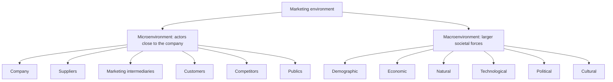

---
{"dg-publish":true,"permalink":"/study/3rd-semester/principles-of-marketing/chapter-3-analyzing-the-marketing-environment/","title":"Chapter 3 - Analyzing the Marketing Environment","tags":["study","marketing","chapter-3","marketing-environment"],"dg-note-properties":{"title":"Chapter 3 - Analyzing the Marketing Environment","subject":"Marketing","semester":"3rd Semester","source":"Chapter 3 Analyzing the Marketing Environment.pdf","tags":["study","marketing","chapter-3","marketing-environment"]}}
---

# Chapter 3: Analyzing the Marketing Environment

> [!info] About this note
> Rewritten from the lecture slides (Pearson / Prentice Hall, 35 slides, previous year's sheet) for studying. Definitions are kept close to the slides. Callouts titled **Memory aid**, **Added** and **Review questions** are mine and are not on the slides. The slides use US examples and 2010 data (baby boomers, "Growth in U.S. West and South").
> Previous: [[Study/3rd Semester/Principles of Marketing/Chapter 2 Company and Marketing Strategy\|Chapter 2 Company and Marketing Strategy]] | Next: [[Study/3rd Semester/Principles of Marketing/Chapter 4 Managing Marketing Information\|Chapter 4 Managing Marketing Information]]

## The big picture (read this first)

The **marketing environment** is everything outside the marketing department that affects how well it can build relationships with customers. It has two layers:

- **Microenvironment:** actors **close to the company** (company, suppliers, intermediaries, customers, competitors, publics).
- **Macroenvironment:** the **larger societal forces** (demographic, economic, natural, technological, political, cultural).

Then the company decides **how to respond**.

> [!tip] Chapter in one sentence
> Marketers must watch the actors around them and the forces above them, because both change what customers want and what the company can do.

---

## Key terms cheat sheet

| Term | Meaning in one line |
|---|---|
| Marketing environment | Actors and forces **outside marketing** that affect management's ability to build and keep successful customer relationships |
| Microenvironment | Actors close to the company that affect its ability to serve customers: the company, suppliers, marketing intermediaries, customer markets, competitors, publics |
| Macroenvironment | Larger societal forces that affect the whole microenvironment |
| Marketing intermediaries | Firms that help the company promote, sell and distribute products to final buyers |
| Public | Any group with an actual or potential interest in, or impact on, the organization's ability to achieve its objectives |
| Demography | Study of human populations: size, density, location, age, gender, race, occupation and other statistics |
| Generational marketing | Segmenting people by lifestyle or life stage instead of age |
| Value marketing | Offering financially cautious buyers greater value: the right combination of quality and service at a fair price |
| Engel's law | As income rises, the share spent on food falls |
| Natural environment | Natural resources marketers need as inputs or that marketing activities affect |
| Political environment | Laws, government agencies and pressure groups that influence or limit organizations and individuals |
| Cultural environment | Institutions and forces that affect a society's basic values, perceptions and behaviors |
| Core beliefs and values | Persistent; passed from parents to children and reinforced by schools, churches, business and government |
| Secondary beliefs and values | More open to change |

---

## 1. The company's microenvironment

### The six actors

| Actor | What the slides say |
|---|---|
| **The company** | Top management, finance, R&D, purchasing, operations, accounting all affect marketing's plans |
| **Suppliers** | Provide the resources to produce goods and services; treated as **partners** in providing customer value |
| **Marketing intermediaries** | Help promote, sell and distribute to final buyers (see types below) |
| **Customers** | The customer markets the company serves (named in the microenvironment definition) |
| **Competitors** | Firms must gain **strategic advantage** by positioning their offerings against competitors' offerings |
| **Publics** | Any group with actual or potential interest in, or impact on, the company's objectives |

> [!note] Customers
> The slides list "customer markets" in the definition of the microenvironment but have no separate slide on them.

### Types of marketing intermediaries
1. **Resellers** (retailers, wholesalers)
2. **Physical distribution firms** (warehousing, transport)
3. **Marketing services agencies** (research, advertising, consulting firms)
4. **Financial intermediaries** (banks, credit and insurance firms)

> [!warning] Added
> The examples in brackets are the usual textbook examples. The slide shows only the four labels.

### Types of publics
Financial · Media · Government · Citizen-action · Local · General public · Internal publics.

> [!tip] Memory aid (mine)
> **"C-S-M-C-C-P"**: Company, Suppliers, Middlemen (intermediaries), Customers, Competitors, Publics.
> Publics (seven): **F**inancial, **M**edia, **G**overnment, **C**itizen-action, **L**ocal, **G**eneral, **I**nternal.

---

## 2. The company's macroenvironment

### 2.1 Demographic environment
**Demography** studies populations by size, density, location, age, gender, race, occupation and other statistics. It matters because **people make up markets**. Trends: age structure, family structure, geographic shifts, education, diversity.

**Changing age structure (generations)**

| Generation | Born | Slide characteristics |
|---|---|---|
| **Baby boomers** | 1946 to 1964 | Most affluent Americans |
| **Generation X** | 1965 to 1976 | High parental divorce rates; cautious economic outlook; less materialistic; **family comes first**; lag behind on retirement savings |
| **Millennials** (Gen Y, echo boomers) | 1977 to 2000 | Comfortable with technology; include **tweens** (8 to 12), **teens** (13 to 19) and **young adults** (20s) |

**Generational marketing** segments people by lifestyle or life stage instead of age.

**Changing family structure:** more people are divorcing or separating, choosing not to marry, marrying later, marrying without intending to have children; more working women; more stay-at-home dads.

**Geographic shifts:** growth in the US West and South and decline in the Midwest and Northeast; movement from rural to metropolitan areas; changes in where people work (telecommuting, home office).

**Workforce:** more educated, more white collar.

**Increased diversity:** markets are becoming more diverse, internationally and nationally (ethnicity, gay and lesbian, disabled).

> [!warning] Slide error
> Slide 19 lists "Divorcing or separating" a second time under "Changes in where people work". It is a copy of the family-structure bullet and does not belong there.

### 2.2 Economic environment
Factors that affect **consumer purchasing power and spending patterns**.
- **Industrial economies** are richer markets.
- **Subsistence economies** consume most of their own agricultural and industrial output.
- **Changes in income:** value marketing offers financially cautious buyers more value (quality and service at a fair price).
- **Changes in spending patterns, Engel's law** (Ernst Engel): as income rises
  - the percentage spent on **food declines**,
  - the percentage spent on **housing stays constant**,
  - the percentage spent on **savings increases**.

### 2.3 Natural environment
Natural resources needed as inputs, or affected by marketing activities. Trends: **shortages of raw materials, increased pollution, increased government intervention, environmentally sustainable strategies**.

### 2.4 Technological environment
- The **most dramatic force** changing the marketplace.
- Creates new products and opportunities.
- The **safety** of new products is always a concern.

### 2.5 Political environment
Laws, agencies and pressure groups that influence or limit organizations.
- **Legislation regulating business:** increased legislation and changing government agency enforcement.
- **Increased emphasis on ethics:** socially responsible behavior and **cause-related marketing**.

### 2.6 Cultural environment
Institutions and forces that shape a society's basic values, perceptions and behaviors.

**Persistence of cultural values**
- **Core** beliefs and values persist (family, school, church, business, government reinforce them).
- **Secondary** beliefs and values change more easily.

**Shifts in secondary values (how people view...)**

| View of | Slide content |
|---|---|
| **Themselves** | Yankelovich Monitor segments, e.g. do-it-yourselfers (recent movers) and adventurers |
| **Others** | More "cocooning" |
| **Organizations** | Listed as a heading only |
| **Society** | **Patriots** defend it, **reformers** want to change it, **malcontents** want to leave it |
| **Nature** | Some feel ruled by it, some in harmony with it, some seek to master it |
| **The universe** | Renewed interest in spirituality |

> [!tip] Memory aid (mine)
> Six macro forces: **DENT-PC** = **D**emographic, **E**conomic, **N**atural, **T**echnological, **P**olitical, **C**ultural.
> Society's three types: **P**atriots **R**eformers **M**alcontents = defend, change, leave.

---

## 3. Responding to the marketing environment

Slide 34 shows three views on responding:

| View | Meaning on the slide |
|---|---|
| **Uncontrollable** | React and adapt to forces in the environment |
| **Proactive** | Take **aggressive actions** to affect forces in the environment |
| **Reactive** | **Watch and react** to forces in the environment |

> [!warning] Added
> The textbook this deck comes from contrasts a **passive** stance (accept the environment as uncontrollable and adapt) with an **environmental management** stance (act to change it). The slide's three labels are the version to learn for your exam.

---

> [!question]- Review questions (mine)
> 1. What is the difference between the microenvironment and the macroenvironment? Give two actors and two forces.
> 2. List the four types of marketing intermediaries.
> 3. Give the birth years and one trait of each generation (boomers, Gen X, millennials).
> 4. State Engel's law with all three effects.
> 5. Explain the difference between core and secondary cultural values and which one marketers can influence more.
> 6. Name the three ways people view society and what each wants to do.
> 7. What is cause-related marketing and which environment does it belong to?
> 8. Compare proactive and reactive responses to the environment.
