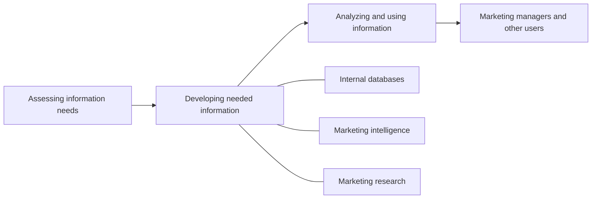

---
{"dg-publish":true,"permalink":"/study/3rd-semester/principles-of-marketing/chapter-4-managing-marketing-information/","title":"Chapter 4 - Managing Marketing Information","tags":["study","marketing","chapter-4","marketing-research","mis"],"dg-note-properties":{"title":"Chapter 4 - Managing Marketing Information","subject":"Marketing","semester":"3rd Semester","source":"Chapter 4 Managing Marketing Information.pdf","tags":["study","marketing","chapter-4","marketing-research","mis"]}}
---


# Chapter 4: Managing Marketing Information

> [!info] About this note
> Rewritten from the lecture slides (Pearson / Prentice Hall, 37 slides, 23-24 session sheet) for studying. Definitions are kept close to the slides. Callouts titled **Memory aid**, **Added** and **Review questions** are mine and are not on the slides.
> Previous: [[Study/3rd Semester/Principles of Marketing/Chapter 3 Analyzing the Marketing Environment\|Chapter 3 Analyzing the Marketing Environment]] | Next: [[Study/3rd Semester/Principles of Marketing/Chapter 5 Consumer Markets and Consumer Buyer Behavior\|Chapter 5 Consumer Markets and Consumer Buyer Behavior]]

## The big picture (read this first)

Companies need **customer insights**: fresh, deep understanding of what customers need and want. The **marketing information system (MIS)** turns scattered data into insights in three jobs:

1. **Assess** information needs.
2. **Develop** the needed information (internal data, marketing intelligence, marketing research).
3. **Analyze and use** it (distribute it to decision makers, apply CRM).



> [!tip] Chapter in one sentence
> Better information, not more information, produces customer insights, and the MIS gets it from internal data, intelligence and research.

---

## Key terms cheat sheet

| Term | Meaning in one line |
|---|---|
| Customer insights | Fresh, deep understanding of customers' needs and wants; hard to get because it is not obvious and customers are unsure of their own behavior |
| Marketing information system (MIS) | People and procedures for assessing information needs, developing the needed information, and helping decision makers use it |
| Internal database | Electronic collection of consumer and market information from data sources **within** the company network |
| Marketing intelligence | Systematic collection and analysis of **publicly available** information about consumers, competitors and marketplace developments |
| Marketing research | Systematic design, collection, analysis and reporting of data relevant to a **specific marketing situation** facing an organization |
| Exploratory research | Gather preliminary information to define the problem and suggest hypotheses |
| Descriptive research | Describe things such as market potential or customer attitudes |
| Causal research | Test hypotheses about **cause-and-effect** relationships |
| Secondary data | Information that **already exists**, collected for another purpose |
| Primary data | Information collected **for the specific research plan** |
| Observational research | Gather primary data by observing relevant people, actions and situations |
| Ethnographic research | Trained observers watch and interact with consumers in their **natural environment** |
| Survey research | Most widely used method; best for **descriptive** information (knowledge, attitudes, preferences, buying behavior) |
| Experimental research | Best for gathering **causal** information |
| Sample | A segment of the population selected to represent the whole population |
| CRM | Software and analytical tools that integrate customer information from all sources, analyze it, and apply the results to build stronger relationships |
| Intranet | Provides information to employees and other stakeholders |
| Extranet | Provides information to key customers and suppliers |

> [!warning] Added: the three research types
> The slide lists exploratory, descriptive and causal research as headings only. The one-line definitions above are the standard textbook ones.

---

## 1. Marketing information and customer insights

- Customer insights are **difficult to obtain**: not obvious, and customers are unsure of their behavior.
- They come from **better information and more effective use of existing information**, not from more information.
- Companies form **customer insights teams** that include all functional areas and use the insights to create more value for customers. A possible problem noted on the slide is "customer controlled could be a problem" (the slide does not explain this point).

## 2. Assessing marketing information needs

- The MIS serves the company's marketing and other managers and **external partners** (suppliers, resellers, marketing service agencies).
- A **good MIS** balances what users **would like to have**, what they **need**, and what is **feasible** to offer.

## 3. Developing marketing information

Three sources: **internal data**, **marketing intelligence**, **marketing research**.

### 3.1 Internal data
Electronic databases of consumer and market information from inside the company network.

### 3.2 Marketing intelligence
Public information about consumers, competitors and developments in the marketplace, collected systematically.

### 3.3 Marketing research

**The 4-step process**

```
1. Define the problem and research objectives
2. Develop the research plan (for collecting information)
3. Implement the plan: collect and analyze the data
4. Interpret and report the findings
```

**Step 1: Define the problem and objectives:** exploratory, descriptive or causal research.

**Step 2: Develop the research plan**
- Outlines sources of existing data and spells out research approaches, contact methods, sampling plans and instruments.
- A **written research plan** includes: management problem, research objectives, information needed, how results will help management decisions, budget.

**Secondary vs primary data**

| | Secondary data | Primary data |
|---|---|---|
| Meaning | Already exists, collected for another purpose | Gathered for the special research plan |

**Advantages and disadvantages (slide 18)**

| Advantages | Disadvantages (is it...?) |
|---|---|
| Low **cost** | **Current**? May be out of date |
| **Speed** | **Relevant**? May not fit the problem |
| Can provide data that **could not be obtained otherwise** | **Accuracy**: may not be accurate |
| | **Impartial**: may be biased |

> [!warning] Added
> The slide shows this list without saying which data type it describes. It is the standard list for **secondary** data; primary data has the reverse strengths (current, relevant) but costs more and takes longer.

**Planning primary data collection:** choose research approaches, contact methods, sampling plan and research instruments.

**Research approaches**

| Approach | Best for |
|---|---|
| **Observational** (including **ethnographic**) | Primary data by watching people, actions, situations |
| **Survey** | Descriptive information. Flexible, but people may be unable or unwilling to answer, may give misleading or pleasing answers, and privacy is a concern |
| **Experimental** | Causal (cause-and-effect) information |

**Contact methods: strengths and weaknesses (slide 23)**

| | Mail | Telephone | Personal | Online |
|---|---|---|---|---|
| Flexibility | Poor | Good | Excellent | Good |
| Quantity of data collected | Good | Fair | Excellent | Good |
| Control of interviewer effects | Excellent | Fair | Poor | Fair |
| Control of sample | Fair | Excellent | Good | Excellent |
| Speed of data collection | Poor | Excellent | Good | Excellent |
| Response rate | Poor | Poor | Good | Good |
| Cost | Good | Fair | Poor | Excellent |

**Focus groups:** six to 10 people with a trained moderator. Challenges: **expensive**, **hard to generalize** from a small group, consumers **not always open and honest**.

**Online marketing research:** online surveys, online panels, online experiments, online focus groups, click-stream data.
- Advantages: low cost, speed, higher response rates, good for hard-to-reach groups.
- Disadvantages: restricted internet access, not sure who is answering.

**Sampling plan:** answer three questions: who is to be surveyed, how many, and how should they be chosen.

| Probability samples | Meaning |
|---|---|
| **Simple random** | Every member of the population has a known and equal chance of selection |
| **Stratified random** | Population divided into mutually exclusive groups; random samples drawn from each group |
| **Cluster (area)** | Population divided into mutually exclusive groups; the researcher draws a sample of the groups |

| Nonprobability samples | Meaning |
|---|---|
| **Convenience** | Researcher selects the easiest population members |
| **Judgment** | Researcher uses their judgment to select members likely to give accurate information |
| **Quota** | Researcher finds and interviews a prescribed number of people in each of several categories |

**Research instruments**
- **Questionnaires** are the most common: in person, by phone or online; flexible; wording and ordering of questions matter.
  - **Closed-end** questions list all possible answers; easier to interpret and tabulate.
  - **Open-end** questions let respondents answer in their own words; useful in **exploratory** research.
- **Mechanical devices:** checkout scanners, people meters, neuromarketing.

**Step 3: Implement the plan:** collect, process and analyze the information; then interpret findings, draw conclusions and report to management.

## 4. Analyzing marketing information: CRM

CRM integrates customer information from all **touchpoints** and analyzes it in depth. Touchpoints on the slide: customer purchases, sales force contacts, service and support calls, web site visits, satisfaction surveys, credit and payment interactions, research studies.

## 5. Distributing and using marketing information
Enter information into databases and make it available in a **time-useable manner**. **Intranet** for employees and stakeholders; **extranet** for key customers and suppliers.

## 6. Other considerations
Marketing research in small businesses and nonprofits · international marketing research · **public policy and ethics** (customer privacy, misuse of research findings).

> [!tip] Memory aid (mine)
> - **Sources of information: I-I-R** = Internal data, Intelligence, Research.
> - **Research steps: D-D-I-I** = Define, Develop plan, Implement, Interpret and report.
> - Match the approach to the question: **Survey = Describe, Experiment = Explain (cause), Observe = Watch.**
> - Random samples: **S**imple (everyone equal), **S**tratified (every group sampled), **C**luster (some groups sampled).

---

> [!question]- Review questions (mine)
> 1. Why are customer insights hard to obtain, and where do they come from?
> 2. What three tasks does an MIS perform?
> 3. Differentiate internal data, marketing intelligence and marketing research.
> 4. List the four steps of the marketing research process.
> 5. What goes into a written research plan?
> 6. Compare mail, telephone, personal and online contact methods on cost and speed.
> 7. Which research approach is best for causal information and which for descriptive information?
> 8. Name three probability samples and three nonprobability samples.
> 9. Give two challenges of focus groups and two disadvantages of online research.
> 10. What is the difference between an intranet and an extranet?
