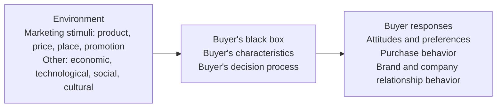
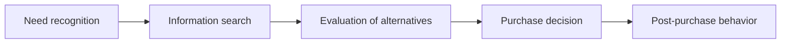

---
{"dg-publish":true,"permalink":"/study/3rd-semester/principles-of-marketing/chapter-5-consumer-markets-and-consumer-buyer-behavior/","title":"Chapter 5 - Consumer Markets and Consumer Buyer Behavior","tags":["study","marketing","chapter-5","consumer-behavior","buyer-decision-process"],"dg-note-properties":{"title":"Chapter 5 - Consumer Markets and Consumer Buyer Behavior","subject":"Marketing","semester":"3rd Semester","source":"Chapter 5 Consumer Markets and Consumer Buyer Behavior.pdf","tags":["study","marketing","chapter-5","consumer-behavior","buyer-decision-process"]}}
---


# Chapter 5: Consumer Markets and Consumer Buyer Behavior

> [!info] About this note
> Rewritten from the lecture slides (Pearson / Prentice Hall, 39 slides, previous year's sheet) for studying. Definitions are kept close to the slides. Callouts titled **Memory aid**, **Added** and **Review questions** are mine and are not on the slides. Percentages for social classes are US figures from the slides.
> Previous: [[Study/3rd Semester/Principles of Marketing/Chapter 4 Managing Marketing Information\|Chapter 4 Managing Marketing Information]]

## The big picture (read this first)

Consumer behavior is a **stimulus, black box, response** story:

1. **Stimuli** enter the buyer: marketing stimuli (4Ps) and other forces (economic, technological, social, cultural).
2. Inside the **buyer's black box**, the buyer's **characteristics** (cultural, social, personal, psychological) and **decision process** shape the outcome.
3. The **buyer responds**: attitudes and preferences, purchase behavior (what, when, where, how much), and brand and company relationship behavior.



> [!tip] Chapter in one sentence
> Four sets of characteristics shape the buyer, the kind of purchase decides how much thinking the buyer does, and every purchase runs through a five-stage decision process.

---

## Key terms cheat sheet

| Term | Meaning in one line |
|---|---|
| Consumer buyer behavior | Buying behavior of **final consumers**: individuals and households who buy for personal consumption |
| Consumer market | All the personal consumption of final consumers |
| Culture | Learned values, perceptions, wants and behavior from family and other important institutions |
| Subculture | Group within a culture with shared values from common life experiences and situations |
| Social classes | Society's relatively permanent, ordered divisions whose members share similar values, interests and behaviors |
| Membership group | Group with **direct influence** to which a person belongs |
| Aspirational group | Group an individual **wishes to belong to** |
| Reference group | Group that forms a **comparison or reference** in forming attitudes or behavior |
| Opinion leader | Person in a reference group who exerts social influence on others (also **influentials** or **leading adopters**) |
| Online social networks | Online communities where people socialize or exchange information and opinions |
| Lifestyle | A person's pattern of living as expressed in his or her **psychographics** |
| AIOs | Activities, interests, opinions: the measures used to capture lifestyle |
| Personality | Unique psychological characteristics leading to consistent and lasting responses to the environment |
| Motive (drive) | A need pressing enough to direct a person to seek satisfaction |
| Motivation research | Qualitative research probing consumers' hidden, subconscious motivations |
| Perception | How people select, organize and interpret information to form a meaningful picture of the world |
| Learning | Change in an individual's behavior arising from experience |
| Belief | Descriptive thought a person has about something (based on knowledge, opinion, faith) |
| Attitude | Relatively consistent evaluations, feelings and tendencies toward an object or idea |
| Cognitive dissonance | Discomfort caused by a post-purchase conflict |
| Adoption process | Mental process from first learning about an innovation to final regular use |

---

## 1. Characteristics affecting consumer behavior

| Cultural | Social | Personal | Psychological |
|---|---|---|---|
| Culture | Reference groups | Age and life-cycle stage | Motivation |
| Subculture | Family | Occupation | Perception |
| Social class | Roles and status | Economic situation | Learning |
| | | Lifestyle | Beliefs and attitudes |
| | | Personality and self-concept | |

### 1.1 Cultural factors
- **Culture** = learned values, perceptions, wants and behavior from family and other important institutions.
- **Subcultures** (slide examples): Hispanic, African American, Asian, mature consumers.
- **Social classes** are measured by a combination of **occupation, income, education, wealth** and other variables.

**US social class ladder (slide 9)**

| Class | Group | Share | Description |
|---|---|---|---|
| Upper | Upper uppers | 1% | Social elite living on inherited wealth; give to charity; send children to the finest schools |
| Upper | Lower uppers | 2% | High income or wealth through exceptional ability; active in social and civic affairs |
| Middle | Upper middles | 12% | Professionals, independent business people, corporate managers; want "better things in life" |
| Middle | Middle class | 32% | Average-pay white- and blue-collar workers; live "on the better side of town"; want a nice home in a good neighborhood |
| Working | Working class | 38% | Lead a "working-class lifestyle"; depend on relatives for economic and emotional support |
| Lower | Upper lowers | 9% | The working poor; just above poverty; strive toward a higher class |
| Lower | Lower lowers | 7% | Visibly poor, often unemployed; some depend on public assistance |

The arrow beside the ladder reads **Income, Occupation, Education, Wealth** from bottom to top.

### 1.2 Social factors
- **Groups:** membership groups, aspirational groups, reference groups (defined in the table above).
- **Word-of-mouth and buzz marketing:** **opinion leaders** influence others; marketers identify them and use them as **brand ambassadors**.
- **Online social networks:** blogs, social networking sites (Facebook), virtual worlds (Second Life).
- **Family** is the most important consumer-buying organization in society.
- **Roles and status:** the groups, family, clubs and organizations a person belongs to define role and social status.

### 1.3 Personal factors
- **Age and life-cycle stage.** The slide uses the RBC Royal Bank stages:

  | Stage | Age |
  |---|---|
  | Youth | under 18 |
  | Getting started | 18 to 35 |
  | Builders | 35 to 50 |
  | Accumulators | 50 to 60 |
  | Preservers | over 60 |

- **Occupation** affects goods and services bought.
- **Economic situation:** trends in personal income, savings and interest rates.
- **Lifestyle** expressed through AIOs.
- **Personality and self-concept.** Personality traits on the slide: dominance, autonomy, defensiveness, adaptability, aggressiveness.

### 1.4 Psychological factors

**Motivation: Maslow's hierarchy of needs** (bottom to top)

| Level | Need | Slide description |
|---|---|---|
| 5 (top) | Self-actualization | Self-development and realization |
| 4 | Esteem | Self-esteem, recognition, status |
| 3 | Social | Sense of belonging, love |
| 2 | Safety | Security, protection |
| 1 (bottom) | Physiological | Hunger, thirst |

> [!warning] Added
> The slide shows the pyramid only. The usual rule is that lower needs must be reasonably satisfied before higher ones motivate behavior.

**Perception: three selective processes**

| Process | Meaning |
|---|---|
| **Selective attention** | Screening out most of the information a person is exposed to |
| **Selective distortion** | Interpreting information in a way that supports what you already believe |
| **Selective retention** | Remembering good points about a brand you favor and forgetting good points about competing brands |

**Learning** occurs through the interplay of **drives, stimuli, cues, responses and reinforcement**.

**Beliefs and attitudes:** a belief is a descriptive thought based on knowledge, opinion or faith; an attitude is a relatively consistent evaluation, feeling and tendency toward an object or idea.

> [!tip] Memory aid (mine)
> - **C-S-P-P** = **C**ultural, **S**ocial, **P**ersonal, **P**sychological (from the widest to the most individual).
> - **MPLB** = **M**otivation, **P**erception, **L**earning, **B**eliefs and attitudes.
> - Selective: **A**ttention (ignore), **D**istortion (twist), **R**etention (forget).

---

## 2. Types of buying decision behavior

|  | **High involvement** | **Low involvement** |
|---|---|---|
| **Significant differences** between brands | **Complex buying behavior** | **Variety-seeking buying behavior** |
| **Few differences** between brands | **Dissonance-reducing buying behavior** | **Habitual buying behavior** |

> [!warning] Added
> The slide gives only the grid. Usual textbook examples: complex = buying a computer or house; dissonance-reducing = carpeting; habitual = salt; variety-seeking = cookies or snacks (switching for variety, not dissatisfaction).

---

## 3. The buyer decision process (five stages)



| Stage | Key points from the slides |
|---|---|
| **1. Need recognition** | Buyer recognizes a problem or need, triggered by **internal stimuli** or **external stimuli** |
| **2. Information search** | Sources: **personal** (family, friends), **commercial** (advertising, Internet), **public** (mass media, consumer organizations), **experiential** (handling, examining, using the product) |
| **3. Evaluation of alternatives** | Consumer uses information to evaluate brands in the **choice set**. Decisions depend on several factors (quality, performance, price, style), so marketers must identify what influences the choice |
| **4. Purchase decision** | Buying the most preferred brand; can be affected by **attitudes of others** and **unexpected situational factors** |
| **5. Post-purchase behavior** | Satisfaction or dissatisfaction depends on the gap between **expectations** and **perceived performance**; the larger the gap, the greater the dissatisfaction. **Cognitive dissonance** is the discomfort from a post-purchase conflict |

Customer satisfaction is the key to keeping and growing customers and reaping their **customer lifetime value**.

> [!tip] Memory aid (mine)
> **N-I-E-P-P**: **N**eed, **I**nformation, **E**valuate, **P**urchase, **P**ost-purchase. Information sources: **P-C-P-E** = Personal, Commercial, Public, Experiential.

---

## 4. The buyer decision process for new products

**Adoption process:** from first learning about an innovation to final regular use.

```
Awareness → Interest → Evaluation → Trial → Adoption
```

**Product characteristics that affect the rate of adoption:** **relative advantage, compatibility, complexity, divisibility, communicability**.

> [!warning] Added
> The slide lists the five characteristics without definitions. Usual meanings: relative advantage (better than existing products), compatibility (fits the consumer's values and experiences), complexity (how hard it is to understand or use; higher complexity slows adoption), divisibility (can be tried on a limited basis), communicability (results are easy to observe or describe).

---

> [!question]- Review questions (mine)
> 1. Draw the model of consumer behavior and label its three parts.
> 2. List the four groups of characteristics and the factors in each.
> 3. Distinguish membership, aspirational and reference groups.
> 4. Who are opinion leaders and why do marketers want them?
> 5. List Maslow's five levels from bottom to top.
> 6. Explain selective attention, distortion and retention with an example of each.
> 7. Fill the 2×2 grid of buying behaviors and give an example of each.
> 8. List the five stages of the buyer decision process and the four information sources.
> 9. What is cognitive dissonance and how does the expectation gap relate to satisfaction?
> 10. Name the five stages of adoption and the five product characteristics that affect its rate.
