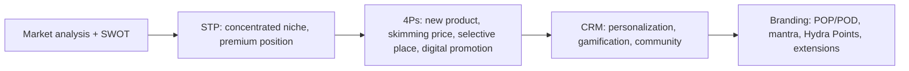

---
{"dg-publish":true,"permalink":"/study/3rd-semester/principles-of-marketing/mkt-grp-c/","title":"MKT Grp-C - New Product Development and its Marketing (HydraFlect report)","tags":["study","marketing","group-project","hydraflect","new-product-development"],"dg-note-properties":{"title":"MKT Grp-C - New Product Development and its Marketing (HydraFlect report)","subject":"Marketing","semester":"3rd Semester","source":"MKT Grp-C.pdf","tags":["study","marketing","group-project","hydraflect","new-product-development"]}}
---

# HydraFlect: New Product Development and its Marketing

> [!info] About this note
> Structured summary of Group C's 25-page report for **Principles of Marketing** (course code 04121401), submitted 5 May 2026. Cover pages, the evaluation sheet and member ID/registration numbers are left out. Callouts titled **Added** and **Check before you submit or present** are mine and are not in the report.
> Presentation version: [[Study/3rd Semester/Principles of Marketing/HydraFlect Group C\|HydraFlect Group C]]
> Theory behind each section: [[Study/3rd Semester/Principles of Marketing/Chapter 2 Company and Marketing Strategy\|Chapter 2 Company and Marketing Strategy]] (STP, 4Ps), [[Study/3rd Semester/Principles of Marketing/Chapter 3 Analyzing the Marketing Environment\|Chapter 3 Analyzing the Marketing Environment]] (SWOT context), [[Study/3rd Semester/Principles of Marketing/Chapter 4 Managing Marketing Information\|Chapter 4 Managing Marketing Information]] (CRM), [[Study/3rd Semester/Principles of Marketing/Chapter 5 Consumer Markets and Consumer Buyer Behavior\|Chapter 5 Consumer Markets and Consumer Buyer Behavior]] (target buyers)

## The big picture (read this first)

**HydraFlect** is a smart water bottle for Bangladesh that monitors hydration **and** water safety. The report applies the course framework end to end:

> [!tip] Report in one sentence
> A premium, sensor-equipped smart bottle sold through D2C and selective retail to tech-savvy, health-conscious urban Bangladeshis, supported by digital promotion and an app-based loyalty ecosystem.

---

## Key facts

| Item | Detail |
|---|---|
| Product | HydraFlect smart water bottle |
| Brand mantra | "Effortless Hydration, Zero Doubt" |
| Core features | Germ counter, oxygen-level sensor, UV-C automatic purification, LED drink reminders, SOS button, Bluetooth app |
| Main markets | Urban Bangladesh (Dhaka, Chittagong); students 18 to 35, fitness enthusiasts, office workers, tech-savvy and eco-conscious households |
| Price | **4,999 BDT** (psychological price vs 5,000), price skimming under a value-based strategy |
| Bundle | "Duo Pack" with **10% discount** |
| Warranty | Limited **one year** on sensors and batteries |
| Loyalty | **Hydra Points** reward program |
| Goal | Notable market presence within 12 months |

---

## 1. Introduction and objectives
Many students and professionals neglect to drink enough water and worry about water quality. HydraFlect tracks daily intake over Bluetooth, sets personal goals from age, height and weight, and gives light notifications. An oxygen sensor identifies bacteria or germs, and a UV purifier removes them. It also has an emergency button and aims to reduce plastic-bottle pollution.

**Marketing objectives**
1. **Positioning:** a technology-based health assistant.
2. **Awareness:** educate the market about innovative hydration.
3. **Target audience:** urban students, working professionals, sports people.
4. **Sustainability:** reduce plastic usage.
5. **Market share:** a notable presence within 12 months.

## 2. Market analysis
- **Consumer shift:** urban Bangladeshis (Dhaka, Chittagong), especially young professionals, students and middle to upper-middle-class consumers, invest more in gyms, fitness subscriptions, smart devices and health apps.
- **Digitalization:** growing smartphone use and familiarity with wearables (Apple, Samsung, Xiaomi). Consumers value convenience, personalization and technology integration.
- **Water quality concern:** WaterAid and UNICEF report contamination and limited access to safe water, so consumers are cautious.
- **Sustainability:** single-use plastic is a growing concern; reusable products with premium function are increasingly welcome.
- **Competition:** conventional reusable bottles, imported premium bottles and accessories **without smart features**; no major localized smart-bottle brand, giving **first-mover advantage**.
- **Pricing challenge:** Bangladesh is price-sensitive. Options: tiered versions, student discounts, installment payments, gym and wellness bundles.
- **Marketing ideas:** gym, yoga and sports-club partnerships; fitness influencers; campus ambassadors; corporate wellness; hydration and sustainability campaigns.

### SWOT

| Strengths | Weaknesses |
|---|---|
| Innovative concept with little direct competition | Higher price than ordinary bottles |
| Smart hydration technology with tracking and personalized notifications | Limited awareness as a new entrant |
| Sustainable, reusable design | Learning curve for app setup |
| Strong appeal to tech-savvy, health-conscious buyers | Depends on smartphone compatibility and battery |
| Can integrate with fitness apps and wearables | Customer skepticism about a new product category |

| Opportunities | Threats |
|---|---|
| Growing fitness and wellness culture | International competitors after market validation |
| Partnerships with gyms, wellness centers, sports communities | Smartwatches and other multifunctional wearables |
| Universities and corporate wellness programs | Rapid technological change |
| Rising awareness of hydration and preventive health | Data privacy concerns with app tracking |
| Gifting, premium lifestyle, e-commerce segments; South Asian expansion | Economic fluctuations reducing non-essential spending |

---

## 3. Marketing strategy and tactics

### 3.1 STP
- **Segmentation (psychographic and behavioral):** fitness lovers, athletes and health-conscious people; people who already track health with smart devices such as fitness bands.
- **Targeting:** a **concentrated (niche)** strategy focused on athletes and wealthy, technology-interested people, because the product is costly and innovative.
- **Positioning:** a **premium, innovative health guard and hydration device**, linking simple hydration with advanced health monitoring.
  *Positioning statement:* serves athletes and fitness enthusiasts in Bangladesh as an intelligent companion that monitors hydration, water quality and oxygen level and protects overall health.

### 3.2 Marketing mix (4Ps)

| P | Strategy |
|---|---|
| **Product** | New product category in the local market. App sets a daily intake goal and tracks progress; **glow ring light** reminders plus phone notifications. **USPs:** embedded germ counter and oxygen detector; if either passes the safe limit the bottle flashes and the phone sounds an alert |
| **Price** | **Price skimming**: maximize profit with a high price while the technology is new in Bangladesh |
| **Place** | **Selective distribution** to keep a premium image: (1) **Direct-to-consumer** exclusive e-commerce site, (2) **selective retail partners** (exclusive gyms, sports-gear retailers, specialty tech stores in large cities such as Dhaka), (3) **premium sections of online marketplaces** |
| **Promotion** | No traditional mass media such as TV. **YouTube, Facebook and Instagram** (strong analytics, interest targeting); high-quality video on **YouTube Shorts and Instagram Reels** showing the glow reminder and germ alert; **influencers, national athletes and gym trainers** as brand ambassadors justifying the price through health benefits |

---

## 4. Customer relationship management (CRM)
CRM aims at long-term relationships, higher **customer lifetime value** and personalization. HydraFlect is an ecosystem (device + app + data), so the **mobile app is the central CRM platform**.

### Retention and loyalty strategies
1. **Personalized digital experience:** goals from age, weight, activity and climate; real-time reminders; **AI recommendations** (more water on hot days or after workouts); weekly and monthly progress reports.
2. **Gamification and rewards:** points or badges for consecutive goal days (7, 15, 30); rewards are discount vouchers, free premium app features, partner offers (gyms, wellness brands); leaderboards and challenges.
3. **Smart maintenance and lifecycle support:** sensors monitor hygiene, usage and component health; alerts for contamination risk, filter wear or sensor malfunction; loyal customers get discounted replacements, priority servicing, maintenance subscriptions.
4. **Community building, the "Clean Water Community":** collective milestones (e.g. 100 liters tracked) lead to donated water purifiers for underserved communities, aligned with WaterAid and UNICEF.
5. **Sustainability tracking:** the app counts single-use plastic bottles avoided; users unlock digital certificates, social recognition and "Eco-champion" badges.
6. **Lifestyle campaigns:** healthy lifestyle, hydration education, clean water, productivity; short videos, expert tips, user-generated content.

### Feedback and continuous improvement
1. **In-app feedback and ratings:** low ratings trigger feedback forms and support follow-up (a closed feedback loop).
2. **Data-driven product optimization:** sensor analytics reveal low usage, water-quality concerns and abnormal consumption; the company investigates, updates software and improves hardware.
3. **Social media listening:** monitor Facebook, YouTube and Twitter for sentiment, trends and complaints.
4. **Customer support and omnichannel communication:** in-app live chat, email, social messaging, FAQ and chatbot.
5. **Continuous innovation:** regular app features, software updates and planned hardware upgrades.

---

## 5. Brand positioning

**Points of parity (POP):** what any good bottle must have: leak-proof and durable, non-toxic plastic, portable, long battery life, temperature retention.

**Points of difference (POD):**
- **Germ detector and oxygen monitor** that warns when water is unsafe.
- **Automatic UV-C purification** in the cap (similar to LARQ and Philips bottles abroad).
- **LED light notifications** on the bottle itself (harder to ignore than phone alerts).
- **Gamified virtual companion app** (a pet or anime character that levels up when you follow the schedule and gets tired and thirsty if you do not).
- **SOS button:** press for two seconds and your location is visible to emergency contacts via the app.

**Brand mantra:** "Effortless Hydration, Zero Doubt." *Effortless Hydration* = convenience; *Zero Doubt* = reliability and safety (germ detector, oximeter, UV-C, SOS).

## 6. Brand equity
- **Awareness:** Facebook and Instagram campaigns on dehydration and contaminated-water risks.
- **Perception:** scientifically superior device, "Peace of mind with every sip."
- **Loyalty:** **Hydra Points** earned by meeting daily goals, redeemable for discounts or branded goods.
- **Extensions (if successful):** **line extensions** (Mini for office goers, Pro for trekkers) and **brand extensions** (smart health accessories, fitness wearables, compatible scales).

## 7. Product strategy (three levels)

| Level | HydraFlect |
|---|---|
| **Basic product** | Advanced intelligent bottle for hydration and water quality |
| **Actual product** | Sensors (germs, oxygen), signals (alerts when water is harmful or the hydration plan is missed), dedicated app, durable design for physical activity |
| **Augmented product** | **One-year limited warranty** on sensors and batteries; permanent access to a digital health advisor in the app |

## 8. Pricing strategy
- **Primary: value-based pricing.** The price reflects well-being and safety value, not the cost of regular bottles, because the product is novel and costly to make.
- **Tactics:** **price skimming** for innovators and early adopters (high-income athletes and tech fans); **bundle pricing** (Duo Pack, 10% off); **psychological pricing** (4,999 BDT instead of 5,000 BDT).

## 9. Conclusion
HydraFlect combines health, technology and sustainability. A premium niche strategy, selective distribution and digital marketing build a distinctive brand, and CRM builds loyalty through personalization, gamification, community and feedback. Challenges are high price, low initial awareness and future competition; opportunities are first-mover advantage, customer education and continuous improvement.

**References cited:** ResearchGate (urban health trends), UNICEF Bangladesh (WASH), WaterAid Bangladesh (water quality), LARQ (UV-C bottle), Philips (UV purification).

---

> [!warning] Added: check before you submit or present
> These are inconsistencies I noticed. They may matter in the Q&A.
> - **Heading typo:** "Exclusive Summary" (title and table of contents) should be "Executive Summary".
> - **Stray text:** "[00:16]" appears twice (Product and Promotion), likely a leftover video timestamp. The objectives list also ends mid-word ("within 12 mon").
> - **Target market is described two ways.** Section 2 lists students, gym members, office workers, tech users and eco households. Section 3 says a **concentrated niche of athletes and wealthy tech-interested people**. The slides add students 18 to 25 and professionals 25 to 35. Decide on one clear target and explain the others as secondary.
> - **Materials:** the report's POP says "non-toxic plastic", but the slides describe a **stainless steel** (or Tritan) body. Align these.
> - **Differentiation claim:** the report says UV-C purification works "just like LARQ and Philips bottles abroad", so the difference is mainly *local availability plus germ and oxygen sensing plus app and SOS*, not UV-C alone.
> - **Features not carried through:** "temperature monitoring" appears only in the market analysis.
> - **Spelling:** "HydraFlect" and "Hydra Flect" are both used.
> - **References** have no dates and point to homepages (n.d.), which is weak for APA. Add specific pages and access dates.

> [!question]- Likely viva questions (mine)
> 1. Why did you choose a concentrated rather than a mass-market targeting strategy?
> 2. What is the difference between value-based pricing and price skimming, and why use both?
> 3. Why selective rather than intensive distribution?
> 4. Explain the basic, actual and augmented product levels of HydraFlect.
> 5. What are your points of parity and points of difference?
> 6. How does CRM raise customer lifetime value for this product?
> 7. How will you handle price sensitivity in Bangladesh?
> 8. What are the main privacy risks of the app and how would you address them?
> 9. What is your plan if a competitor copies the germ-sensor feature?
> 10. How would you measure success of the 12-month market share goal?
