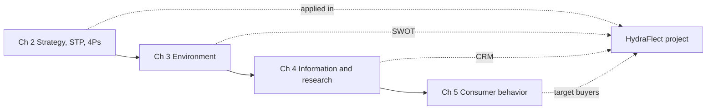

---
{"dg-publish":true,"permalink":"/study/3rd-semester/principles-of-marketing/principles-of-marketing/","title":"Principles of Marketing (index)","tags":["study","marketing","index"],"dg-note-properties":{"title":"Principles of Marketing (index)","subject":"Marketing","semester":"3rd Semester","tags":["study","marketing","index"]}}
---

> [!summary] About this index
> Map of the converted Principles of Marketing notes. Source PDFs and slides are in `Previous year's sheets/` and `Group shared/`. Notes are reworded for studying; anything not on the slides is marked **Added** or **mine**.

## Chapter notes

| Chapter | Note | Main ideas | Source |
|---|---|---|---|
| 2 | [[Study/3rd Semester/Principles of Marketing/Chapter 2 Company and Marketing Strategy\|Chapter 2 Company and Marketing Strategy]] | Strategic planning, portfolio, STP, 4Ps, value chain | `Chapter 2 Company and Marketing Strategy.pdf` |
| 3 | [[Study/3rd Semester/Principles of Marketing/Chapter 3 Analyzing the Marketing Environment\|Chapter 3 Analyzing the Marketing Environment]] | Micro and macro environment, six macro forces, responses | `Chapter 3 Analyzing the Marketing Environment.pdf` |
| 4 | [[Study/3rd Semester/Principles of Marketing/Chapter 4 Managing Marketing Information\|Chapter 4 Managing Marketing Information]] | MIS, internal data, intelligence, marketing research, CRM | `Chapter 4 Managing Marketing Information.pdf` |
| 5 | [[Study/3rd Semester/Principles of Marketing/Chapter 5 Consumer Markets and Consumer Buyer Behavior\|Chapter 5 Consumer Markets and Consumer Buyer Behavior]] | Buyer characteristics, 4 buying types, 5-stage decision process, adoption | `Chapter 5 Consumer Markets and Consumer Buyer Behavior.pdf` |

## Group project: HydraFlect smart water bottle

| Note | What it is |
|---|---|
| [[Study/3rd Semester/Principles of Marketing/MKT Grp-C\|MKT Grp-C]] | The 25-page written report (market analysis, SWOT, STP, 4Ps, CRM, branding, pricing) |
| [[Study/3rd Semester/Principles of Marketing/HydraFlect Group C\|HydraFlect Group C]] | The 47-slide presentation, slide by slide, with differences from the report |

## How the chapters connect

## Quick finder

| I need... | Go to |
|---|---|
| STP, 4Ps, marketing mix definitions | [[Study/3rd Semester/Principles of Marketing/Chapter 2 Company and Marketing Strategy\|Chapter 2 Company and Marketing Strategy]] |
| Micro vs macro environment, Engel's law, generations | [[Study/3rd Semester/Principles of Marketing/Chapter 3 Analyzing the Marketing Environment\|Chapter 3 Analyzing the Marketing Environment]] |
| Research steps, sampling, contact methods | [[Study/3rd Semester/Principles of Marketing/Chapter 4 Managing Marketing Information\|Chapter 4 Managing Marketing Information]] |
| Maslow, buying behavior grid, decision stages | [[Study/3rd Semester/Principles of Marketing/Chapter 5 Consumer Markets and Consumer Buyer Behavior\|Chapter 5 Consumer Markets and Consumer Buyer Behavior]] |
| A worked example of STP, 4Ps, CRM, branding | [[Study/3rd Semester/Principles of Marketing/MKT Grp-C\|MKT Grp-C]] |

## Things to check
> [!warning] From the group report and slides
> The report and slides disagree on the **target segment** (athletes and wealthy tech users vs students and professionals) and on the **body material** (plastic vs stainless steel). Details are in [[Study/3rd Semester/Principles of Marketing/MKT Grp-C\|MKT Grp-C]] and [[Study/3rd Semester/Principles of Marketing/HydraFlect Group C\|HydraFlect Group C]].

## Open items
- [ ] Extract slide images into `attachments/` and embed key diagrams (Maslow, buying-behavior grid, MIS, research process).
- [ ] Convert any further chapters from `Group shared/` when needed.
